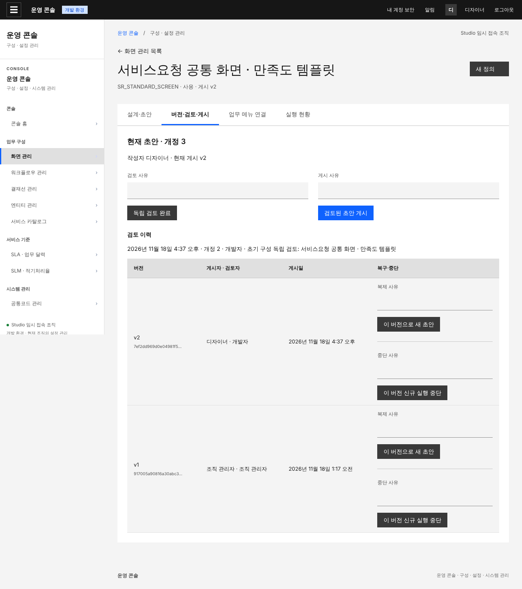
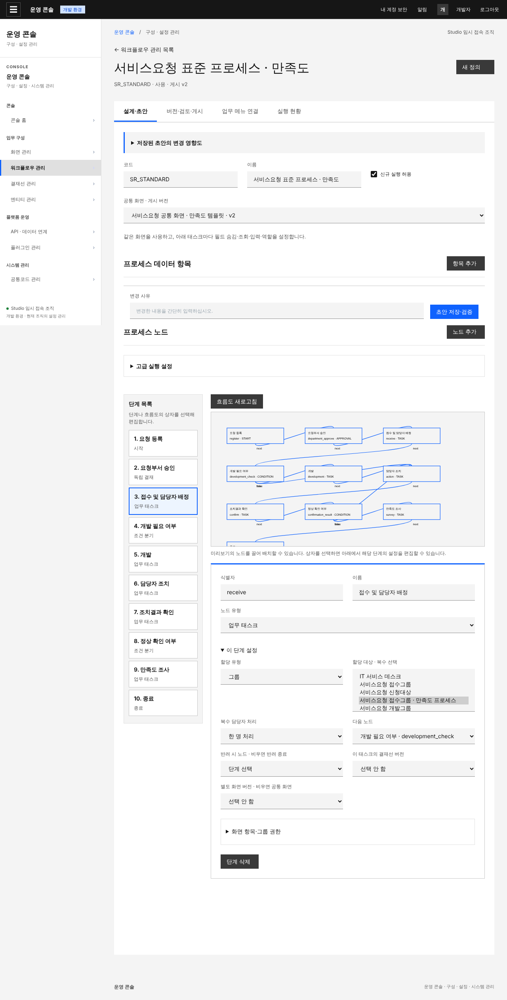
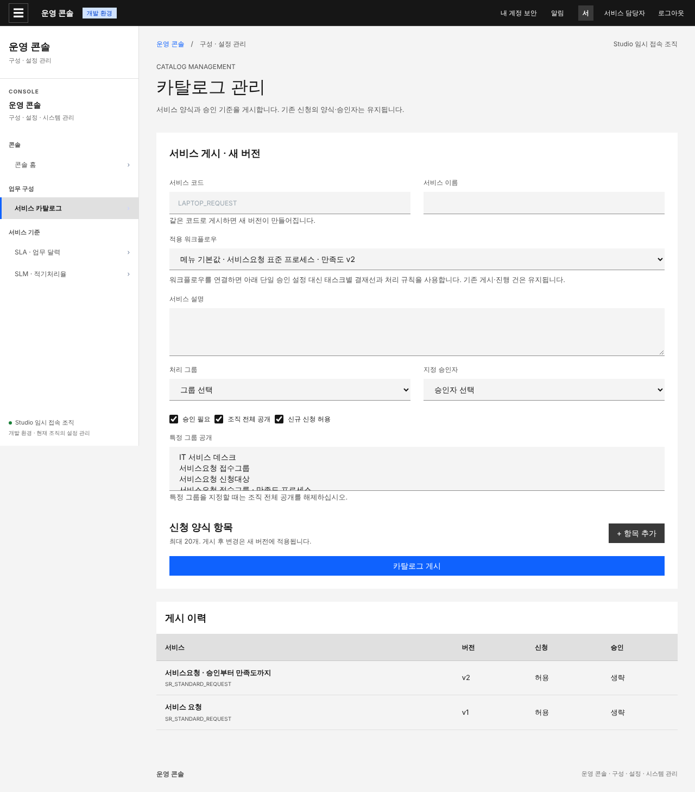
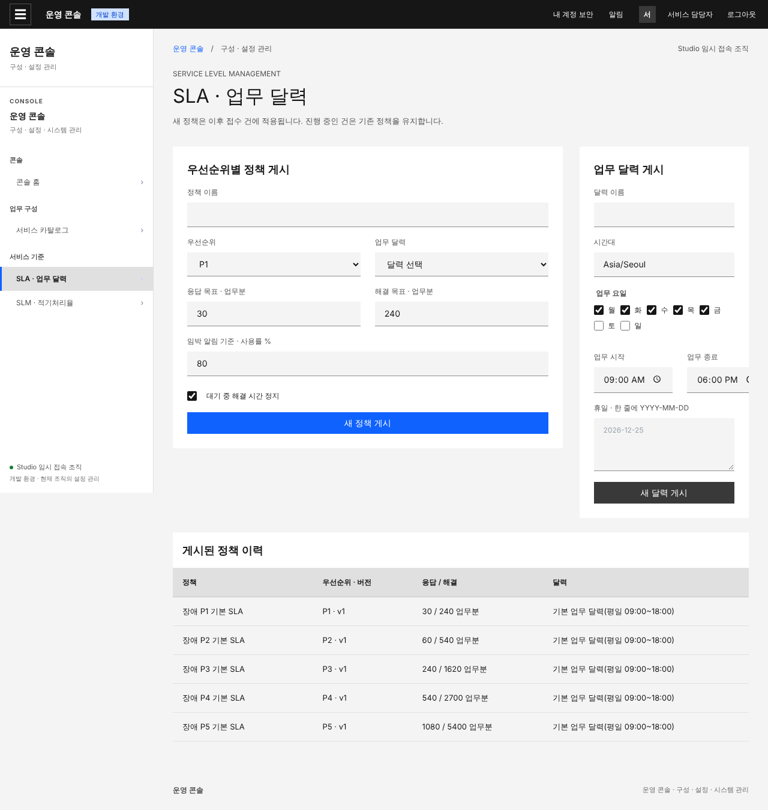

# 통합 ITSM 운영자 매뉴얼

> 운영 적용 상태(2026-11-18 통합본): 개발 단계·독립 검토 게시·서비스 기준값을 합친 최종 구성은 로컬 PostgreSQL 16에서 검증했습니다. 운영 DB 초기 적재는 main 병합·배포 후 신규 계정 비밀번호를 Render 비밀 환경변수로 전달해 실행합니다. 기존 운영 계정과 진행 요청은 유지됩니다.

2026-11-18 · 서비스요청 만족도 프로세스 구현 기준. 대상은 구성 담당 디자이너, 개발자/검토자, 서비스 운영 관리자, 조직·보안 관리자입니다. 메뉴는 역할에 따라 다르게 보입니다. 아래 기능은 현재 구현 기준이며 물리 DB 타입 DDL·복합 PK·UI 인덱스 생성, Group→Set→Field, 현장 SSO·외부 시스템 연결은 구현/검수 완료로 간주하지 않습니다.

화면 예시는 로컬 검증 환경입니다. 배포 조직의 버전 번호·요청 번호·입력 데이터는 다를 수 있습니다.

## 1. 접속·계정·운영 원칙

접속: https://studio-itsm-preview-2zzi.onrender.com/login/ . 기존 계정은 기존 비밀번호를 사용합니다. 신규 developer1·designer1의 초기 비밀번호는 별도 비공개 접속정보로 전달하며 첫 로그인에서 변경합니다. 비밀번호를 GitHub·업무 댓글·매뉴얼에 붙이지 않습니다. 잠금/만료는 시스템 관리자에게 조치 요청합니다.

user1은 요청자, user_auth1은 요청부서 승인자, worker1/worker2는 접수·조치 운영자, designer1은 화면 템플릿·카탈로그 디자이너, developer1은 개발 단계 처리와 결재선·워크플로우 작성, 화면 독립 검토 담당입니다. temp-admin은 사용자·조직·보안과 플랫폼 구성 관리자입니다. 일반 운영자에게 개발자/시스템 관리자 역할을 대신 주지 않습니다. 개발자 권한은 구성 기능을 넓게 허용하므로 통제된 담당자에게만 배정합니다.

상단 운영 콘솔을 열어 구성합니다. designer1이 초안을 바꾼 경우 developer1처럼 작성자와 다른 검토자가 검토해야 합니다. 초기 구성도 콘솔과 같은 업무 명령으로 게시합니다. 화면은 designer1 작성 → developer1 독립 검토 → designer1 게시, 결재선·워크플로우는 developer1 작성 → temp-admin 독립 검토 → developer1 게시입니다. 버전·검토·게시 탭의 검토 이력과 게시자·검토자에 그대로 남습니다. 초기 구성 명령이 각 계정 명의로 실행한 것이며, 사람이 화면에서 직접 검토했다는 의미는 아닙니다.

활용 예: designer1으로 화면 이름을 바꾸고 사유와 초안을 저장한 뒤, developer1이 버전·검토·게시 탭에서 같은 개정의 독립 검토를 완료하고 게시합니다. 검토 후 다시 수정하면 최신 초안으로 재검토합니다.

## 2. 서비스요청을 구현하는 순서

부서/그룹/역할·사용자 준비 → 요청 구분 코드 준비 → 업무 달력·SLA·적기처리 기준 → 공통 화면 설계 → 요청부서 결재선 → 워크플로우 → 검토·게시 → 업무 메뉴 연결 → 카탈로그 공개 → 역할별 검증 순서입니다. 각 단계의 게시 버전 ID를 다음 단계에서 선택합니다.

사전 구성된 화면 SR_STANDARD_SCREEN, 결재선 SR_STANDARD_APPROVAL, 프로세스 SR_STANDARD, 서비스 항목 SR_STANDARD_REQUEST를 예제로 사용합니다. 현재 구성은 서비스요청 신청대상 그룹에 공개되어 user1이 신청할 수 있습니다. 기존 진행 건은 시작 당시 버전으로 계속 처리됩니다. 이전 초안 *_B20261118은 중지 상태의 보관본입니다.

활용 예: 기존 정의를 수정할 때 게시본을 새 초안으로 복제하고, 변경 사유를 ‘접수 의견 필수화’로 기록합니다. 새 화면을 게시한 뒤 워크플로우에서 새 화면 버전을 선택해 다시 검토·게시하고, 카탈로그의 새 버전에 새 워크플로우를 연결합니다. 화면만 게시해 기존 실행이 자동으로 바뀌지는 않습니다.

### 2.1 최종 프로세스와 단계별 입력 권한

등록(user1) → 요청부서 승인(user_auth1, 반려 시 반려 종료) → 접수 및 담당자 배정(SR_DEMO_INTAKE: worker1/worker2 중 한 명) → 개발 필요 여부 분기 → 개발(SR_DEV: developer1, 개발 필요 시) → 담당자 조치(접수에서 선택한 담당자) → 조치결과 확인(신청자, 아니오면 담당자 조치로 복귀) → 만족도 조사(신청자, 1~5점) → 자동 종료.

| 화면 그룹 | 승인 | 접수 | 개발 | 조치 | 확인 | 만족도 |
|---|---|---|---|---|---|---|
| 요청 기본정보(7) | 조회 | 조회 | 조회 | 조회 | 조회 | 조회 |
| 접수 및 배정(개발 필요 여부·조치 담당자·접수 의견·처리 예정일시) | 숨김 | **입력** | 조회 | 조회 | 숨김 | 숨김 |
| 개발(개발 내용·변경 프로그램·개발 완료일) | 숨김 | 숨김 | **입력** | 조회 | 조회 | 조회 |
| 담당자 조치(조치 내용·원인·시작/완료일시·작업 시간) | 숨김 | 숨김 | 숨김 | **입력** | 조회 | 조회 |
| 조치결과 확인(정상 확인·의견) | 숨김 | 숨김 | 숨김 | 숨김 | **입력** | 조회 |
| 만족도 조사(점수·의견) | 숨김 | 숨김 | 숨김 | 숨김 | 숨김 | **입력** |

필수: 접수(개발 필요 여부·조치 담당자·접수 의견), 개발(개발 내용·개발 완료일), 조치(조치 내용), 확인(정상 확인), 만족도(점수). 공통 화면은 6개 그룹·23개 필드입니다.

## 3. 콘솔 홈·공통 화면 조작

콘솔 홈은 권한 있는 구성 메뉴로 이동하는 진입점입니다. 포털/콘솔은 같은 로그인·조직을 사용합니다. 상단 본인 이름은 본인 정보 모달, 내 계정 보안은 비밀번호·재인증·MFA·세션 관리, 알림은 업무 알림, 로그아웃은 현재 인증 종료입니다.

데스크톱 상단 메뉴 버튼은 사이드바 접기/펼치기, 경계 드래그는 폭 조절입니다. 기본256px, 220~480px 및 화면 너비45% 제한입니다. 경계에서 좌/우10px, Shift+좌/우50px, Home/End, 두 번 클릭 기본 폭을 지원합니다. Escape는 저장 전 드래그를 취소합니다. 브라우저 설정으로 새로고침/포털·콘솔 전환에 유지되며 다른 장치에는 동기화되지 않습니다. 모바일680px 이하에서는 메뉴 열기·배경/Escape 닫기·키보드 순환을 사용합니다.

활용 예: 넓은 필드 표를 편집할 때 사이드바를 접고 표 안에서 가로 스크롤합니다. 설정이 손상되거나 브라우저가 저장을 차단해도 현재 화면 조작은 가능하며 기본 폭으로 시작합니다.

## 4. 사용자 관리

시스템 관리 → 사용자 관리. 조회 조건은 로그인 ID/이름·상태·부서·그룹·역할입니다. 결과는 최대100건이며 이름을 선택하면 상세입니다. 생성은 로그인 ID·이름·부서·이메일·연락처·사번·초대 여부·초기 비밀번호·사유를 입력합니다. 역할/그룹은 기존 사용자 또는 부서의 할당 조회 후 선택 복제할 수 있습니다. 부서 자동 상속과 직접 복제는 다릅니다.

상세의 프로필은 이름·부서·사용 종료일·변경 사유, 개인정보 조회·편집은 권한·재인증·접근 이력을 요구합니다. 역할 탭은 역할/그룹 및 배정 출처를 조회하고 조직 권한 관리로 이동합니다. 보안 탭에서 중지/재활성화, 초기 비밀번호 설정·변경 강제, 잠금 해제, 초대 링크 발급, MFA 초기화를 수행합니다. 세션 탭은 개별/전체 회수, 이력 탭은 변경·접근 이력을 확인합니다. 개인정보 파기는 중지 상태 등 보호 규칙을 충족해야 합니다. 마지막 관리자 보호 규칙을 우회하지 않습니다.

활용 예: 신규 접수자를 만들 때 worker1의 역할·그룹을 조회하고 필요한 항목만 선택 복제합니다. 연락처·비밀번호는 복제하지 않습니다. 로그인 실패로 잠긴 사용자는 실패 사유를 확인한 뒤 잠금만 해제하고, 비밀번호를 알 수 없으면 별도 초기화합니다.

## 5. 조직·권한 관리: 역할·그룹·부서·메뉴

역할 탭은 역할 목록에서 하나를 선택해 사용자/부서/그룹 세 영역에 배정합니다. 그룹 탭은 사용자/부서 두 영역을 구성합니다. 부서 탭은 트리에서 부서를 선택하고 코드·이름·상위 부서·설명·활성 여부를 편집하며 배정 역할·그룹을 조회합니다. 하위 부서 포함은 명시적으로 선택합니다. 순환 상위 부서는 저장할 수 없습니다.

메뉴 탭에서는 역할에 메뉴와 운영 콘솔 버튼을 매핑하고 조회/입력 범위를 설정합니다. 메뉴 숨김은 서버 권한 검사를 대신하지 않으며 직접 URL/API에서도 검사합니다. 역할/그룹의 추가·수정·삭제와 사용자 배정은 기능을 구분합니다. 참조 중인 항목·기본 보호 역할은 삭제가 제한됩니다. 이력 탭에서 사유와 변경 기록을 확인합니다. 여러 역할의 유효 권한과 행 범위는 기존 업무 접근권한과 함께 적용됩니다.

활용 예: SR_DEMO_INTAKE 그룹에 worker1과 worker2, SR_DEV 그룹에 developer1을 넣고 service.work 역할을 확인합니다. 개발 태스크는 SR_DEV 그룹 구성원에게 할당됩니다. 서비스 관리자 역할에는 기본 메뉴를 유지한 채 운영 콘솔 버튼을 허용해 카탈로그·SLA·SLM 설정 화면을 쓸 수 있게 했습니다. 이 그룹을 접수 TASK에 연결하면 두 사람에게 같은 태스크가 보이고 ANY에서는 먼저 완료한 한 명의 처리가 유효합니다. 조치 TASK는 assignee 필드의 선택 사용자에게만 할당하므로 접수 그룹 전체가 조치할 수 있는 구조가 아닙니다.

## 6. 보안 관리

보안 관리 목록 → 정책 상세에서 값을 변경합니다. 비밀번호 정책은 길이·문자 조합·재사용 이력·변경 주기·경고일·차단 목록·기존 계정 강제 적용, 로그인 정책은 실패 횟수·집계 시간·잠금 시간·접속 경로 제한, 세션 정책은 유휴/최대 시간·동시 세션·재인증 시간을 관리합니다. 관리 접근 정책과 MFA 대상도 해당 설정에서 구성합니다. 각 설정에는 허용 범위와 플랫폼의 고정 보호 규칙이 있습니다. 미리보기는 적용 결과 확인이며 저장하지 않습니다. 적용에는 사유·행 버전과 권한이 필요합니다.

활용 예: 비밀번호 실패 제한을5회, 잠금15분으로 설정하고 미리보기 결과를 확인한 뒤 적용합니다. 변경 주기를30일로 바꿀 때 기존 계정에 즉시 강제할지 구분합니다. MFA 해제는 본인 우회가 아니라 관리자 복구 절차로 수행합니다.

## 7. 공통코드 관리

코드 그룹 목록 → 상세에서 그룹 코드·이름·설명·사용 여부를 저장합니다. 코드 행은 코드값·표시명·순서·사용 여부를 추가/제거해 일괄 저장합니다. 중복 코드와 참조/보호 제약을 확인합니다. 조직별 운영 코드와 프로그램 고정 코드 정의서는 다릅니다.

활용 예: SR_DEMO_CATEGORY의 계정/권한/소프트웨어/장비/기타를 조회합니다. 카탈로그 선택지는 게시 버전에 저장된 스냅샷이므로 코드 표시명을 바꾼 것만으로 기존 카탈로그·기존 요청이 바뀌지 않습니다. 새 카탈로그 버전을 게시할 때 선택지를 맞춥니다.

## 8. 엔티티 관리

목록에서 엔티티 생성 → 상세에서 업무 필드 그리드 작성 → 검증·스키마 게시 → 레코드 등록/관계 조회 순서입니다. 시스템 고정 필드는 id·조직·스키마 버전·생성/수정자와 시각·row_version을 서버가 관리합니다. 업무 필드는 식별자·이름·논리 유형·필수·선택지·코드·참조·길이/정밀도/설명·기본값을 구성합니다. 문자, 장문, 정수/실수/DECIMAL, Boolean, 날짜/일시/시간/연월/연도, JSON/JSON 목록, 사용자, UUID/이메일/전화/URL 및 선택/코드/엔티티 참조를 구분합니다.

참조는 N:1/1:1/1:N/N:M과 중간 엔티티를 설정하며 기준 방향·상대 스키마·조직·조회 범위를 확인합니다. 게시본은 불변이며 기존 레코드 참조 버전을 보존합니다. 실제 엔티티별 물리 테이블 생성·DB 타입 DDL·복합 업무 PK·UI 인덱스 DDL은 현재 제공 기능이 아닙니다.

활용 예: ‘시스템 사용권’ 엔티티에 시스템명과 사용자 참조를 추가하고 중간 엔티티로 사용자-시스템 관계를 정의합니다. 사용 중인 필드를 삭제/유형 변경할 때 표시된 영향도를 확인하되 모든 규칙·API의 완전한 의존성 분석으로 간주하지 않습니다.

## 9. 화면 관리·화면 디자이너

목록에서 이름/코드 검색·사용 상태 필터·페이지 이동, 새 정의에서 코드·이름·사용 여부 등록 후 상세로 이동합니다. 상세는 설계·초안 / 버전·검토·게시 / 업무 메뉴 연결 / 실행 현황입니다. 다른 정의는 목록으로 돌아가 선택합니다. 미저장 이동 경고가 나오면 입력을 보존하거나 저장합니다.

설계에서 항목표의 식별자·이름·유형·필수·담당자 선택 그룹·조회 전용과 열 수를 편집합니다. 화면 디자이너의 왼쪽 아이콘 클릭 또는 원하는 그룹으로 드래그해 필드를 추가합니다. 그룹 추가와 그룹 선택은 별개입니다. 그룹 이름/나열·탭, 필드 이동·너비/높이, 우클릭·더블클릭·상세 속성, 빠른 속성, 검색·복제·삭제·실행 취소/다시 실행을 사용합니다. Ctrl+방향키 이동, Shift+방향키 크기, Shift+F10 속성을 지원합니다. 최대20그룹·30필드·1~3열, 높이는48px 단위1~5입니다. 숫자 최소/최대는 정수·실수 유형에 적용하며 최소≤최대입니다. 만족도는 정수 최소1·최대5입니다.

화면 미리보기는 현재 편집 배치의 데스크톱/모바일·나열/탭·필수·조회 전용·리터럴 기본값을 보여 주며 입력값은 저장하지 않습니다. 자동 기본값·사용자 목록·태스크 권한은 실제 실행에서 확인합니다. ‘적용하고 닫기’는 항목표 반영만 하므로 바깥 초안 저장·검증이 필요합니다. 디자이너 ‘초안 저장’은 사유와 함께 실제 저장·검증합니다. 게시 전에는 진행 건에 적용되지 않습니다.

활용 예: SR_STANDARD_SCREEN을 선택해 ‘접수 및 배정’ 그룹에 개발 필요 여부(논리값)와 처리 예정일시를 배치하고, ‘개발’ 그룹에 개발 내용·변경 프로그램·개발 완료일을 둡니다. 저장 후 developer1이 독립 검토하고 designer1이 게시합니다. 만족도 조사 그룹의 satisfaction은 정수1~5로 설정합니다. 정상 확인 그룹을 입력 가능하게 만드는 것은 화면 자체가 아니라 워크플로우의 confirm 태스크 설정에서 수행합니다.

## 10. 결재선 관리

목록/새 정의/상세와 검토·게시 방식은 화면 관리와 같습니다. 단계 식별자·이름, 대상 방식 USER/ROLE/GROUP/DEPARTMENT/STARTER/FIELD_USER, 대상 목록·하위 부서 포함, ANY/ALL을 구성합니다. 태스크의 처리 전 또는 후 결재선으로 연결하거나 독립 APPROVAL 노드에서 게시 결재선 버전을 선택합니다. 자기 신청 결재는 배제하고 담당자가 없으면 실행이 차단됩니다. 재할당에는 사유와 자격 검증이 필요합니다.

활용 예: SR_STANDARD_APPROVAL의 요청부서 승인자를 user_auth1로 선택합니다. user1과 같은 요청부서인지 사용자 정보에서 확인합니다. 향후 부서별 승인 규칙을 바꿀 때 고정 사용자 방식과 부서 전체 ANY/ALL 방식의 차이를 확인한 뒤 새 결재선을 게시합니다.

## 11. 워크플로우 관리: 편집·노드 기능

목록/새 정의/상세에서 공통 화면의 게시 버전과 프로세스 데이터 항목을 선택합니다. 단계 목록이나 흐름도 상자를 선택하면 해당 단계의 속성만 표시됩니다. 흐름도 상자는 드래그로 배치하고 Enter/Space로 선택합니다. 다음/반려/조건/합류는 단계 이름으로 선택합니다. 식별자 변경은 직접 경로·분기·시작점·좌표 참조를 갱신하지만, 삭제 후 남은 참조는 게시 전 검증해야 합니다.

START는 시작 경로, TASK는 사용자/역할/그룹/부서/신청자/선택 사용자 필드 할당과 ANY/ALL 처리, APPROVAL은 게시 결재선 및 승인/반려 경로, CONDITION은 eq/ne/gt/gte/lt/lte/in/empty에 따른 참/거짓 경로입니다. PARALLEL은 복수 분기, JOIN은 합류, WAIT는 초 단위 시간 대기, SUBPROCESS는 하위 게시 버전·개수/개수 필드·입출력 매핑과 전체 완료 대기, TRANSFER는 타 프로세스로 이관·입력 매핑, API는 게시 API 버전·입출력 매핑, ACTION은 전이만 수행 또는 데이터 항목 설정, END는 종료입니다.

TASK의 결재선 버전·BEFORE/AFTER, 별도 화면 버전을 선택할 수 있습니다. 그룹·필드 권한 영역에서 HIDDEN/READ/EDIT, 조회/입력 역할, 필드 필수를 설정합니다. 그룹 숨김/조회/입력 제한을 필드 허용으로 해제할 수 없습니다. 완료/결재 태스크는 조회 전용이며 서버도 위조 입력을 거부합니다.

활용 예: receive는 GROUP SR_DEMO_INTAKE·ANY이며 다음은 조건 노드 development_check(dev_required eq true)입니다. 참이면 development(GROUP SR_DEV·ANY), 거짓이면 바로 action으로 갑니다. development 다음도 action이며, action은 FIELD_USER assignee·ANY입니다. confirm은 STARTER이며 confirmed=True이면 survey, False이면 action으로 연결합니다. survey는 STARTER·satisfaction 필수, 다음 END입니다. survey 완료 시 close_on_complete 설정으로 연결 SR이 자동 종료됩니다. 만족도1점도 제출 완료이므로 정상 종료하며 ‘만족해야 종료’ 조건이 아닙니다.

## 12. 워크플로우 버전·업무 연결·실행 운영

초안 저장·검증 → 다른 작성자의 독립 검토 → 게시 사유와 함께 게시합니다. 이전 게시 버전은 새 초안으로 복제할 수 있고 신규 실행 퇴역을 설정할 수 있습니다. 업무 메뉴 연결에서 서비스요청과 게시 버전을 선택하고 카탈로그의 연결 버전을 확인합니다. 실행 현황은 실제 건으로 이동합니다. 기존 실행은 원래 화면·프로세스 버전으로 고정되며 새 버전 자동 이관은 없습니다.

업무·결재 화면은 조회 가능/내 시작/내 처리 대기 목록, 선택 실행의 열린 태스크·담당자·입력/결정·사유, 실행 이력, 관리자 재할당·실행 취소·만료 대기 진행을 제공합니다. 하위 실행 실패는 보완 재시도, 결과 충돌은 결과 확정 기능을 사용합니다. 이미 투표한 태스크 재할당, 자기 결재, 다른 조직 참조 등은 제한됩니다. 시간 대기/API 큐는 run_platform_worker가 실행해야 하며 무료 웹 휴면 중 정시 실행은 보장되지 않습니다.

활용 예: 작업자가 휴가이면 미처리 태스크를 적격 운영자에게 사유와 함께 재할당합니다. 여러 하위 작업이 완료되기 전 상위를 강제로 끝내지 말고 실패/취소 원인을 보완합니다. 이 초기 SR은 하위 호출을 사용하지 않지만 다른 변경관리 프로세스에는 SUBPROCESS→합류 구조를 적용할 수 있습니다.

## 13. 서비스 카탈로그 구성·템플릿 공개

서비스 카탈로그 관리에서 코드·이름·설명·처리 그룹·공개 범위·신청 필드·연결 워크플로우 버전을 설정해 양식 버전을 게시합니다. 독립 승인자를 쓰는 카탈로그와 워크플로우 결재를 중복으로 설정하지 않습니다. 워크플로우 연결 시 승인 흐름은 엔진이 맡습니다. 공개 범위는 조직 전체 또는 그룹 중 하나를 선택합니다. 선택지·필수·유형은 워크플로우의 초기 필드와 호환되어야 합니다.

활용 예: SR_STANDARD_REQUEST를 신청 대상 그룹 SR_REQUESTERS에 공개하고 새 SR_STANDARD 게시 버전을 연결합니다. 초기7개 항목은 제목·내용·구분·시스템·우선순위·희망 완료일·연락처입니다. 접수/조치/만족도 필드는 신청 양식에 넣지 않습니다. 연결 화면의 ‘요청 기본정보’ 배치를 재사용하고 나머지 그룹은 신청 때 표시하지 않습니다.

## 14. SLA·업무 달력과 SLM·적기처리율

SLA 메뉴에서 시간대·근무 요일·시작/종료·휴일 달력을 저장하고 우선순위별 응답/해결 목표·대기 정지 정책을 설정합니다. 새 요청에 적용된 정책·달력·기한은 스냅샷으로 유지됩니다. SLM은 KPI 정책의 대상 업무·접수/합의 시작/요청 기한/합의 기한 기준·목표 시간·달력을 저장하고 기간/완료 또는 기한도래 모집단으로 확정 보고서·CSV를 산출합니다. 개별 합의 시각·기한 변경에는 사유가 필요합니다.

활용 예: 초기 구성은 값이 없을 때만 다음을 만듭니다. 업무 달력 ‘기본 업무 달력(평일 09:00~18:00)’(Asia/Seoul, 2026·2027년 설·추석·부처님오신날·대체공휴일·2026-06-03 지방선거 임시공휴일·노동절·제헌절 포함. 언론·달력 자료를 대조해 정리했으므로 관보로 최종 확인하고, 이후 임시공휴일과 2028년 이후 휴일은 운영자가 추가), 서비스요청 적기처리 기준 ‘접수 기준 3영업일(1,620업무분)’, 장애 SLA P1 30/240·P2 60/540·P3 240/1,620·P4 540/2,700·P5 1,080/5,400(응답/해결 업무분, 임박 80%, 대기 중 정지)입니다. 이미 있는 달력·정책은 바꾸지 않습니다. 실제 고객의 협의가 있으면 SLM에서 기준과 달력을 변경합니다. 기한 초과 미완료를 제외해 달성률을 부풀리지 않습니다. 신규 SR은 확인 뒤 만족도 제출까지 완료되어야 종료되므로 그 시각과 KPI 완료 근거를 함께 확인합니다.

## 15. API·데이터 연계 관리

목록→정의 상세에서 REST/SOAP/GraphQL/Webhook, 메서드·URL·효과(읽기/쓰기)·시간 제한·재시도·실행 계정·인증을 설정합니다. 입력 행은 키/유형/필수, 결과 매핑은 키/원본 경로/변환(COPY/STRING/NUMBER/BOOLEAN/TRIM/UPPER/LOWER/DATE)/필수입니다. 고급 JSON 설정과 OpenAPI 작업 읽기·선택 가져오기를 지원합니다. 가져오기만으로 게시/실행하지 않습니다.

인증정보는 NONE/Basic/Bearer/API Key/OAuth2 Client Credentials 등 제공 유형에 맞게 별도 등록합니다. 네트워크 허용 호스트·사설 CIDR은 승인된 대상만 구성합니다. 게시 버전 호출 시 JSON 입력과 쓰기 확인을 사용하고 작업 결과·이력·오류를 조회합니다. 외부 호출 클라이언트는 인증 방식·속도 제한을 설정해 발급/중지합니다. 비밀정보를 업무 데이터나 매뉴얼에 넣지 않습니다.

활용 예: 승인된 테스트 REST API에서 상태를 읽는 정의를 만들고 response.status를 업무 결과 상태로 매핑합니다. 게시 API를 워크플로우 API 노드에서 선택합니다. 실제 고객 API·SSO·Jenkins 연결은 자격증명/방화벽/실제 응답 계약을 별도로 검수해야 합니다. 임의 호스트 호출이나 WSDL/대용량 ETL 전체 지원으로 간주하지 않습니다.

## 16. 플러그인 관리

등록된 플러그인을 목록에서 선택하고 설정·권한·매니페스트·실행 이력을 봅니다. 설정 저장과 시험 실행, 업무번호 발급은 서로 다릅니다. 번호 발급 플러그인은 입력을 시험한 뒤 실제 발급하며 같은 결과 재확인과 새 발급을 구분합니다. 매니페스트 해시/버전이 바뀌면 검토 후 적용합니다. 임의 코드 파일 업로드로 플러그인이 설치되는 구조가 아닙니다.

활용 예: 서비스요청용 번호 설정을 시험해 접두어/기간을 확인한 뒤 발급합니다. 오류 재시도 시 중복 발급 방지를 위해 기존 결과 재확인을 먼저 사용합니다.

## 17. 포털 IT서비스·장애·구성항목 운영

서비스 현황과 내가 할 일의 전체/부서/나는 기존 조회 권한 안에서 범위를 좁힙니다. 부서는 담당자의 현재 부서이며 하위 부서는 포함하지 않습니다. 작업자가 없는 건과 부서 미지정 안내를 구분합니다. 서비스 요청 처리에서 목록/상세·담당 정보·대화·이력을 보고 연결된 건은 업무·결재 화면으로 이동합니다. 레거시 SR의 직접 배정/조치 버튼을 연결 워크플로우에서 우회하지 않습니다.

장애 처리에서는 조회/검색·그룹/담당자 배정·허용된 상태 전이·해결 내용·공개/내부 댓글·자산/구성항목 연결·SLA를 관리합니다. 구성항목 대장은 검색·상세·연결 업무와 자산 관계를 조회합니다. 대화/처리 이력은 우측에서 접고 펼칠 수 있습니다.

활용 예: worker1의 접수 태스크에서 worker2를 선택해 완료한 뒤 worker1 화면에서는 조치 제출 폼이 없는지 확인합니다. 요청자에게 보이면 안 되는 운영 메모는 내부 댓글로 작성하고 공개 범위를 다시 확인합니다.

## 18. IT자산·구매·재고 운영

자산 현황/대장/등록/상세는 자산번호·품목·상태·위치·소유/지급 사용자·요청 연결·수정·이력을 관리합니다. 지급·반납·이동·폐기 등 허용 동작에서 대상자·위치·반납 창고 같은 필수를 확인합니다. 구매 요청·승인은 품목/수량/승인자/연결 SR, 승인·반려·취소, 발주는 공급업체/계약/수량과 허용 상태 동작, 입고는 창고/수량/일련번호를 관리합니다. 공급업체·계약 메뉴는 기준정보·계약 기간·자산 연결, 창고·재고는 창고/품목·가용 수량·이동/출고·개별 자산 선택, 이동 이력은 결과를 조회합니다.

활용 예: 장비 지급 SR을 승인한 뒤 구매·발주·부분 입고·창고 출고/자산 지급을 연결합니다. 같은 일련번호 재입고, 가용 수량을 넘는 출고, 다른 조직 자산 선택은 오류로 처리합니다. 현재 범위에 없는 회계·전체 실사/반품 자동화를 완료 기능으로 안내하지 않습니다.

## 19. IT자원: 소스 변경·배포 현황

IT자원 현황은 GitHub 소스 변경과 Jenkins 빌드/배포 스냅샷을 집계합니다. 소스 변경/배포 목록에서 검색·상태/기간·대상 필터와 상세의 저장소·커밋·작업·환경·결과·외부 링크를 확인합니다. 수집/스냅샷 수신 관리 권한과 조회 권한을 분리합니다. 이 화면은 사용자의 소스 코드를 직접 수정하거나 Jenkins 배포를 무조건 실행하는 버튼이 아닙니다.

활용 예: 실패한 배포 행을 열어 연관 커밋과 Jenkins 빌드 링크를 확인합니다. 외부 자격증명 설정과 실제 수집 검수가 없다면 샘플/미연결 상태를 실제 자동 연계 성공이라고 안내하지 않습니다.

## 20. 변경 적용·실패 대응·검수 체크

오류 메시지를 먼저 확인합니다. 필수 누락/숫자 범위/JSON 형식은 입력 수정, VERSION_CONFLICT는 입력을 복사한 뒤 최신 화면 재조회, 403/조회 불가는 역할·메뉴·행 범위·조직·할당 점검, 담당자 없음은 활성 계정·그룹·부서·자기 결재 제외 확인, 초안 검토 오류는 작성자 분리·현재 개정 재검토, 종료되지 않음은 확인/만족도 열린 태스크를 확인합니다. 우회 입력이나 DB 직접 상태 변경으로 해결하지 않습니다.

활용 예: 만족도6점은 서버가 거부하며 태스크·실행 버전·데이터가 유지됩니다. 유효한1~5점으로 제출하면 자동 종료합니다. 조치 담당자가 다른 사람의 태스크를 보내도 거부되어야 합니다. 아래 기준으로 인수합니다: 역할별 로그인, 신청7개 필드, 승인, ANY 접수, 개발 분기·개발그룹 할당, 선택 사용자 조치, 재조치 분기, 요청자 확인, 만족도 자동 종료, 목록·대화·감사·KPI 근거, 기존 버전 보존, 재실행 중복 없음.

## 21. 초기 적재 명령과 환경별 적용

배포 URL은 현재 환경의 초기 적재 명령으로 사전 구성합니다. 설치형·노트북 Docker는 최신 소스/이미지를 받고 migrate 후 `setup_service_request_demo --organization-id <UUID> --password-file <비밀 JSON>`을 실행합니다. 비밀 JSON은 없는 계정의 비밀번호만 넣으며 기존 계정은 재사용합니다. 로그에는 비밀번호를 출력하지 않습니다. --no-samples는 기준정보만, 재실행 마커는 중복 계정·샘플·버전 생성 방지입니다. 기존 KPI·환경변수·조직 데이터를 임의로 초기화하지 않습니다.

Render는 Environment에 STUDIO_SR_DEMO_ENABLED=1, STUDIO_SR_PROVISION_ORGANIZATION_ID, STUDIO_SR_DEMO_PASSWORDS_JSON(신규 developer1·designer1 비밀번호)를 추가하고 Manual Deploy합니다. 구성에 실패해도 웹 서비스는 기존 구성으로 기동되며 로그에 실패가 남습니다. 절차는 render-deployment.md의 ‘서비스요청 초기 구성 적용’을 따릅니다.

활용 예: 새 로컬 DB는 먼저 조직 관리자 기본 계정을 준비하고 해당 조직 UUID로 명령을 실행합니다. 기존 DB는 같은 로그인 ID가 다른 조직에 있으면 중단하므로 새 조직으로 계정을 잘못 연결하지 않습니다. 기존 진행 건은 원래 버전으로 남으며 이전 초안 보관본을 삭제하지 않습니다.

## 22. 제공 실습 5건과 수행 예

user1이 등록하고 실제 담당자 명의로 각 단계까지 처리해 둔 5건입니다.

| 실습 요청 | 현재 단계 | 다음 처리자 |
|---|---|---|
| [실습] 신규 입사자 그룹웨어 계정 생성 | 요청부서 승인 대기 | user_auth1 |
| [실습] 프로젝트 공유폴더 접근 권한 | 접수 및 담당자 배정 대기 | worker1 또는 worker2 |
| [실습] 고객 상담 이력 조회 화면 개발 | 개발 진행(개발 필요=예, 조치 담당=worker1) | developer1 |
| [실습] 업무 노트북 화상회의 점검 | 조치결과 확인 대기(worker2 조치 완료) | user1 |
| [실습] ERP 월 마감 조회 오류 | 종료(개발 → 조치 → 정상 확인 → 만족도 5점) | — |

수행 예: 승인 대기 건을 user_auth1로 승인 → worker1이 개발 필요 ‘아니오’, 담당자 worker2로 접수 → worker2 조치 → user1 확인 ‘아니오’ → worker2 재조치 → user1 확인 ‘예’ → 만족도 제출 순서로 재조치 경로까지 연습합니다.

## 23. 메뉴 기능 전체 색인 읽는 법

다음 부록은 기존 화면의 입력·조회·버튼 항목을 메뉴별로 빠짐없이 찾아보는 색인입니다. 본문의 각 메뉴 활용 예와 함께 사용합니다. 역할/상태별 조건부 버튼이 있어 현재 계정에 모든 항목이 동시에 나타나지는 않습니다. 반복 행의 동작은 행 스키마로 한 번 정의합니다. ‘선택 항목’은 사용자/정의/업무 이름이 실행 시 표시되는 곳입니다. 새 SR의 실제 단계·그룹·점수 범위는 본문과 최신 구현 가이드를 우선합니다.

### 부록 UI-ACCESS_DEPARTMENTS · 부서 선택 목록

경로: /console/access

UI-ACCESS_DEPARTMENTS-E001 · 선택 항목선택 항목 — checkbox

### 부록 UI-ACCESS_PEOPLE · 사용자·그룹 선택 목록

경로: /console/access

UI-ACCESS_PEOPLE-E001 · 선택 항목 — checkbox

### 부록 UI-ACCESS · 조직 · 권한 관리

경로: /admin/access

UI-ACCESS-E001 · 사용자 — 조회/표시

UI-ACCESS-E002 · 로그인 ID — 조회/표시

UI-ACCESS-E003 · 상태 — 조회/표시

UI-ACCESS-E004 · 배정된 역할 — 조회/표시

UI-ACCESS-E005 · 관리 — 조회/표시

UI-ACCESS-E006 · 역할 관리 — a; 링크 이동: ?tab=roles#person-선택 항목

UI-ACCESS-E007 · 계정 관리 — a; 링크 이동: ?tab=accounts#account-선택 항목

UI-ACCESS-E008 · 선택 항목 — checkbox

UI-ACCESS-E009 · 입력 항목 — div

UI-ACCESS-E010 · 변경 사유 — text; 필수(조건부 여부는 화면 표시 따름); 최대 문자 500

UI-ACCESS-E011 · 저장 — submit; 폼 제출: roles → /api/v1/admin/persons/선택 항목/roles

UI-ACCESS-E012 · 그룹 소속 — checkbox

UI-ACCESS-E013 · 입력 항목 — div

UI-ACCESS-E014 · 변경 사유 — text; 필수(조건부 여부는 화면 표시 따름); 최대 문자 500

UI-ACCESS-E015 · 저장 — submit; 폼 제출: membership → /api/v1/admin/groups/선택 항목/members/선택 항목

UI-ACCESS-E016 · active — hidden

UI-ACCESS-E017 · 변경 사유 — text; 필수(조건부 여부는 화면 표시 따름); 최대 문자 2000

UI-ACCESS-E018 · 입력 항목 — div

UI-ACCESS-E019 · 계정 중지 재활성화 — submit; 폼 제출: account → /api/v1/admin/persons/선택 항목/account

UI-ACCESS-E020 · 회수 사유 — text; 필수(조건부 여부는 화면 표시 따름); 최대 문자 2000

UI-ACCESS-E021 · 입력 항목 — div

UI-ACCESS-E022 · 모든 기존 세션 회수 — submit; 폼 제출: revoke-sessions → /api/v1/admin/persons/선택 항목/revoke-sessions

UI-ACCESS-E023 · 일시 — 조회/표시

UI-ACCESS-E024 · 사용자 — 조회/표시

UI-ACCESS-E025 · 동작 — 조회/표시

UI-ACCESS-E026 · 추적 ID — 조회/표시

UI-ACCESS-E027 · 일시 — 조회/표시

UI-ACCESS-E028 · 변경자 — 조회/표시

UI-ACCESS-E029 · 동작 — 조회/표시

UI-ACCESS-E030 · 변경 사유 — 조회/표시

### 부록 UI-ACCOUNT_SECURITY · 내 계정 보안

경로: /account/security

UI-ACCOUNT_SECURITY-E001 · 포털 — a; 링크 이동: /

UI-ACCOUNT_SECURITY-E002 · 입력 항목 — p

UI-ACCOUNT_SECURITY-E003 · 입력 항목 — p

UI-ACCOUNT_SECURITY-E004 · action — hidden

UI-ACCOUNT_SECURITY-E005 · 현재 비밀번호 — password; 필수(조건부 여부는 화면 표시 따름)

UI-ACCOUNT_SECURITY-E006 · 새 비밀번호 — password; 필수(조건부 여부는 화면 표시 따름)

UI-ACCOUNT_SECURITY-E007 · 새 비밀번호 확인 — password; 필수(조건부 여부는 화면 표시 따름)

UI-ACCOUNT_SECURITY-E008 · MFA 인증번호 또는 복구 코드 — text; 필수(조건부 여부는 화면 표시 따름)

UI-ACCOUNT_SECURITY-E009 · 비밀번호 변경 — submit; 폼 제출: submit → 현재 URL POST

UI-ACCOUNT_SECURITY-E010 · action — hidden

UI-ACCOUNT_SECURITY-E011 · 현재 비밀번호 — password; 필수(조건부 여부는 화면 표시 따름)

UI-ACCOUNT_SECURITY-E012 · MFA 인증번호 또는 복구 코드 — text; 필수(조건부 여부는 화면 표시 따름)

UI-ACCOUNT_SECURITY-E013 · 재인증 — submit; 폼 제출: submit → 현재 URL POST

UI-ACCOUNT_SECURITY-E014 · 인증 앱에서 열기 — a; 링크 이동: 선택 항목

UI-ACCOUNT_SECURITY-E015 · action — hidden

UI-ACCOUNT_SECURITY-E016 · 현재 비밀번호 — password; 필수(조건부 여부는 화면 표시 따름)

UI-ACCOUNT_SECURITY-E017 · 인증번호 — text; 필수(조건부 여부는 화면 표시 따름)

UI-ACCOUNT_SECURITY-E018 · MFA 등록 — submit; 폼 제출: submit → 현재 URL POST

UI-ACCOUNT_SECURITY-E019 · action — hidden

UI-ACCOUNT_SECURITY-E020 · 현재 비밀번호 — password; 필수(조건부 여부는 화면 표시 따름)

UI-ACCOUNT_SECURITY-E021 · 인증번호 또는 복구 코드 — text; 필수(조건부 여부는 화면 표시 따름)

UI-ACCOUNT_SECURITY-E022 · MFA 해제 — submit; 폼 제출: submit → 현재 URL POST

### 부록 UI-BASE · 공통 셸·상단·사이드바·내 정보

경로: /, /account/security, /activate/<str:uid>/, /approvals, /assets, /assets/<uuid:id>, /assets/new, /catalog, /catalog/items/<uuid:id>, /cis, /cis/<uuid:id>, /contracts, /inventory, /inventory/movements, /login/mfa/, /my-assets, /notifications, /portal/incidents, /portal/incidents/<uuid:id>, /portal/incidents/new, /portal/requests, /portal/requests/<uuid:id>, /processes, /processes/<uuid:id>, /procurement/orders, /procurement/orders/<uuid:id>, /procurement/requisitions, /procurement/requisitions/<uuid:id>, /resources/changes, /resources/changes/<uuid:id>, /resources/deployments, /resources/deployments/<uuid:id>, /systems/asset, /systems/resource, /systems/service, /work/incidents, /work/incidents/<uuid:id>, /work/requests

UI-BASE-E001 · 본문으로 이동 — a; 링크 이동: #main

UI-BASE-E002 · 업무 포털 — a; 링크 이동: /

UI-BASE-E003 · ⌂ 통합 홈 ↗ — a; 링크 이동: /

UI-BASE-E004 · 선택 항목 › — a; 링크 이동: 선택 항목

UI-BASE-E005 · 선택 항목 선택 항목 — a; 링크 이동: 선택 항목

UI-BASE-E006 · 메뉴 닫기 — button; 클라이언트 조작: 메뉴 닫기

UI-BASE-E007 · 메뉴 열기 — button; 클라이언트 조작: 메뉴 열기

UI-BASE-E008 · 통합 ITSM — a; 링크 이동: /

UI-BASE-E009 · 선택 항목 — a; 링크 이동: 선택 항목

UI-BASE-E010 · 운영 콘솔 새 탭 열기 — a; 링크 이동: /console

UI-BASE-E011 · 내 계정 보안 — a; 링크 이동: /account/security

UI-BASE-E012 · 알림 선택 항목 — a; 링크 이동: /notifications

UI-BASE-E013 · 선택 항목 — button; 클라이언트 조작: 선택 항목

UI-BASE-E014 · 로그아웃 — submit; 폼 제출: submit → /logout/

UI-BASE-E015 · 입력 항목 — p

UI-BASE-E016 · 비밀번호 변경 — a; 링크 이동: /account/security

UI-BASE-E017 · 통합 포털 — a; 링크 이동: /

UI-BASE-E018 · 닫기 — button; 클라이언트 조작: 닫기

UI-BASE-E019 · data-profile-content — div

UI-BASE-E020 · 비밀번호 변경·내 계정 보안 — a; 링크 이동: /account/security

### 부록 UI-CODES · 공통코드 관리

경로: /console/codes, /console/codes/<uuid:id>

UI-CODES-E001 · 코드 그룹 목록 — a; 링크 이동: /console/codes

UI-CODES-E002 · 그룹 코드 — 조회/표시

UI-CODES-E003 · 이름 — 조회/표시

UI-CODES-E004 · 사용 여부 — 조회/표시

UI-CODES-E005 · 관리 범위 — 조회/표시

UI-CODES-E006 · 선택 항목 — a; 링크 이동: /console/codes/선택 항목

UI-CODES-E007 · 입력 항목 — div

UI-CODES-E008 · 그룹 코드 — text; 필수(조건부 여부는 화면 표시 따름); 최대 문자 40

UI-CODES-E009 · 이름 — text; 필수(조건부 여부는 화면 표시 따름); 최대 문자 100

UI-CODES-E010 · 설명 — text; 최대 문자 500

UI-CODES-E011 · 사용 — checkbox

UI-CODES-E012 · 변경 사유 — text; 필수(조건부 여부는 화면 표시 따름); 최대 문자 500

UI-CODES-E013 · 그룹 저장 그룹 생성 — submit; 폼 제출: code-group → /api/v1/admin/code-groups /선택 항목

UI-CODES-E014 · 입력 항목 — div

UI-CODES-E015 · 코드 — 조회/표시

UI-CODES-E016 · 표시 이름 — 조회/표시

UI-CODES-E017 · 설명 — 조회/표시

UI-CODES-E018 · 순서 — 조회/표시

UI-CODES-E019 · 사용 — 조회/표시

UI-CODES-E020 · 행 — 조회/표시

UI-CODES-E021 · 코드 — text; 필수(조건부 여부는 화면 표시 따름)

UI-CODES-E022 · 표시 이름 — text; 필수(조건부 여부는 화면 표시 따름); 최대 문자 100

UI-CODES-E023 · 설명 — text; 최대 문자 500

UI-CODES-E024 · 정렬 순서 — number; 필수(조건부 여부는 화면 표시 따름); 최소 0; 최대 99999

UI-CODES-E025 · 사용 여부 — checkbox

UI-CODES-E026 · 코드 추가 — button; 클라이언트 조작: 코드 추가

UI-CODES-E027 · 변경 사유 — text; 필수(조건부 여부는 화면 표시 따름); 최대 문자 500

UI-CODES-E028 · 코드 저장 — submit; 폼 제출: code-items → /api/v1/admin/code-groups/선택 항목/items

UI-CODES-E029 · 코드 — text; 필수(조건부 여부는 화면 표시 따름); 최대 문자 40

UI-CODES-E030 · 표시 이름 — text; 필수(조건부 여부는 화면 표시 따름); 최대 문자 100

UI-CODES-E031 · 설명 — text; 최대 문자 500

UI-CODES-E032 · 정렬 순서 — number; 필수(조건부 여부는 화면 표시 따름); 최소 0; 최대 99999

UI-CODES-E033 · 사용 여부 — checkbox

UI-CODES-E034 · 취소 — button; 클라이언트 조작: 취소

UI-CODES-E035 · 코드 — 조회/표시

UI-CODES-E036 · 표시 이름 — 조회/표시

UI-CODES-E037 · 선택 항목 · 선택 항목 — a; 링크 이동: /console/entities/선택 항목

UI-CODES-E038 · 일시 — 조회/표시

UI-CODES-E039 · 변경자 — 조회/표시

UI-CODES-E040 · 구성 버전 — 조회/표시

UI-CODES-E041 · 변경 사유 — 조회/표시

### 부록 UI-CONFIGURATION_IMPACT · 초안 변경 영향도

경로: /admin/entities, /admin/entities/<uuid:id>, /console/approval-lines, /console/approval-lines/<uuid:id>, /console/approval-lines/new, /console/entities, /console/entities/<uuid:id>, /console/screens, /console/screens/<uuid:id>, /console/screens/new, /console/workflows, /console/workflows/<uuid:id>, /console/workflows/new

UI-CONFIGURATION_IMPACT-E001 · 저장된 초안의 변경 영향도 — summary; 상위 details 영역 접기/펼치기; open 속성이 있으면 초기 펼침; 서버 저장 없음

UI-CONFIGURATION_IMPACT-E002 · 항목 — 조회/표시

UI-CONFIGURATION_IMPACT-E003 · 변경 — 조회/표시

UI-CONFIGURATION_IMPACT-E004 · 검토 — 조회/표시

UI-CONFIGURATION_IMPACT-E005 · 확인 내용 — 조회/표시

### 부록 UI-CONSOLE_BASE · 운영 콘솔 공통 셸

경로: /console

UI-CONSOLE_BASE-E001 · 운영 콘솔 — a; 링크 이동: /console

UI-CONSOLE_BASE-E002 · 콘솔 홈 › — a; 링크 이동: /console

UI-CONSOLE_BASE-E003 · 선택 항목 › — a; 링크 이동: 선택 항목

UI-CONSOLE_BASE-E004 · 운영 콘솔 — a; 링크 이동: /console

### 부록 UI-CONSOLE_HOME · 운영 콘솔

경로: /console

UI-CONSOLE_HOME-E001 · 선택 항목 → — a; 링크 이동: 선택 항목

### 부록 UI-CONSOLE_TABS · 공통 상세 탭

경로: /admin/access, /admin/plugins, /console/access, /console/approval-lines, /console/approval-lines/<uuid:id>, /console/approval-lines/new, /console/plugins, /console/plugins/<str:plugin_id>, /console/screens, /console/screens/<uuid:id>, /console/screens/new, /console/security, /console/security/<str:category>, /console/users, /console/users/<str:id>, /console/workflows, /console/workflows/<uuid:id>, /console/workflows/new

UI-CONSOLE_TABS-E001 · 선택 항목 — a; 링크 이동: 선택 항목

### 부록 UI-ENTITIES · 엔티티 관리

경로: /admin/entities, /admin/entities/<uuid:id>, /console/entities, /console/entities/<uuid:id>

UI-ENTITIES-E001 · 새 엔티티 — a; 링크 이동: 선택 항목?new=1

UI-ENTITIES-E002 · 코드 — 조회/표시

UI-ENTITIES-E003 · 이름 — 조회/표시

UI-ENTITIES-E004 · 업무 필드 수 — 조회/표시

UI-ENTITIES-E005 · 구성 버전 — 조회/표시

UI-ENTITIES-E006 · 시스템 필드 — 조회/표시

UI-ENTITIES-E007 · 선택 항목 — a; 링크 이동: 선택 항목/선택 항목

UI-ENTITIES-E008 · ← 엔티티 목록 — a; 링크 이동: 선택 항목

UI-ENTITIES-E009 · 시스템 필드 · 자동 제공 8개 (읽기 전용) — summary; 상위 details 영역 접기/펼치기; open 속성이 있으면 초기 펼침; 서버 저장 없음

UI-ENTITIES-E010 · 필드 코드 — 조회/표시

UI-ENTITIES-E011 · 이름 — 조회/표시

UI-ENTITIES-E012 · 유형 — 조회/표시

UI-ENTITIES-E013 · 관리 — 조회/표시

UI-ENTITIES-E014 · 입력 항목 — div

UI-ENTITIES-E015 · 엔티티 코드 — text; 필수(조건부 여부는 화면 표시 따름); 최대 문자 40

UI-ENTITIES-E016 · 이름 — text; 필수(조건부 여부는 화면 표시 따름); 최대 문자 200

UI-ENTITIES-E017 · 필드 코드 — 조회/표시

UI-ENTITIES-E018 · 표시 이름 — 조회/표시

UI-ENTITIES-E019 · 유형 — 조회/표시

UI-ENTITIES-E020 · 필수 — 조회/표시

UI-ENTITIES-E021 · 길이 · 정밀도 — 조회/표시

UI-ENTITIES-E022 · 선택지 — 조회/표시

UI-ENTITIES-E023 · 참조 대상 — 조회/표시

UI-ENTITIES-E024 · 관계 — 조회/표시

UI-ENTITIES-E025 · 순서 · 제거 — 조회/표시

UI-ENTITIES-E026 · 필드 추가 — button; 클라이언트 조작: 필드 추가

UI-ENTITIES-E027 · 중간 엔티티 설정 — summary; 상위 details 영역 접기/펼치기; open 속성이 있으면 초기 펼침; 서버 저장 없음

UI-ENTITIES-E028 · 중간 엔티티로 사용 — checkbox

UI-ENTITIES-E029 · 왼쪽 참조 필드 코드 — text; 최대 문자 40

UI-ENTITIES-E030 · 오른쪽 참조 필드 코드 — text; 최대 문자 40

UI-ENTITIES-E031 · 변경 사유 — text; 필수(조건부 여부는 화면 표시 따름); 최대 문자 500

UI-ENTITIES-E032 · 초안 저장 — submit; 폼 제출: entity-save → /api/v1/admin/entities

UI-ENTITIES-E033 · 필드 코드 — text; 필수(조건부 여부는 화면 표시 따름); 최대 문자 40

UI-ENTITIES-E034 · 표시 이름 — text; 필수(조건부 여부는 화면 표시 따름); 최대 문자 100

UI-ENTITIES-E035 · 필드 유형 — select; 선택: 선택 항목

UI-ENTITIES-E036 · 필수 입력 — checkbox

UI-ENTITIES-E037 · 문자 길이 — number; 최소 1; 최대 65535

UI-ENTITIES-E038 · 전체 자릿수 — number; 최소 1; 최대 38

UI-ENTITIES-E039 · 소수 자릿수 — number; 최소 0; 최대 18

UI-ENTITIES-E040 · 설명 — text; 최대 문자 500

UI-ENTITIES-E041 · 기본값 · JSON — text

UI-ENTITIES-E042 · 자동 기본값 — select; 선택: 없음, 현재 일시, 현재 날짜, UUID 생성

UI-ENTITIES-E043 · 공통코드 그룹 — select; 선택: 직접 선택지 입력, 선택 항목 · 선택 항목 (중지)

UI-ENTITIES-E044 · 선택지 · 쉼표 구분 — text

UI-ENTITIES-E045 · 참조 대상 — select; 선택: 대상 선택, 선택 항목 · 선택 항목

UI-ENTITIES-E046 · 연결 관계 — select; 선택: 선택 항목

UI-ENTITIES-E047 · 위로 이동 — button; 클라이언트 조작: 위로 이동

UI-ENTITIES-E048 · 아래로 이동 — button; 클라이언트 조작: 아래로 이동

UI-ENTITIES-E049 · 제거 — button; 클라이언트 조작: 제거

UI-ENTITIES-E050 · 입력 항목 — div

UI-ENTITIES-E051 · 게시 사유 — text; 필수(조건부 여부는 화면 표시 따름); 최대 문자 500

UI-ENTITIES-E052 · 저장된 초안 게시 — submit; 폼 제출: entity-publish → /api/v1/admin/entities/선택 항목/publish

UI-ENTITIES-E053 · 버전 — 조회/표시

UI-ENTITIES-E054 · 이름 — 조회/표시

UI-ENTITIES-E055 · 게시 사유 — 조회/표시

UI-ENTITIES-E056 · 게시 시각 — 조회/표시

UI-ENTITIES-E057 · 입력 항목 — div

UI-ENTITIES-E058 · 선택 항목 * — select; 필수(조건부 여부는 화면 표시 따름); 선택: 선택, 선택 항목

UI-ENTITIES-E059 · 선택 항목 * — select; 필수(조건부 여부는 화면 표시 따름); 선택: 선택, 예, 아니오

UI-ENTITIES-E060 · 선택 항목 * — select; 필수(조건부 여부는 화면 표시 따름); 선택: 대상 선택, 선택 항목

UI-ENTITIES-E061 · 선택 항목 * — textarea; 필수(조건부 여부는 화면 표시 따름); 최대 문자 선택 항목

UI-ENTITIES-E062 · 선택 항목 * —  number {{ field.type }} text ; 필수(조건부 여부는 화면 표시 따름); 최대 문자 선택 항목; 최소 -9007199254740991; 최대 9007199254740991

UI-ENTITIES-E063 · 데이터 등록 — submit; 폼 제출: entity-record → /api/v1/admin/entities/선택 항목/records

UI-ENTITIES-E064 · 식별자 — 조회/표시

UI-ENTITIES-E065 · 정의 버전 — 조회/표시

UI-ENTITIES-E066 · 값 — 조회/표시

UI-ENTITIES-E067 · 생성자 · 수정자 — 조회/표시

UI-ENTITIES-E068 · 데이터 버전 — 조회/표시

UI-ENTITIES-E069 · 연결 관계 — 조회/표시

UI-ENTITIES-E070 · 연결 보기 — summary; 상위 details 영역 접기/펼치기; open 속성이 있으면 초기 펼침; 서버 저장 없음

### 부록 UI-GROUPS · 그룹 관리

경로: /console/groups, /console/groups/<str:id>

UI-GROUPS-E001 · 그룹 목록 그룹 생성 — a; 링크 이동: /console/groups /new

UI-GROUPS-E002 · 코드 — 조회/표시

UI-GROUPS-E003 · 그룹 — 조회/표시

UI-GROUPS-E004 · 상태 — 조회/표시

UI-GROUPS-E005 · 접수 그룹 — 조회/표시

UI-GROUPS-E006 · 선택 항목 — a; 링크 이동: /console/groups/선택 항목

UI-GROUPS-E007 · 코드 — text; 필수(조건부 여부는 화면 표시 따름); 최대 문자 40

UI-GROUPS-E008 · 이름 — text; 필수(조건부 여부는 화면 표시 따름); 최대 문자 200

UI-GROUPS-E009 · 설명 — text; 최대 문자 500

UI-GROUPS-E010 · 사용 — checkbox

UI-GROUPS-E011 · 변경 사유 — text; 필수(조건부 여부는 화면 표시 따름); 최대 문자 500

UI-GROUPS-E012 · 그룹 저장 — submit; 폼 제출: group-save → /api/v1/management/groups /선택 항목

UI-GROUPS-E013 · 소속 — checkbox

UI-GROUPS-E014 · 변경 사유 — text; 필수(조건부 여부는 화면 표시 따름); 최대 문자 500

UI-GROUPS-E015 · 저장 — submit; 폼 제출: membership → /api/v1/admin/groups/선택 항목/members/선택 항목

UI-GROUPS-E016 · 선택 항목 · 선택 항목 — a; 링크 이동: /work/incidents/ /work/requests/ 선택 항목

UI-GROUPS-E017 · 삭제 사유 — text; 필수(조건부 여부는 화면 표시 따름); 최대 문자 500

UI-GROUPS-E018 · 미사용 그룹 삭제 — submit; 폼 제출: manage-delete → /api/v1/management/group-delete/선택 항목

### 부록 UI-INTEGRATIONS · API · 데이터 연계 관리

경로: /console/integrations, /console/integrations/<uuid:id>

UI-INTEGRATIONS-E001 · 새 API — a; 링크 이동: /console/integrations?new=1

UI-INTEGRATIONS-E002 · 코드 — 조회/표시

UI-INTEGRATIONS-E003 · 이름 — 조회/표시

UI-INTEGRATIONS-E004 · 방식 — 조회/표시

UI-INTEGRATIONS-E005 · 게시 버전 — 조회/표시

UI-INTEGRATIONS-E006 · 선택 항목 — a; 링크 이동: /console/integrations/선택 항목

UI-INTEGRATIONS-E007 · 정의·매핑 — a; 링크 이동: #definition

UI-INTEGRATIONS-E008 · 버전·호출 — a; 링크 이동: #try

UI-INTEGRATIONS-E009 · 실행 이력 — a; 링크 이동: #history

UI-INTEGRATIONS-E010 · 인증정보 — a; 링크 이동: #credentials

UI-INTEGRATIONS-E011 · 허용 호스트 — a; 링크 이동: #network

UI-INTEGRATIONS-E012 · API 코드 — text; 필수(조건부 여부는 화면 표시 따름)

UI-INTEGRATIONS-E013 · 이름 — text; 필수(조건부 여부는 화면 표시 따름)

UI-INTEGRATIONS-E014 · 프로토콜 — select; 선택: 선택 항목

UI-INTEGRATIONS-E015 · 실행 계정 — select; 선택: 선택 항목

UI-INTEGRATIONS-E016 · 사용 — checkbox

UI-INTEGRATIONS-E017 · 변경 사유 — text; 필수(조건부 여부는 화면 표시 따름)

UI-INTEGRATIONS-E018 · HTTPS URL — text

UI-INTEGRATIONS-E019 · HTTP 메서드 — select; 선택: GET, POST, PUT, PATCH, DELETE

UI-INTEGRATIONS-E020 · 인증정보 — select; 선택: 인증 없음, 선택 항목 · 선택 항목

UI-INTEGRATIONS-E021 · 외부 영향 — select; 선택: 조회, 변경

UI-INTEGRATIONS-E022 · 시간 제한 · 초 — number; 최소 1; 최대 30

UI-INTEGRATIONS-E023 · 재시도 · 회 — number; 최소 0; 최대 3

UI-INTEGRATIONS-E024 · 대상 시스템이 Idempotency-Key를 보장함 — checkbox

UI-INTEGRATIONS-E025 · 이름 — 조회/표시

UI-INTEGRATIONS-E026 · 유형 — 조회/표시

UI-INTEGRATIONS-E027 · 필수 — 조회/표시

UI-INTEGRATIONS-E028 · 관리 열(화면 제목은 공백) — 조회/표시

UI-INTEGRATIONS-E029 · 입력 항목 추가 — button; API 입력 정의 행 추가

UI-INTEGRATIONS-E030 · 결과 이름 — 조회/표시

UI-INTEGRATIONS-E031 · 원본 경로 — 조회/표시

UI-INTEGRATIONS-E032 · 변환 — 조회/표시

UI-INTEGRATIONS-E033 · 필수 — 조회/표시

UI-INTEGRATIONS-E034 · 관리 열(화면 제목은 공백) — 조회/표시

UI-INTEGRATIONS-E035 · 매핑 추가 — button; API 응답 매핑 행 추가

UI-INTEGRATIONS-E036 · 고급 프로토콜·데이터 적재 설정 — summary; 상위 details 영역 접기/펼치기; open 속성이 있으면 초기 펼침; 서버 저장 없음

UI-INTEGRATIONS-E037 · 추가 설정 · JSON — textarea

UI-INTEGRATIONS-E038 · 초안 저장 — submit; 폼 제출: save → /api/v1/integrations/save /선택 항목

UI-INTEGRATIONS-E039 · OpenAPI 3.x / Swagger 2.0 JSON 가져오기 — summary; 상위 details 영역 접기/펼치기; open 속성이 있으면 초기 펼침; 서버 저장 없음

UI-INTEGRATIONS-E040 · OpenAPI 문서 — textarea

UI-INTEGRATIONS-E041 · 작업 읽기 — button; OpenAPI 문서 작업 목록 조회; 파싱 오류 표시

UI-INTEGRATIONS-E042 · 가져올 작업 — select

UI-INTEGRATIONS-E043 · 선택 작업을 초안에 반영 — button; 선택 작업의 설정을 현재 API 초안에 가져오기; 자동 게시하지 않음

UI-INTEGRATIONS-E044 · data-spec-message — p

UI-INTEGRATIONS-E045 · 게시 사유 — text; 필수(조건부 여부는 화면 표시 따름)

UI-INTEGRATIONS-E046 · 검증 후 새 버전 게시 — submit; 폼 제출: publish → /api/v1/integrations/publish/선택 항목

UI-INTEGRATIONS-E047 · 입력 값 · JSON — textarea

UI-INTEGRATIONS-E048 · 외부 변경 호출임을 확인합니다. — checkbox

UI-INTEGRATIONS-E049 · 실행 큐에 등록 — submit; 폼 제출: invoke → /api/v1/integrations/invoke/선택 항목

UI-INTEGRATIONS-E050 · data-integration-result — pre

UI-INTEGRATIONS-E051 · 계정명 — text; 필수(조건부 여부는 화면 표시 따름)

UI-INTEGRATIONS-E052 · 인증 — select; 선택: API_KEY, HMAC_SHA256

UI-INTEGRATIONS-E053 · 분당 호출 수 — number; 최소 1; 최대 1000

UI-INTEGRATIONS-E054 · 사유 — text; 필수(조건부 여부는 화면 표시 따름)

UI-INTEGRATIONS-E055 · 호출 계정 발급 — submit; 폼 제출: client → /api/v1/integrations/client/선택 항목

UI-INTEGRATIONS-E056 · data-integration-result — pre

UI-INTEGRATIONS-E057 · 중지 사유 — text; 필수(조건부 여부는 화면 표시 따름)

UI-INTEGRATIONS-E058 · 계정 중지 — submit; 폼 제출: client-stop → /api/v1/integrations/client-stop/선택 항목

UI-INTEGRATIONS-E059 · 시각 — 조회/표시

UI-INTEGRATIONS-E060 · 상태 — 조회/표시

UI-INTEGRATIONS-E061 · 시도 — 조회/표시

UI-INTEGRATIONS-E062 · 결과 — 조회/표시

UI-INTEGRATIONS-E063 · 결과·이력 보기 — button; API 실행 결과 상세 조회; 조회 실패 안내 표시

UI-INTEGRATIONS-E064 · data-job-result — pre

UI-INTEGRATIONS-E065 · 이름 — text; 필수(조건부 여부는 화면 표시 따름)

UI-INTEGRATIONS-E066 · 인증 방식 — select; 선택: 선택 항목

UI-INTEGRATIONS-E067 · 변경 사유 — text; 필수(조건부 여부는 화면 표시 따름)

UI-INTEGRATIONS-E068 · 인증 항목 · JSON — textarea

UI-INTEGRATIONS-E069 · 인증정보 저장 — submit; 폼 제출: credential → /api/v1/integrations/credential

UI-INTEGRATIONS-E070 · 호스트 · 한 줄에 하나 — textarea

UI-INTEGRATIONS-E071 · 사설망 CIDR · 필요할 때만 — textarea

UI-INTEGRATIONS-E072 · 변경 사유 — text; 필수(조건부 여부는 화면 표시 따름)

UI-INTEGRATIONS-E073 · 허용 정책 저장 — submit; 폼 제출: network → /api/v1/integrations/network

### 부록 UI-ORGANIZATION_ACCESS · 조직 · 권한 관리

경로: /console/access

UI-ORGANIZATION_ACCESS-E001 · 역할 생성 — a; 링크 이동: /console/roles/new

UI-ORGANIZATION_ACCESS-E002 · 선택 항목 — a; 링크 이동: ?tab=선택 항목&selected=선택 항목

UI-ORGANIZATION_ACCESS-E003 · 역할 기본정보·세부 기능 권한 — a; 링크 이동: /console/roles/선택 항목

UI-ORGANIZATION_ACCESS-E004 · 입력 항목 — div

UI-ORGANIZATION_ACCESS-E005 · 선택 항목 — checkbox

UI-ORGANIZATION_ACCESS-E006 · 선택 부서의 하위 부서에도 적용 — checkbox

UI-ORGANIZATION_ACCESS-E007 · 변경 사유 — text; 필수(조건부 여부는 화면 표시 따름); 최대 문자 500

UI-ORGANIZATION_ACCESS-E008 · 역할 배정 저장 — submit; 폼 제출: org-role-targets → /api/v1/management/org-role-targets/선택 항목

UI-ORGANIZATION_ACCESS-E009 · 입력 항목 — div

UI-ORGANIZATION_ACCESS-E010 · 상단 운영콘솔 버튼 및 콘솔 접근 허용 — checkbox

UI-ORGANIZATION_ACCESS-E011 · 허용 메뉴 — 조회/표시

UI-ORGANIZATION_ACCESS-E012 · 조회 데이터 범위 — 조회/표시

UI-ORGANIZATION_ACCESS-E013 · 변경 데이터 범위 — 조회/표시

UI-ORGANIZATION_ACCESS-E014 · 선택 항목 — checkbox

UI-ORGANIZATION_ACCESS-E015 · data-scope-menu — select; 선택: 선택 항목

UI-ORGANIZATION_ACCESS-E016 · data-scope-menu — select; 선택: 선택 항목

UI-ORGANIZATION_ACCESS-E017 · 변경 사유 — text; 필수(조건부 여부는 화면 표시 따름); 최대 문자 500

UI-ORGANIZATION_ACCESS-E018 · 메뉴·버튼 매핑 저장 — submit; 폼 제출: org-menus → /api/v1/management/org-menus/선택 항목

UI-ORGANIZATION_ACCESS-E019 · 그룹 생성 — a; 링크 이동: /console/groups/new

UI-ORGANIZATION_ACCESS-E020 · 선택 항목 — a; 링크 이동: ?tab=groups&selected=선택 항목

UI-ORGANIZATION_ACCESS-E021 · 그룹 기본정보·변경 이력 — a; 링크 이동: /console/groups/선택 항목

UI-ORGANIZATION_ACCESS-E022 · 입력 항목 — div

UI-ORGANIZATION_ACCESS-E023 · 선택 부서의 하위 부서 사용자도 포함 — checkbox

UI-ORGANIZATION_ACCESS-E024 · 변경 사유 — text; 필수(조건부 여부는 화면 표시 따름); 최대 문자 500

UI-ORGANIZATION_ACCESS-E025 · 그룹 구성 저장 — submit; 폼 제출: org-group-targets → /api/v1/management/org-group-targets/선택 항목

UI-ORGANIZATION_ACCESS-E026 · + 부서 추가 — a; 링크 이동: ?tab=departments&selected=new

UI-ORGANIZATION_ACCESS-E027 · 선택 항목📁 선택 항목 (중지) — a; 링크 이동: ?tab=departments&selected=선택 항목

UI-ORGANIZATION_ACCESS-E028 · 입력 항목 — div

UI-ORGANIZATION_ACCESS-E029 · 부서 코드 — text; 필수(조건부 여부는 화면 표시 따름); 최대 문자 40

UI-ORGANIZATION_ACCESS-E030 · 부서명 — text; 필수(조건부 여부는 화면 표시 따름); 최대 문자 200

UI-ORGANIZATION_ACCESS-E031 · 상위 부서 — select; 선택: 최상위, 선택 항목선택 항목

UI-ORGANIZATION_ACCESS-E032 · 설명 — text; 최대 문자 500

UI-ORGANIZATION_ACCESS-E033 · 사용 — checkbox

UI-ORGANIZATION_ACCESS-E034 · 변경 사유 — text; 필수(조건부 여부는 화면 표시 따름); 최대 문자 500

UI-ORGANIZATION_ACCESS-E035 · 부서 저장 — submit; 폼 제출: org-department → /api/v1/management/org-department /선택 항목

UI-ORGANIZATION_ACCESS-E036 · 선택 항목 — a; 링크 이동: /console/users/선택 항목

UI-ORGANIZATION_ACCESS-E037 · 삭제 사유 — text; 필수(조건부 여부는 화면 표시 따름); 최대 문자 500

UI-ORGANIZATION_ACCESS-E038 · 미사용 부서 삭제 — submit; 폼 제출: org-delete → /api/v1/management/org-department-delete/선택 항목

### 부록 UI-PLUGINS · 플러그인 목록/상세

경로: /admin/plugins, /console/plugins, /console/plugins/<str:plugin_id>

UI-PLUGINS-E001 · 플러그인 목록 — a; 링크 이동: /console/plugins

UI-PLUGINS-E002 · 플러그인 — 조회/표시

UI-PLUGINS-E003 · 분류 — 조회/표시

UI-PLUGINS-E004 · 설치 버전 — 조회/표시

UI-PLUGINS-E005 · 사용 상태 — 조회/표시

UI-PLUGINS-E006 · 설정 버전 — 조회/표시

UI-PLUGINS-E007 · 호환 상태 — 조회/표시

UI-PLUGINS-E008 · 최근 성공 실행 — 조회/표시

UI-PLUGINS-E009 · 선택 항목 — a; 링크 이동: /console/plugins/선택 항목

UI-PLUGINS-E010 · 식별자 — 조회/표시

UI-PLUGINS-E011 · 설치 버전 — 조회/표시

UI-PLUGINS-E012 · 제공 기능 — 조회/표시

UI-PLUGINS-E013 · 의존성 — 조회/표시

UI-PLUGINS-E014 · 사용 상태 — 조회/표시

UI-PLUGINS-E015 · 설정 버전 — 조회/표시

UI-PLUGINS-E016 · 설정으로 이동 → — a; 링크 이동: ?tab=settings

UI-PLUGINS-E017 · 입력 항목 — div

UI-PLUGINS-E018 · 설정 항목 — 조회/표시

UI-PLUGINS-E019 · 값 — 조회/표시

UI-PLUGINS-E020 · 식별자 — 조회/표시

UI-PLUGINS-E021 · 선택 항목 — checkbox

UI-PLUGINS-E022 · 선택 항목 — select; 선택: 선택 항목

UI-PLUGINS-E023 · 선택 항목 —  number text ; 필수(조건부 여부는 화면 표시 따름); 최대 문자 선택 항목; 최소 선택 항목; 최대 선택 항목

UI-PLUGINS-E024 · 사용 — checkbox

UI-PLUGINS-E025 · 변경 사유 — text; 필수(조건부 여부는 화면 표시 따름); 최대 문자 500

UI-PLUGINS-E026 · 설정 저장 — submit; 폼 제출: plugin-configure → /api/v1/admin/plugins/선택 항목/configuration

UI-PLUGINS-E027 · 입력 항목 — div

UI-PLUGINS-E028 · 선택 항목 — textarea; 최대 문자 4000

UI-PLUGINS-E029 · 예상 번호 확인 기능 미리보기 — submit; 폼 제출: plugin-preview → /api/v1/admin/plugins/선택 항목/preview

UI-PLUGINS-E030 · data-plugin-output — pre

UI-PLUGINS-E031 · 입력 항목 — div

UI-PLUGINS-E032 · 실제 발급 — submit; 폼 제출: plugin-issue → /api/v1/admin/plugins/선택 항목/issue

UI-PLUGINS-E033 · 새 발급 준비 — button; 클라이언트 조작: 새 발급 준비

UI-PLUGINS-E034 · data-plugin-output — pre

UI-PLUGINS-E035 · 설정으로 이동 — a; 링크 이동: ?tab=settings

UI-PLUGINS-E036 · 일시 — 조회/표시

UI-PLUGINS-E037 · 실행자 — 조회/표시

UI-PLUGINS-E038 · 동작 — 조회/표시

UI-PLUGINS-E039 · 결과 — 조회/표시

UI-PLUGINS-E040 · 상세 — 조회/표시

UI-PLUGINS-E041 · 설정 버전 — 조회/표시

UI-PLUGINS-E042 · 일시 — 조회/표시

UI-PLUGINS-E043 · 변경자 — 조회/표시

UI-PLUGINS-E044 · 설정 버전 — 조회/표시

UI-PLUGINS-E045 · 변경 사유 — 조회/표시

### 부록 UI-PROCESS_CREATE · 화면/워크플로우/결재선 생성

경로: /console/approval-lines, /console/approval-lines/<uuid:id>, /console/approval-lines/new, /console/screens, /console/screens/<uuid:id>, /console/screens/new, /console/workflows, /console/workflows/<uuid:id>, /console/workflows/new

UI-PROCESS_CREATE-E001 · ← 선택 항목 목록 — a; 링크 이동: 선택 항목

UI-PROCESS_CREATE-E002 · kind — hidden

UI-PROCESS_CREATE-E003 · reason — hidden

UI-PROCESS_CREATE-E004 · 입력 항목 — div

UI-PROCESS_CREATE-E005 · 코드 — text; 필수(조건부 여부는 화면 표시 따름); 최대 문자 40

UI-PROCESS_CREATE-E006 · 이름 — text; 필수(조건부 여부는 화면 표시 따름); 최대 문자 200

UI-PROCESS_CREATE-E007 · 사용 — checkbox

UI-PROCESS_CREATE-E008 · 취소 — a; 링크 이동: 선택 항목

UI-PROCESS_CREATE-E009 · 생성 후 설계 시작 — submit; 폼 제출: flow-save → /api/v1/processes/save

### 부록 UI-PROCESS_FIELDS · 프로세스 항목표

경로: /processes, /processes/<uuid:id>

UI-PROCESS_FIELDS-E001 · 선택 항목 — button; 클라이언트 조작: 선택 항목

### 부록 UI-PROCESS_LIST · 화면/워크플로우/결재선 목록

경로: /console/approval-lines, /console/approval-lines/<uuid:id>, /console/approval-lines/new, /console/screens, /console/screens/<uuid:id>, /console/screens/new, /console/workflows, /console/workflows/<uuid:id>, /console/workflows/new

UI-PROCESS_LIST-E001 · 새 정의 — a; 링크 이동: 선택 항목/new

UI-PROCESS_LIST-E002 · 이름·코드 검색 — text; 최대 문자 100

UI-PROCESS_LIST-E003 · 사용 상태 — select; 선택: 전체, 사용, 중지

UI-PROCESS_LIST-E004 · 검색 — submit; 폼 제출: submit → 현재 URL 조회 조건

UI-PROCESS_LIST-E005 · 초기화 — a; 링크 이동: 선택 항목

UI-PROCESS_LIST-E006 · 정의 이름 — 조회/표시

UI-PROCESS_LIST-E007 · 코드 — 조회/표시

UI-PROCESS_LIST-E008 · 사용 상태 — 조회/표시

UI-PROCESS_LIST-E009 · 게시 버전 — 조회/표시

UI-PROCESS_LIST-E010 · 초안 상태 — 조회/표시

UI-PROCESS_LIST-E011 · 초안 작성자 — 조회/표시

UI-PROCESS_LIST-E012 · 상세 — 조회/표시

UI-PROCESS_LIST-E013 · 선택 항목 — a; 링크 이동: 선택 항목/선택 항목

UI-PROCESS_LIST-E014 · 열기 → — a; 링크 이동: 선택 항목/선택 항목

UI-PROCESS_LIST-E015 · ← 이전 — a; 링크 이동: ?선택 항목&page=선택 항목

UI-PROCESS_LIST-E016 · 다음 → — a; 링크 이동: ?선택 항목&page=선택 항목

### 부록 UI-PROCESS_MANAGE · 화면/워크플로우/결재선 상세

경로: /console/approval-lines, /console/approval-lines/<uuid:id>, /console/approval-lines/new, /console/screens, /console/screens/<uuid:id>, /console/screens/new, /console/workflows, /console/workflows/<uuid:id>, /console/workflows/new

UI-PROCESS_MANAGE-E001 · ← 선택 항목 목록 — a; 링크 이동: 선택 항목

UI-PROCESS_MANAGE-E002 · 새 정의 — a; 링크 이동: 선택 항목/new

UI-PROCESS_MANAGE-E003 · 입력 항목 — div

UI-PROCESS_MANAGE-E004 · 입력 항목 — div

UI-PROCESS_MANAGE-E005 · kind — hidden

UI-PROCESS_MANAGE-E006 · 코드 — text; 필수(조건부 여부는 화면 표시 따름); 최대 문자 40

UI-PROCESS_MANAGE-E007 · 이름 — text; 필수(조건부 여부는 화면 표시 따름); 최대 문자 200

UI-PROCESS_MANAGE-E008 · 신규 실행 허용 — checkbox

UI-PROCESS_MANAGE-E009 · 공통 화면 · 게시 버전 — select; 선택: 직접 데이터 항목 정의, 선택 항목 · v선택 항목

UI-PROCESS_MANAGE-E010 · 화면 디자이너 열기 — button; 클라이언트 조작: 화면 디자이너 열기

UI-PROCESS_MANAGE-E011 · 항목 추가 — button; 클라이언트 조작: 항목 추가

UI-PROCESS_MANAGE-E012 · 항목표·고급 설정 프로세스 데이터 항목 편집 — summary; 상위 details 영역 접기/펼치기; open 속성이 있으면 초기 펼침; 서버 저장 없음

UI-PROCESS_MANAGE-E013 · 식별자 — 조회/표시

UI-PROCESS_MANAGE-E014 · 표시 이름 — 조회/표시

UI-PROCESS_MANAGE-E015 · 유형 — 조회/표시

UI-PROCESS_MANAGE-E016 · 필수 — 조회/표시

UI-PROCESS_MANAGE-E017 · 담당자 선택 그룹 — 조회/표시

UI-PROCESS_MANAGE-E018 · 조회 전용 — 조회/표시

UI-PROCESS_MANAGE-E019 · 관리 — 조회/표시

UI-PROCESS_MANAGE-E020 · 화면 열 수 — select; 선택: 1, 2, 3

UI-PROCESS_MANAGE-E021 · 결재 단계 추가 노드 추가 — button; 클라이언트 조작: 결재 단계 추가 노드 추가

UI-PROCESS_MANAGE-E022 · 고급 실행 설정 — summary; 상위 details 영역 접기/펼치기; open 속성이 있으면 초기 펼침; 서버 저장 없음

UI-PROCESS_MANAGE-E023 · 서비스 카탈로그에서만 신규 실행 — checkbox

UI-PROCESS_MANAGE-E024 · 완료 시 연결 서비스요청 종료 — checkbox

UI-PROCESS_MANAGE-E025 · 서비스요청 담당자 필드 — text

UI-PROCESS_MANAGE-E026 · 시작 노드 식별자 — text; 필수(조건부 여부는 화면 표시 따름); 최대 문자 40

UI-PROCESS_MANAGE-E027 · 흐름도 새로고침 — button; 클라이언트 조작: 흐름도 새로고침

UI-PROCESS_MANAGE-E028 · 변경 사유 — text; 필수(조건부 여부는 화면 표시 따름); 최대 문자 500

UI-PROCESS_MANAGE-E029 · 초안 저장·검증 — submit; 폼 제출: flow-save → /api/v1/processes/save /선택 항목

UI-PROCESS_MANAGE-E030 · 검토 사유 — text; 필수(조건부 여부는 화면 표시 따름); 최대 문자 500

UI-PROCESS_MANAGE-E031 · 입력 항목 — div

UI-PROCESS_MANAGE-E032 · 독립 검토 완료 — submit; 폼 제출: flow-review → /api/v1/processes/review/선택 항목

UI-PROCESS_MANAGE-E033 · 게시 사유 — text; 필수(조건부 여부는 화면 표시 따름); 최대 문자 500

UI-PROCESS_MANAGE-E034 · 입력 항목 — div

UI-PROCESS_MANAGE-E035 · 검토된 초안 게시 — submit; 폼 제출: flow-publish → /api/v1/processes/publish/선택 항목

UI-PROCESS_MANAGE-E036 · 버전 — 조회/표시

UI-PROCESS_MANAGE-E037 · 게시자 · 검토자 — 조회/표시

UI-PROCESS_MANAGE-E038 · 게시일 — 조회/표시

UI-PROCESS_MANAGE-E039 · 복구·중단 — 조회/표시

UI-PROCESS_MANAGE-E040 · version_id — hidden

UI-PROCESS_MANAGE-E041 · 복제 사유 — text; 필수(조건부 여부는 화면 표시 따름); 최대 문자 500

UI-PROCESS_MANAGE-E042 · 이 버전으로 새 초안 — submit; 폼 제출: flow-clone → /api/v1/processes/clone/선택 항목

UI-PROCESS_MANAGE-E043 · 중단 사유 — text; 필수(조건부 여부는 화면 표시 따름); 최대 문자 500

UI-PROCESS_MANAGE-E044 · 이 버전 신규 실행 중단 — submit; 폼 제출: flow-retire → /api/v1/processes/retire/선택 항목

UI-PROCESS_MANAGE-E045 · 서비스요청 기본 프로세스 — select; 필수(조건부 여부는 화면 표시 따름); 선택: 게시 버전 선택, 선택 항목 · v선택 항목

UI-PROCESS_MANAGE-E046 · 연결 사유 — text; 필수(조건부 여부는 화면 표시 따름); 최대 문자 500

UI-PROCESS_MANAGE-E047 · 메뉴 연결 저장 — submit; 폼 제출: flow-bind → /api/v1/processes/bind/service-request

UI-PROCESS_MANAGE-E048 · 선택 항목 — a; 링크 이동: /processes/선택 항목

### 부록 UI-ROLES · 역할 관리

경로: /console/roles, /console/roles/<str:id>

UI-ROLES-E001 · 역할 목록 역할 생성 — a; 링크 이동: /console/roles /new

UI-ROLES-E002 · 코드 — 조회/표시

UI-ROLES-E003 · 이름 — 조회/표시

UI-ROLES-E004 · 구분 — 조회/표시

UI-ROLES-E005 · 상태 — 조회/표시

UI-ROLES-E006 · 선택 항목 — a; 링크 이동: /console/roles/선택 항목

UI-ROLES-E007 · 입력 항목 — div

UI-ROLES-E008 · 코드 — text; 필수(조건부 여부는 화면 표시 따름); 최대 문자 40

UI-ROLES-E009 · 이름 — text; 필수(조건부 여부는 화면 표시 따름); 최대 문자 100

UI-ROLES-E010 · 설명 — text; 최대 문자 500

UI-ROLES-E011 · 허용 — 조회/표시

UI-ROLES-E012 · 기능 — 조회/표시

UI-ROLES-E013 · 데이터 범위 — 조회/표시

UI-ROLES-E014 · 선택 항목 — checkbox

UI-ROLES-E015 · 사용 — checkbox

UI-ROLES-E016 · 변경 사유 — text; 필수(조건부 여부는 화면 표시 따름); 최대 문자 500

UI-ROLES-E017 · 역할 저장 — submit; 폼 제출: role-save → /api/v1/management/roles /선택 항목

UI-ROLES-E018 · 사용자 — select; 선택: 선택 항목

UI-ROLES-E019 · 배정(해제하면 회수) — checkbox

UI-ROLES-E020 · 사유 — text; 필수(조건부 여부는 화면 표시 따름); 최대 문자 500

UI-ROLES-E021 · 배정 저장 — submit; 폼 제출: role-grant → /api/v1/management/role-grant/선택 항목

UI-ROLES-E022 · 삭제 사유 — text; 필수(조건부 여부는 화면 표시 따름); 최대 문자 500

UI-ROLES-E023 · 미사용 역할 삭제 — submit; 폼 제출: manage-delete → /api/v1/management/role-delete/선택 항목

### 부록 UI-SCREEN_DESIGNER · 화면 디자이너·필드 속성·미리보기

경로: /console/approval-lines, /console/approval-lines/<uuid:id>, /console/approval-lines/new, /console/screens, /console/screens/<uuid:id>, /console/screens/new, /console/workflows, /console/workflows/<uuid:id>, /console/workflows/new

UI-SCREEN_DESIGNER-E001 · 그룹 표시 — select; 선택: 그룹 나열, 탭

UI-SCREEN_DESIGNER-E002 · 열 수 — select; 선택: 1, 2, 3

UI-SCREEN_DESIGNER-E003 · 실행 취소 — button; 최근 편집 이전 상태로 복원; 실행 취소 이력이 없으면 비활성

UI-SCREEN_DESIGNER-E004 · 다시 실행 — button; 실행 취소한 다음 상태 복원; 다시 실행 이력 없으면 비활성

UI-SCREEN_DESIGNER-E005 · 화면 미리보기 — button; 편집 중 배치를 별도 미리보기 모달에 표시; 입력값 저장 안 함

UI-SCREEN_DESIGNER-E006 · 취소·닫기 — button; 미적용 변경을 버리고 디자이너 닫기

UI-SCREEN_DESIGNER-E007 · 적용하고 닫기 — button; 현재 배치를 항목표에 반영하고 닫기; 서버 저장은 별도

UI-SCREEN_DESIGNER-E008 · 초안 저장 — button; 사유와 배치를 원래 화면 저장 폼으로 전달해 초안 저장·검증

UI-SCREEN_DESIGNER-E009 · 저장 사유 — text; 최대 문자 500

UI-SCREEN_DESIGNER-E010 · data-designer-status — span

UI-SCREEN_DESIGNER-E011 · data-designer-error — p

UI-SCREEN_DESIGNER-E012 · 필드 검색 — search

UI-SCREEN_DESIGNER-E013 · 선택 항목 선택 항목 — button; 선택 그룹에 해당 논리 유형 필드 추가; 드래그 시 놓은 그룹/위치에 추가

UI-SCREEN_DESIGNER-E014 · ＋ 그룹 추가 — button; 고유 그룹 키로 새 그룹 추가 후 선택

UI-SCREEN_DESIGNER-E015 · 그룹 이름 — text; 최대 문자 100

UI-SCREEN_DESIGNER-E016 · 그룹 삭제·필드 이동 — button; 선택 그룹 삭제; 포함 필드는 남은 그룹으로 이동

UI-SCREEN_DESIGNER-E017 · 표시 이름 — text; 최대 문자 100

UI-SCREEN_DESIGNER-E018 · 너비 · 열 — number; 최소 1; 최대 3

UI-SCREEN_DESIGNER-E019 · 높이 · 단 — number; 최소 1; 최대 5

UI-SCREEN_DESIGNER-E020 · 필수 입력 — checkbox

UI-SCREEN_DESIGNER-E021 · 조회 전용 — checkbox

UI-SCREEN_DESIGNER-E022 · 유형·상세 속성 — button; 선택 필드 상세 속성 모달 열기

UI-SCREEN_DESIGNER-E023 · 앞으로 이동 — button; 선택 필드를 앞 순서로 이동

UI-SCREEN_DESIGNER-E024 · 뒤로 이동 — button; 선택 필드를 뒤 순서로 이동

UI-SCREEN_DESIGNER-E025 · 필드 복제 — button; 선택 필드를 새 식별자로 복제

UI-SCREEN_DESIGNER-E026 · 필드 삭제 — button; 선택 필드 및 배치에서 제거

UI-SCREEN_DESIGNER-E027 · data-property-error — p

UI-SCREEN_DESIGNER-E028 · 식별자 — text; 필수(조건부 여부는 화면 표시 따름); 최대 문자 40

UI-SCREEN_DESIGNER-E029 · 표시 이름 — text; 필수(조건부 여부는 화면 표시 따름); 최대 문자 100

UI-SCREEN_DESIGNER-E030 · 유형 — select; 선택: 선택 항목

UI-SCREEN_DESIGNER-E031 · 배치 그룹 — select

UI-SCREEN_DESIGNER-E032 · 너비 · 차지할 열 수 — number; 필수(조건부 여부는 화면 표시 따름); 최소 1; 최대 3

UI-SCREEN_DESIGNER-E033 · 높이 · 48px 단위 — number; 필수(조건부 여부는 화면 표시 따름); 최소 1; 최대 5

UI-SCREEN_DESIGNER-E034 · 담당자 선택 범위 — select

UI-SCREEN_DESIGNER-E035 · 최대 문자 수 — number; 최소 1; 최대 65535

UI-SCREEN_DESIGNER-E036 · 전체 자릿수 · DECIMAL — number; 최소 1; 최대 38

UI-SCREEN_DESIGNER-E037 · 소수 자릿수 · DECIMAL — number; 최소 0; 최대 18

UI-SCREEN_DESIGNER-E038 · 설명 — text; 최대 문자 500

UI-SCREEN_DESIGNER-E039 · 기본값 · JSON 표기 — text; 최대 문자 4000

UI-SCREEN_DESIGNER-E040 · 자동 기본값 — select; 선택: 사용 안 함, 현재 일시 · 날짜시간형, 현재 날짜 · 날짜형, UUID 생성 · UUID형

UI-SCREEN_DESIGNER-E041 · 필수 입력 — checkbox

UI-SCREEN_DESIGNER-E042 · 조회 전용 — checkbox

UI-SCREEN_DESIGNER-E043 · 취소 — button; 속성 변경 미적용 후 닫기

UI-SCREEN_DESIGNER-E044 · 속성 적용 — submit; 폼 제출: submit →

UI-SCREEN_DESIGNER-E045 · data-designer-applied — p

UI-SCREEN_DESIGNER-E046 · 데스크톱 — button; 미리보기 데스크톱 너비로 전환

UI-SCREEN_DESIGNER-E047 · 모바일 — button; 미리보기 모바일 너비로 전환

UI-SCREEN_DESIGNER-E048 · 편집으로 돌아가기 — button; 미리보기 종료 후 편집 상태 복귀

### 부록 UI-SECURITY_POLICIES · 보안정책 목록/상세

경로: /console/security, /console/security/<str:category>

UI-SECURITY_POLICIES-E001 · 정책 목록 — a; 링크 이동: /console/security

UI-SECURITY_POLICIES-E002 · 정책 — 조회/표시

UI-SECURITY_POLICIES-E003 · 적용 상태 — 조회/표시

UI-SECURITY_POLICIES-E004 · 설정 버전 — 조회/표시

UI-SECURITY_POLICIES-E005 · 변경자 — 조회/표시

UI-SECURITY_POLICIES-E006 · 적용일 — 조회/표시

UI-SECURITY_POLICIES-E007 · 선택 항목 — a; 링크 이동: /console/security/선택 항목

UI-SECURITY_POLICIES-E008 · 민감 작업 재인증·내 MFA 설정 — a; 링크 이동: /account/security

UI-SECURITY_POLICIES-E009 · 입력 항목 — div

UI-SECURITY_POLICIES-E010 · 설정 항목 — 조회/표시

UI-SECURITY_POLICIES-E011 · 값 — 조회/표시

UI-SECURITY_POLICIES-E012 · 허용 범위 — 조회/표시

UI-SECURITY_POLICIES-E013 · 선택 항목 — checkbox

UI-SECURITY_POLICIES-E014 · 선택 항목 —  number text ; 필수(조건부 여부는 화면 표시 따름); 최대 문자 2000; 최소 선택 항목; 최대 선택 항목

UI-SECURITY_POLICIES-E015 · 변경 사유 — text; 필수(조건부 여부는 화면 표시 따름); 최대 문자 500

UI-SECURITY_POLICIES-E016 · 조직의 로그인·세션에 미치는 영향을 확인했으며 즉시 적용합니다. — checkbox

UI-SECURITY_POLICIES-E017 · 사전 검증·영향 확인 — submit; 보안정책 적용 전 미리보기; 결과만 표시하며 저장하지 않음

UI-SECURITY_POLICIES-E018 · 정책 적용 — submit; 폼 제출: security-policy → /api/v1/management/policies/선택 항목

UI-SECURITY_POLICIES-E019 · data-policy-output — pre

UI-SECURITY_POLICIES-E020 · 일시 — 조회/표시

UI-SECURITY_POLICIES-E021 · 사용자 — 조회/표시

UI-SECURITY_POLICIES-E022 · 이벤트 — 조회/표시

UI-SECURITY_POLICIES-E023 · 추적 ID — 조회/표시

### 부록 UI-SLA_SETTINGS · SLA · 업무 달력

경로: /console/sla, /work/sla

UI-SLA_SETTINGS-E001 · 입력 항목 — div

UI-SLA_SETTINGS-E002 · 정책 이름 — text; 필수(조건부 여부는 화면 표시 따름); 최대 문자 200

UI-SLA_SETTINGS-E003 · 우선순위 — select; 선택: P1, P2, P3, P4, P5

UI-SLA_SETTINGS-E004 · 업무 달력 — select; 필수(조건부 여부는 화면 표시 따름); 선택: 달력 선택, 선택 항목 · 선택 항목

UI-SLA_SETTINGS-E005 · 응답 목표 · 업무분 — number; 필수(조건부 여부는 화면 표시 따름); 최소 1; 최대 10080

UI-SLA_SETTINGS-E006 · 해결 목표 · 업무분 — number; 필수(조건부 여부는 화면 표시 따름); 최소 1; 최대 10080

UI-SLA_SETTINGS-E007 · 임박 알림 기준 · 사용률 % — number; 필수(조건부 여부는 화면 표시 따름); 최소 1; 최대 99

UI-SLA_SETTINGS-E008 · 대기 중 해결 시간 정지 — checkbox

UI-SLA_SETTINGS-E009 · 새 정책 게시 — submit; 폼 제출: sla-policy → /api/v1/sla/policies

UI-SLA_SETTINGS-E010 · 입력 항목 — div

UI-SLA_SETTINGS-E011 · 달력 이름 — text; 필수(조건부 여부는 화면 표시 따름); 최대 문자 200

UI-SLA_SETTINGS-E012 · 시간대 — text; 필수(조건부 여부는 화면 표시 따름); 최대 문자 80

UI-SLA_SETTINGS-E013 · 월 — checkbox

UI-SLA_SETTINGS-E014 · 화 — checkbox

UI-SLA_SETTINGS-E015 · 수 — checkbox

UI-SLA_SETTINGS-E016 · 목 — checkbox

UI-SLA_SETTINGS-E017 · 금 — checkbox

UI-SLA_SETTINGS-E018 · 토 — checkbox

UI-SLA_SETTINGS-E019 · 일 — checkbox

UI-SLA_SETTINGS-E020 · 업무 시작 — time; 필수(조건부 여부는 화면 표시 따름)

UI-SLA_SETTINGS-E021 · 업무 종료 — time; 필수(조건부 여부는 화면 표시 따름)

UI-SLA_SETTINGS-E022 · 휴일 · 한 줄에 YYYY-MM-DD — textarea

UI-SLA_SETTINGS-E023 · 새 달력 게시 — submit; 폼 제출: sla-calendar → /api/v1/sla/calendars

UI-SLA_SETTINGS-E024 · 정책 — 조회/표시

UI-SLA_SETTINGS-E025 · 우선순위 · 버전 — 조회/표시

UI-SLA_SETTINGS-E026 · 응답 / 해결 — 조회/표시

UI-SLA_SETTINGS-E027 · 달력 — 조회/표시

### 부록 UI-TIMELINESS_AGREEMENT · KPI 기준일·기한 조정

경로: /console/slm/agreements/<uuid:id>

UI-TIMELINESS_AGREEMENT-E001 · 적기처리율 — a; 링크 이동: /console/slm

UI-TIMELINESS_AGREEMENT-E002 · 합의한 처리 시작 · 시간대 포함 — text

UI-TIMELINESS_AGREEMENT-E003 · 고객 요청 완료 기한 — text

UI-TIMELINESS_AGREEMENT-E004 · 고객 합의 완료 기한 — text

UI-TIMELINESS_AGREEMENT-E005 · 합의·변경 사유 — text; 필수(조건부 여부는 화면 표시 따름); 최대 문자 500

UI-TIMELINESS_AGREEMENT-E006 · 합의 내용 저장·기한 재계산 — submit; 폼 제출: kpi-adjust → /api/v1/timeliness/adjust/선택 항목

### 부록 UI-TIMELINESS · SLM · 적기처리율

경로: /console/slm, /console/slm/reports/<uuid:report_id>/csv

UI-TIMELINESS-E001 · SLA·업무 달력 — a; 링크 이동: /console/sla

UI-TIMELINESS-E002 · 시작일 — date; 필수(조건부 여부는 화면 표시 따름)

UI-TIMELINESS-E003 · 종료일 — date; 필수(조건부 여부는 화면 표시 따름)

UI-TIMELINESS-E004 · 집계 모집단 — select; 선택: 기간 내 완료 건, 기간 내 기한 도래 건 · 미완료 포함

UI-TIMELINESS-E005 · 자동 산출 — submit; 폼 제출: submit → 현재 URL 조회 조건

UI-TIMELINESS-E006 · starts_on — hidden

UI-TIMELINESS-E007 · ends_on — hidden

UI-TIMELINESS-E008 · cohort — hidden

UI-TIMELINESS-E009 · 현재 조건으로 결과 확정·CSV 내려받기 — submit; 폼 제출: kpi-report → /api/v1/timeliness/report

UI-TIMELINESS-E010 · 요청 — 조회/표시

UI-TIMELINESS-E011 · 기준·정책 버전 — 조회/표시

UI-TIMELINESS-E012 · 접수 시각 — 조회/표시

UI-TIMELINESS-E013 · 처리 기한 — 조회/표시

UI-TIMELINESS-E014 · 실제 완료 — 조회/표시

UI-TIMELINESS-E015 · 결과 — 조회/표시

UI-TIMELINESS-E016 · 선택 항목 — a; 링크 이동: /console/slm/agreements/선택 항목

UI-TIMELINESS-E017 · ticket_type — hidden

UI-TIMELINESS-E018 · 정책명 — text; 필수(조건부 여부는 화면 표시 따름); 최대 문자 200

UI-TIMELINESS-E019 · 적기 기준 — select; 선택: 선택 항목

UI-TIMELINESS-E020 · SLA 목표 처리 시간 · 분 — number; 필수(조건부 여부는 화면 표시 따름); 최소 1; 최대 525600

UI-TIMELINESS-E021 · 업무 달력 — select; 선택: 경과 시간 · 24시간 기준, 선택 항목

UI-TIMELINESS-E022 · 협의·변경 사유 — text; 필수(조건부 여부는 화면 표시 따름); 최대 문자 500

UI-TIMELINESS-E023 · 새 정책 게시 — submit; 폼 제출: kpi-policy → /api/v1/timeliness/policy

UI-TIMELINESS-E024 · 선택 항목 ~ 선택 항목 · 선택 항목 · 선택 항목 · CSV — a; 링크 이동: /console/slm/reports/선택 항목/csv

### 부록 UI-USERS · 사용자 관리

경로: /console/users, /console/users/<str:id>

UI-USERS-E001 · 사용자 목록 사용자 생성 — a; 링크 이동: /console/users /new

UI-USERS-E002 · 로그인 ID·이름 검색 — text

UI-USERS-E003 · 상태 — select; 선택: 전체, 활성, 중지

UI-USERS-E004 · 부서 — select; 선택: 전체, 선택 항목선택 항목

UI-USERS-E005 · 그룹 — select; 선택: 전체, 선택 항목

UI-USERS-E006 · 역할 — select; 선택: 전체, 선택 항목

UI-USERS-E007 · 조회 — submit; 폼 제출: submit → 현재 URL 조회 조건

UI-USERS-E008 · 이름 — 조회/표시

UI-USERS-E009 · 로그인 ID — 조회/표시

UI-USERS-E010 · 상태 — 조회/표시

UI-USERS-E011 · 사용 종료일 — 조회/표시

UI-USERS-E012 · 선택 항목 — a; 링크 이동: /console/users/선택 항목

UI-USERS-E013 · 입력 항목 — div

UI-USERS-E014 · 로그인 ID — text; 필수(조건부 여부는 화면 표시 따름); 최대 문자 150

UI-USERS-E015 · 이름 — text; 필수(조건부 여부는 화면 표시 따름); 최대 문자 200

UI-USERS-E016 · 부서 — select; 선택: 미지정, 선택 항목선택 항목

UI-USERS-E017 · 이메일 — email; 최대 문자 254

UI-USERS-E018 · 연락처 — text; 최대 문자 40

UI-USERS-E019 · 사번 — text; 최대 문자 80

UI-USERS-E020 · 초기 비밀번호(초대 방식이 아닐 때) — password

UI-USERS-E021 · 초대 방식 — checkbox

UI-USERS-E022 · 생성 사유 — text; 필수(조건부 여부는 화면 표시 따름); 최대 문자 500

UI-USERS-E023 · 기존 사용자 — select; 선택: 선택, 선택 항목 · 선택 항목

UI-USERS-E024 · 복제할 부서 — select; 선택: 선택, 선택 항목선택 항목

UI-USERS-E025 · 사용자 할당 조회 — button; 선택 사용자/부서 할당을 조회하고 복제할 역할·그룹 선택 목록과 토큰 갱신

UI-USERS-E026 · 부서 할당 조회 — button; 선택 사용자/부서 할당을 조회하고 복제할 역할·그룹 선택 목록과 토큰 갱신

UI-USERS-E027 · allocation_token — hidden

UI-USERS-E028 · data-copy-error — div

UI-USERS-E029 · 사용자 생성 — submit; 폼 제출: user-create → /api/v1/management/users

UI-USERS-E030 · 개인정보 조회·편집(재인증 및 접근 이력 기록) — a; 링크 이동: ?tab=profile&reveal=1

UI-USERS-E031 · 입력 항목 — div

UI-USERS-E032 · 이름 — text; 필수(조건부 여부는 화면 표시 따름); 최대 문자 200

UI-USERS-E033 · 이메일 — email; 최대 문자 254

UI-USERS-E034 · 연락처 — text; 최대 문자 40

UI-USERS-E035 · 사번 — text; 최대 문자 80

UI-USERS-E036 · 부서 — select; 선택: 미지정, 선택 항목선택 항목

UI-USERS-E037 · 사용 종료일 — date

UI-USERS-E038 · 변경 사유 — text; 필수(조건부 여부는 화면 표시 따름); 최대 문자 500

UI-USERS-E039 · 사용자 정보 저장 — submit; 폼 제출: user-save → /api/v1/management/users/선택 항목

UI-USERS-E040 · 역할 배정 관리 — a; 링크 이동: /console/access?tab=roles

UI-USERS-E041 · 그룹 구성 관리 — a; 링크 이동: /console/access?tab=groups

UI-USERS-E042 · active — hidden

UI-USERS-E043 · 변경 사유 — text; 필수(조건부 여부는 화면 표시 따름); 최대 문자 500

UI-USERS-E044 · 계정 중지 계정 재활성화 — submit; 폼 제출: account → /api/v1/admin/persons/선택 항목/account

UI-USERS-E045 · 새 임시 비밀번호 — password; 필수(조건부 여부는 화면 표시 따름)

UI-USERS-E046 · 초기화 사유 — text; 필수(조건부 여부는 화면 표시 따름); 최대 문자 500

UI-USERS-E047 · 비밀번호 초기화·변경 강제 — submit; 폼 제출: user-reset → /api/v1/management/user-reset/선택 항목

UI-USERS-E048 · 잠금 해제 사유 — text; 필수(조건부 여부는 화면 표시 따름); 최대 문자 500

UI-USERS-E049 · 잠금 해제 — submit; 폼 제출: user-action → /api/v1/management/user-unlock/선택 항목

UI-USERS-E050 · MFA 초기화 사유 — text; 필수(조건부 여부는 화면 표시 따름); 최대 문자 500

UI-USERS-E051 · MFA 초기화 — submit; 폼 제출: user-action → /api/v1/management/user-mfa-reset/선택 항목

UI-USERS-E052 · 초대 사유 — text; 필수(조건부 여부는 화면 표시 따름); 최대 문자 500

UI-USERS-E053 · 초대 링크 발급 — submit; 폼 제출: user-invite → /api/v1/management/user-invite/선택 항목

UI-USERS-E054 · data-invitation-output — pre

UI-USERS-E055 · 개인정보 파기 사유 — text; 필수(조건부 여부는 화면 표시 따름); 최대 문자 500

UI-USERS-E056 · 복원할 수 없으며 업무 참조 ID와 감사 이력은 유지됨을 확인합니다. — checkbox; 필수(조건부 여부는 화면 표시 따름)

UI-USERS-E057 · 개인정보 파기 — submit; 폼 제출: user-action → /api/v1/management/user-erase/선택 항목

UI-USERS-E058 · session_id — hidden

UI-USERS-E059 · 회수 사유 — text; 필수(조건부 여부는 화면 표시 따름); 최대 문자 500

UI-USERS-E060 · 세션 회수 — submit; 폼 제출: user-session → /api/v1/management/user-session/선택 항목

### 부록 UI-JS_PROCESS · 프로세스 동적 항목·노드·권한 편집

경로: 상위 화면 공통 영역

UI-JS_PROCESS-E001 · 그룹 표시·입력 — 선택; 선택 노드/그룹/필드의 groupMode 설정 갱신; 초안 저장 시 그래프 검증

UI-JS_PROCESS-E002 · 그룹 조회 역할 — 선택; 선택 노드/그룹/필드의 groupReadRoles 설정 갱신; 초안 저장 시 그래프 검증

UI-JS_PROCESS-E003 · 그룹 입력 역할 — 선택; 선택 노드/그룹/필드의 groupWriteRoles 설정 갱신; 초안 저장 시 그래프 검증

UI-JS_PROCESS-E004 · 표시·입력 — 선택; 선택 노드/그룹/필드의 fieldMode 설정 갱신; 초안 저장 시 그래프 검증

UI-JS_PROCESS-E005 · 이 태스크에서 필수 — 체크; 선택 노드/그룹/필드의 fieldRequired 설정 갱신; 초안 저장 시 그래프 검증

UI-JS_PROCESS-E006 · 조회 역할 · 미선택은 제한 없음 — 선택; 선택 노드/그룹/필드의 fieldReadRoles 설정 갱신; 초안 저장 시 그래프 검증

UI-JS_PROCESS-E007 · 입력 역할 · 미선택은 제한 없음 — 선택; 선택 노드/그룹/필드의 fieldWriteRoles 설정 갱신; 초안 저장 시 그래프 검증

UI-JS_PROCESS-E008 · 식별자 — 입력; 선택 노드/그룹/필드의 key 설정 갱신; 초안 저장 시 그래프 검증

UI-JS_PROCESS-E009 · 이름 — 입력; 선택 노드/그룹/필드의 label 설정 갱신; 초안 저장 시 그래프 검증

UI-JS_PROCESS-E010 · 노드 유형 — 선택; 선택 노드/그룹/필드의 type 설정 갱신; 초안 저장 시 그래프 검증

UI-JS_PROCESS-E011 · 복수 담당자 처리 — 선택; 선택 노드/그룹/필드의 mode 설정 갱신; 초안 저장 시 그래프 검증

UI-JS_PROCESS-E012 · 게시 API 버전 — 선택; 선택 노드/그룹/필드의 api_version_id 설정 갱신; 초안 저장 시 그래프 검증

UI-JS_PROCESS-E013 · 하위·이관 프로세스 또는 독립 결재 버전 — 선택; 선택 노드/그룹/필드의 version_id 설정 갱신; 초안 저장 시 그래프 검증

UI-JS_PROCESS-E014 · 하위 작업 수 — 입력; 선택 노드/그룹/필드의 count 설정 갱신; 초안 저장 시 그래프 검증

UI-JS_PROCESS-E015 · 하위 작업 수를 정하는 숫자 항목 — 입력; 선택 노드/그룹/필드의 count_field 설정 갱신; 초안 저장 시 그래프 검증

UI-JS_PROCESS-E016 · 하위 입력 매핑 · 하위항목=상위항목 — 입력; 선택 노드/그룹/필드의 input_mapping 설정 갱신; 초안 저장 시 그래프 검증

UI-JS_PROCESS-E017 · 하위 결과 매핑 · 상위항목=하위항목 — 입력; 선택 노드/그룹/필드의 output_mapping 설정 갱신; 초안 저장 시 그래프 검증

UI-JS_PROCESS-E018 · 이 태스크의 결재선 버전 — 선택; 선택 노드/그룹/필드의 approval_version_id 설정 갱신; 초안 저장 시 그래프 검증

UI-JS_PROCESS-E019 · 결재 시점 — 선택; 선택 노드/그룹/필드의 approval_timing 설정 갱신; 초안 저장 시 그래프 검증

UI-JS_PROCESS-E020 · 별도 화면 버전 · 비우면 공통 화면 — 선택; 선택 노드/그룹/필드의 screen_version_id 설정 갱신; 초안 저장 시 그래프 검증

UI-JS_PROCESS-E021 · 조건 데이터 항목 — 입력; 선택 노드/그룹/필드의 conditionField 설정 갱신; 초안 저장 시 그래프 검증

UI-JS_PROCESS-E022 · 조건 연산자 — 선택; 선택 노드/그룹/필드의 conditionOp 설정 갱신; 초안 저장 시 그래프 검증

UI-JS_PROCESS-E023 · 비교 값 · 목록은 쉼표 / 논리는 true·false — 입력; 선택 노드/그룹/필드의 conditionValue 설정 갱신; 초안 저장 시 그래프 검증

UI-JS_PROCESS-E024 · 대기 시간 · 초 — 입력; 선택 노드/그룹/필드의 wait_seconds 설정 갱신; 초안 저장 시 그래프 검증

UI-JS_PROCESS-E025 · 데이터 동작 — 선택; 선택 노드/그룹/필드의 action 설정 갱신; 초안 저장 시 그래프 검증

UI-JS_PROCESS-E026 · 설정할 데이터 항목 — 입력; 선택 노드/그룹/필드의 field 설정 갱신; 초안 저장 시 그래프 검증

UI-JS_PROCESS-E027 · 설정 값 — 입력; 선택 노드/그룹/필드의 value 설정 갱신; 초안 저장 시 그래프 검증

UI-JS_PROCESS-E028 · 다음 노드 — 선택; 존재하는 단계 이름으로 선택

UI-JS_PROCESS-E029 · 반려 시 노드 — 선택; 미지정 시 반려 종료

UI-JS_PROCESS-E030 · 조건 참 경로 — 선택; CONDITION 노드

UI-JS_PROCESS-E031 · 조건 거짓 경로 — 선택; CONDITION 노드

UI-JS_PROCESS-E032 · 병렬 시작 노드 — 입력; 쉼표 구분, 연결 대상 검증

UI-JS_PROCESS-E033 · 병렬 합류 노드 — 선택; PARALLEL의 합류 대상

UI-JS_PROCESS-E034 · 담당자 선택 방식 — 선택; USER/ROLE/GROUP/DEPARTMENT/STARTER/FIELD_USER

UI-JS_PROCESS-E035 · 담당자 대상 — 다중선택; 방식에 맞는 조직 내 대상; FIELD_USER는 사용자형 데이터 필드

UI-JS_PROCESS-E036 · 하위 부서 포함 — 체크; DEPARTMENT에서만 표시

UI-JS_PROCESS-E037 · 항목 식별자 — 입력; 고유 키

UI-JS_PROCESS-E038 · 항목 표시 이름 — 입력; 필수 표시 이름

UI-JS_PROCESS-E039 · 항목 유형 — 선택; 화면 논리 유형18개

UI-JS_PROCESS-E040 · 항목 필수 — 체크; 서버 검증

UI-JS_PROCESS-E041 · 담당자 선택 그룹 — 선택; 사용자형 필드만 적용

UI-JS_PROCESS-E042 · 항목 조회 전용 — 체크; 화면 전체 조회 전용

UI-JS_PROCESS-E043 · 항목 제거 — 버튼; 현재 항목표에서 제거

UI-JS_PROCESS-E044 · 단계 삭제 — 버튼; 단계 제거; 남은 참조는 게시 전 검증

UI-JS_PROCESS-E045 · 단계 목록 선택 — 버튼; 선택한 단계만 편집

UI-JS_PROCESS-E046 · 흐름도 상자 — 클릭/드래그; 단계 선택·좌표 이동; Enter/Space 선택

UI-JS_PROCESS-E047 · 필드 규칙 갱신 — 버튼; 공통 화면·데이터 항목을 기준으로 규칙 다시 표시

### 부록 UI-JS_INTEGRATION · API 동적 입력·매핑 행

경로: 상위 화면 공통 영역

UI-JS_INTEGRATION-E001 · 입력 이름 — 입력; API 입력 필드 식별자

UI-JS_INTEGRATION-E002 · 입력 유형 — 선택; text/number/boolean/json

UI-JS_INTEGRATION-E003 · 입력 필수 — 체크; 실행 시 필수 검사

UI-JS_INTEGRATION-E004 · 입력 행 제거 — 버튼; 현재 API 초안에서 행 제거

UI-JS_INTEGRATION-E005 · 결과 이름 — 입력; 중복 이름 거부

UI-JS_INTEGRATION-E006 · 응답 경로 — 입력; 매핑할 원본 경로

UI-JS_INTEGRATION-E007 · 변환 방식 — 선택; COPY/STRING/NUMBER/BOOLEAN/TRIM/UPPER/LOWER/DATE

UI-JS_INTEGRATION-E008 · 결과 필수 — 체크; 필수 경로 누락 시 매핑 실패

UI-JS_INTEGRATION-E009 · 결과 행 제거 — 버튼; 현재 매핑 행만 제거

### 부록 UI-JS_DESIGNER · 디자이너 동적 캔버스 조작

경로: 상위 화면 공통 영역

UI-JS_DESIGNER-E001 · 그룹 목록/제목 선택 — 버튼; 추가 버튼과 별개; 선택 그룹과 속성 영역 변경

UI-JS_DESIGNER-E002 · 그룹 탭 선택 — 탭; 탭 표시 모드에서 대상 그룹으로 전환; 드롭 대상

UI-JS_DESIGNER-E003 · 캔버스 필드 선택 — 클릭; 선택 표시·빠른 속성 갱신

UI-JS_DESIGNER-E004 · 필드 드래그 이동 — 드래그; 그룹 내 순서 또는 그룹 간 이동; 실행 취소 가능

UI-JS_DESIGNER-E005 · 필드 크기 핸들 — 드래그; 너비1~화면열수, 높이1~5, 48px 단위

UI-JS_DESIGNER-E006 · 우클릭/더블클릭 속성 — 마우스; 선택 필드의 상세 속성 열기

UI-JS_DESIGNER-E007 · Ctrl+방향키 — 키보드; 필드 앞/뒤 이동

UI-JS_DESIGNER-E008 · Shift+방향키 — 키보드; 너비/높이 조정

UI-JS_DESIGNER-E009 · Shift+F10 — 키보드; 필드 상세 속성 열기

UI-JS_DESIGNER-E010 · 미리보기 그룹 탭 — 탭/키보드; 방향키/Home/End 전환; 미리보기 입력값은 저장 안 함

UI-JS_DESIGNER-E011 · Escape로 디자이너 종료 — 키보드; 미적용 편집 취소

UI-JS_DESIGNER-E012 · 문자 필드 추가 — 아이콘 버튼/드래그; 문자 유형을 선택 그룹 또는 놓은 위치에 추가; 공통 길이/타입 검증

UI-JS_DESIGNER-E013 · 긴 문자 필드 추가 — 아이콘 버튼/드래그; 긴 문자 유형을 선택 그룹 또는 놓은 위치에 추가; 공통 길이/타입 검증

UI-JS_DESIGNER-E014 · 정수 필드 추가 — 아이콘 버튼/드래그; 정수 유형을 선택 그룹 또는 놓은 위치에 추가; 공통 길이/타입 검증

UI-JS_DESIGNER-E015 · 실수 필드 추가 — 아이콘 버튼/드래그; 실수 유형을 선택 그룹 또는 놓은 위치에 추가; 공통 길이/타입 검증

UI-JS_DESIGNER-E016 · 고정소수 필드 추가 — 아이콘 버튼/드래그; 고정소수 유형을 선택 그룹 또는 놓은 위치에 추가; 공통 길이/타입 검증

UI-JS_DESIGNER-E017 · 논리값 필드 추가 — 아이콘 버튼/드래그; 논리값 유형을 선택 그룹 또는 놓은 위치에 추가; 공통 길이/타입 검증

UI-JS_DESIGNER-E018 · 날짜 필드 추가 — 아이콘 버튼/드래그; 날짜 유형을 선택 그룹 또는 놓은 위치에 추가; 공통 길이/타입 검증

UI-JS_DESIGNER-E019 · 날짜·시간 필드 추가 — 아이콘 버튼/드래그; 날짜·시간 유형을 선택 그룹 또는 놓은 위치에 추가; 공통 길이/타입 검증

UI-JS_DESIGNER-E020 · 시간 필드 추가 — 아이콘 버튼/드래그; 시간 유형을 선택 그룹 또는 놓은 위치에 추가; 공통 길이/타입 검증

UI-JS_DESIGNER-E021 · 연월 필드 추가 — 아이콘 버튼/드래그; 연월 유형을 선택 그룹 또는 놓은 위치에 추가; 공통 길이/타입 검증

UI-JS_DESIGNER-E022 · 연도 필드 추가 — 아이콘 버튼/드래그; 연도 유형을 선택 그룹 또는 놓은 위치에 추가; 공통 길이/타입 검증

UI-JS_DESIGNER-E023 · JSON 필드 추가 — 아이콘 버튼/드래그; JSON 유형을 선택 그룹 또는 놓은 위치에 추가; 공통 길이/타입 검증

UI-JS_DESIGNER-E024 · JSON 목록 필드 추가 — 아이콘 버튼/드래그; JSON 목록 유형을 선택 그룹 또는 놓은 위치에 추가; 공통 길이/타입 검증

UI-JS_DESIGNER-E025 · 사용자 필드 추가 — 아이콘 버튼/드래그; 사용자 유형을 선택 그룹 또는 놓은 위치에 추가; 공통 길이/타입 검증

UI-JS_DESIGNER-E026 · UUID 필드 추가 — 아이콘 버튼/드래그; UUID 유형을 선택 그룹 또는 놓은 위치에 추가; 공통 길이/타입 검증

UI-JS_DESIGNER-E027 · 이메일 필드 추가 — 아이콘 버튼/드래그; 이메일 유형을 선택 그룹 또는 놓은 위치에 추가; 공통 길이/타입 검증

UI-JS_DESIGNER-E028 · 전화번호 필드 추가 — 아이콘 버튼/드래그; 전화번호 유형을 선택 그룹 또는 놓은 위치에 추가; 공통 길이/타입 검증

UI-JS_DESIGNER-E029 · URL 필드 추가 — 아이콘 버튼/드래그; URL 유형을 선택 그룹 또는 놓은 위치에 추가; 공통 길이/타입 검증

### 부록 UI-JS_SHELL · 공통 조작·키보드·반응형

경로: 상위 화면 공통 영역

UI-JS_SHELL-E001 · 모바일 사이드바 열기/닫기 — 버튼; 680px 이하에서 메뉴 버튼 표시. aria-expanded 갱신; 열면 첫 링크로 포커스

UI-JS_SHELL-E002 · 메뉴 배경 클릭 — 버튼; 배경 클릭 시 메뉴 닫고 버튼 포커스 복원

UI-JS_SHELL-E003 · Escape 메뉴 닫기 — 키보드; 메뉴 열린 상태에서만 닫기

UI-JS_SHELL-E004 · 메뉴 포커스 순환 — Tab/Shift+Tab; 열린 메뉴 링크 안에서 키보드 순환

UI-JS_SHELL-E005 · 모바일 너비 이탈 — 반응형; 680px 초과로 전환 시 메뉴 닫기

UI-JS_SHELL-E006 · 데스크톱 사이드바 접기 — 공통 조작; 2026-11-17 구현: 사이드바 접기·220~480px 폭 조절·브라우저 설정 유지. 본문 공통 조작 참조.

UI-JS_SHELL-E007 · 사이드바 폭 드래그 조절 — 공통 조작; 2026-11-17 구현: 사이드바 접기·220~480px 폭 조절·브라우저 설정 유지. 본문 공통 조작 참조.

UI-JS_SHELL-E008 · 사이드바 상태 저장 — 공통 조작; 2026-11-17 구현: 사이드바 접기·220~480px 폭 조절·브라우저 설정 유지. 본문 공통 조작 참조.

UI-JS_SHELL-E009 · 장문 입력 높이 조절 — 드래그; textarea의 기본 세로 resize 허용; 데이터 자동 저장은 아님

UI-JS_SHELL-E010 · 넓은 표 가로 스크롤 — 스크롤; table-wrap 내부에서 가로 이동; 화면 전체 너비 확장 방지

UI-JS_SHELL-E011 · 미저장 변경 경고 — 브라우저 이동; data-track-changes 폼 수정 후 이동 시 확인; 저장 성공 후 경고 해제

UI-JS_SHELL-E012 · 중복 제출 방지 — 상태; 처리 중 제출 버튼 비활성; 실패 시 오류 표시 및 버튼 복원

UI-JS_SHELL-E013 · 본인 정보: 이름 — 조회; 상단 본인 이름 선택 → /account/profile 조회 후 모달에 표시; 조회 실패 안내; 개인정보는 허용된 범위만 반환

UI-JS_SHELL-E014 · 본인 정보: 로그인 ID — 조회; 상단 본인 이름 선택 → /account/profile 조회 후 모달에 표시; 조회 실패 안내; 개인정보는 허용된 범위만 반환

UI-JS_SHELL-E015 · 본인 정보: 부서 — 조회; 상단 본인 이름 선택 → /account/profile 조회 후 모달에 표시; 조회 실패 안내; 개인정보는 허용된 범위만 반환

UI-JS_SHELL-E016 · 본인 정보: 이메일 — 조회; 상단 본인 이름 선택 → /account/profile 조회 후 모달에 표시; 조회 실패 안내; 개인정보는 허용된 범위만 반환

UI-JS_SHELL-E017 · 본인 정보: 연락처 — 조회; 상단 본인 이름 선택 → /account/profile 조회 후 모달에 표시; 조회 실패 안내; 개인정보는 허용된 범위만 반환

UI-JS_SHELL-E018 · 본인 정보: 적용 역할·배정 경로 — 조회; 상단 본인 이름 선택 → /account/profile 조회 후 모달에 표시; 조회 실패 안내; 개인정보는 허용된 범위만 반환

UI-JS_SHELL-E019 · 본인 정보: 소속 그룹·배정 경로 — 조회; 상단 본인 이름 선택 → /account/profile 조회 후 모달에 표시; 조회 실패 안내; 개인정보는 허용된 범위만 반환

UI-JS_SHELL-E020 · 본인 정보 모달 열기 — 상호작용; 비동기 조회 중 불러오는 중 표시; 응답 성공 시 내용 교체

UI-JS_SHELL-E021 · 본인 정보 모달 닫기 — 상호작용; 닫기 버튼·Escape·모달 바깥 클릭으로 닫기

UI-JS_SHELL-E022 · 지급 동작 선택 — 상호작용; 대상자 필수; 서비스요청 선택 시 요청자 자동 선택

UI-JS_SHELL-E023 · 반납 동작 선택 — 상호작용; 반납 창고 필수; 창고 선택 시 위치 자동 반영

UI-JS_SHELL-E024 · 일련번호 재고 선택 — 상호작용; 출발 창고·품목에 맞는 자산만 선택 가능

UI-JS_SHELL-E025 · 엔티티 유형 전환 — 상호작용; 유형에 맞는 선택값·코드·참조·길이/정밀도 컨트롤 활성화

### 최신 SR 구성 보완

요청 등록7개 필드, 전체 화면23개 필드/6그룹(개발 그룹 포함), 만족도 정수1~5 및 작업 시간 최소0, 할당된 열린 태스크만 입력·처리합니다. 숫자 최소/최대 속성은 화면 디자이너 상세 속성에서 설정하며 등록 화면은 연결 공통 화면 배치를 재사용합니다. 기존 개별 항목 색인은 이전 버전의 다른 업무 기능도 포함하므로 실제 새 프로세스는 본문 예제를 따릅니다.

## 부록 화면 예시(2026-11-18 통합 구성)

로컬 검증 환경에서 최종 구성으로 촬영했습니다.

단계별 처리 화면 예시는 사용자 매뉴얼 부록을 참고하십시오.
