# 1. 문서 개요

## 1.1 목적과 대상

이 매뉴얼은 Studio 통합 ITSM의 **운영 콘솔**을 사용하는 시스템 관리자, 서비스 관리자, 화면 디자이너, 개발자를 위한 안내서입니다. 다음 내용을 다룹니다.

- 접속 정보와 역할별 계정
- 서비스요청을 구현하는 순서: 사용자·조직 → 화면 템플릿 → 결재선 → 워크플로우 → 카탈로그 → 기준정보
- 운영 콘솔 메뉴별 기능 설명과 활용 예시
- 구현된 「IT 서비스 요청(개발·운영)」 구성값 전체

화면 이미지는 2026-11-17에 개발 환경에서 같은 구성으로 촬영했습니다. 실제 서비스 화면의 조직 이름·건수·일시는 다를 수 있습니다.

## 1.2 용어

| 용어 | 의미 |
|---|---|
| 화면(SCREEN) | 업무 단계에서 보여 줄 입력 항목과 배치(그룹·열·높이)의 정의. 게시하면 여러 워크플로우에서 다시 쓸 수 있는 **템플릿**이 됩니다. |
| 결재선(APPROVAL) | 결재 단계와 결재자(사용자·역할·그룹·부서), 합의 방식(ALL/ANY)의 정의 |
| 워크플로우(WORKFLOW) | 시작→결재→업무→조건 분기→종료로 이어지는 노드 그래프. 노드마다 담당자와 항목별 숨김·조회·입력 권한을 지정합니다. |
| 초안 / 게시 버전 | 저장한 설정은 초안입니다. 작성자와 **다른 검토자**가 독립 검토한 뒤에만 불변 게시 버전(v1, v2…)이 됩니다. |
| 카탈로그 | 사용자가 신청하는 서비스 항목과 신청 양식. 워크플로우 게시 버전과 연결합니다. |
| 실행(Run) / 태스크(Task) | 신청 1건마다 만들어지는 워크플로우 실행과 그 안의 단계별 업무 |

# 2. 접속 정보

## 2.1 접속 주소

| 환경 | 주소 | 비고 |
|---|---|---|
| 외부 임시 서버(Render) | Render 대시보드의 웹 서비스 `studio-itsm-preview-2zzi` URL 뒤에 `/login/` | 정확한 URL은 Render가 생성한 값을 확인합니다. 무료 인스턴스는 유휴 상태 후 첫 접속이 수십 초 걸릴 수 있습니다. |
| 로컬 Docker(AP·DB 분리) | `https://localhost:18443/login/` | `deploy/local_split/README.md` 절차로 설치 |
| 로컬 Docker(단일) | `https://localhost:8443/login/` | `deploy/compose.yaml` |

로그인 후 상단의 **운영 콘솔** 버튼 또는 `/console`로 이동합니다. 콘솔 버튼은 콘솔 권한이 있는 역할에만 보입니다.

## 2.2 역할별 계정

비밀번호는 이 문서와 소스에 적지 않습니다. 확인 위치는 아래 표와 같습니다. 새 계정은 첫 로그인 때 비밀번호를 바꿔야 합니다.

| 아이디 | 표시 이름 | 역할·소속 | 주요 업무 | 비밀번호 확인 위치(Render) |
|---|---|---|---|---|
| temp-admin | 조직 관리자 | 시스템 관리자(ORG_ADMIN) | 사용자·조직·권한·보안, 결재선·워크플로우 독립 검토 | `STUDIO_LOCAL_TEMP_ADMIN_PASSWORD` |
| temp-manager | 서비스 담당자 | 서비스 관리자, 처리 담당자 | 카탈로그 게시, SLA·업무 달력, 적기처리율 | `STUDIO_LOCAL_TEMP_MANAGER_PASSWORD` |
| user1 | 요청자 | 요청부서, 서비스요청 신청대상 그룹 | 서비스 신청, 결과 확인 | 기존 계정(`STUDIO_SR_PASSWORDS_JSON`) |
| user_auth1 | 요청부서 승인자 | 요청부서 | 요청부서 승인·반려 | 기존 계정(`STUDIO_SR_PASSWORDS_JSON`) |
| worker1 | 운영자1 | 서비스 운영부서, 운영그룹, 처리 담당자 | 접수·배정, 운영 조치 | 기존 계정(`STUDIO_SR_PASSWORDS_JSON`) |
| worker2 | 운영자2 | 서비스 운영부서, 운영그룹, 처리 담당자 | 접수·배정, 운영 조치 | 기존 계정(`STUDIO_SR_PASSWORDS_JSON`) |
| developer1 | 개발자 | 개발부서, 개발그룹, 개발자 역할, 처리 담당자 | 개발 단계 처리, 워크플로우 작성·게시, 화면 검토 | `STUDIO_SR_TEMPLATE_PASSWORDS_JSON` |
| designer1 | 디자이너 | 개발부서, 화면 디자이너 역할 | 서비스요청 화면 템플릿 설계·게시 | `STUDIO_SR_TEMPLATE_PASSWORDS_JSON` |

worker3(운영자3)은 기존 「서비스요청 표준 프로세스」의 접수그룹에만 속하며 이번 구성에는 포함하지 않았습니다.

## 2.3 로그인 화면

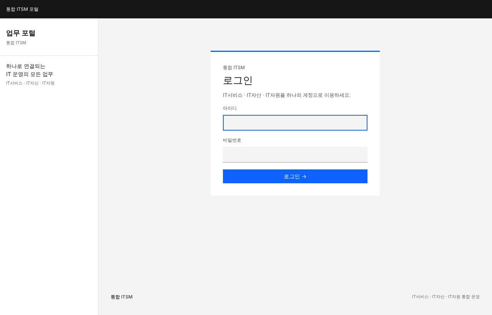

| 항목 | 설명 |
|---|---|
| 아이디·비밀번호 | 위 표의 계정을 입력합니다. 실패가 반복되면 보안 정책에 따라 잠기며, 시스템 관리자가 사용자 관리에서 잠금을 해제합니다. |
| 추가 인증 | 보안 정책에서 MFA를 사용하면 로그인 뒤 `/login/mfa/`에서 인증 코드를 입력합니다. |
| 비밀번호 변경 | 초기 비밀번호나 만료된 비밀번호로 로그인하면 내 계정 보안 화면으로 이동해 변경해야 합니다. |

# 3. 서비스요청 구현 순서

## 3.1 전체 흐름

「IT 서비스 요청(개발·운영)」은 아래 순서로 구성했습니다. 새 서비스를 만들 때도 같은 순서를 따릅니다.

| 순서 | 작업 | 수행 역할 | 콘솔 메뉴 |
|---|---|---|---|
| 1 | 부서·사용자·그룹·역할 준비 | 시스템 관리자 | 사용자 관리, 조직·권한 관리, 역할 관리, 그룹 관리 |
| 2 | 선택지 기준정보 등록 | 시스템 관리자 | 공통코드 관리 |
| 3 | 화면 템플릿 설계 → 독립 검토 → 게시 | 디자이너 작성, 개발자 검토 | 화면 관리 |
| 4 | 결재선 작성 → 검토 → 게시 | 개발자 작성, 시스템 관리자 검토 | 결재선 관리 |
| 5 | 워크플로우 작성 → 검토 → 게시 | 개발자 작성, 시스템 관리자 검토 | 워크플로우 관리 |
| 6 | 업무 달력·SLA·적기처리 기준 게시 | 서비스 관리자 | SLA·업무 달력, SLM·적기처리율 |
| 7 | 카탈로그 게시(신청 양식 + 워크플로우 연결) | 서비스 관리자 | 서비스 카탈로그 |
| 8 | 시험 신청과 단계별 처리 확인 | 요청자·승인자·운영자·개발자 | 사용자 포털 |

## 3.2 프로세스 정의

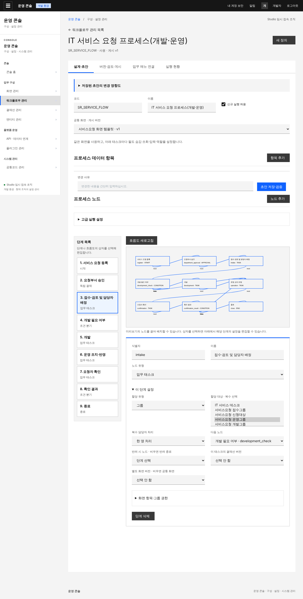

| 순번 | 노드(식별자) | 유형 | 담당자 | 담당자가 입력하는 항목 | 다음 단계 |
|---|---|---|---|---|---|
| 1 | 서비스 요청 등록(register) | 시작 | 요청자(카탈로그 신청) | 요청 제목, 요청 유형, 대상 시스템, 긴급도, 희망 완료일, 요청 내용, 요청 사유·기대 효과 | 2 |
| 2 | 요청부서 승인(department_approval) | 결재 | 요청부서 승인자(user_auth1) | 없음(승인/반려, 의견) | 승인 → 3, 반려 → 요청 반려 종료 |
| 3 | 접수·검토 및 담당자 배정(intake) | 업무 | 서비스요청 운영그룹(운영자1·2 중 한 명) | **개발 필요 여부\***, **조치 담당 운영자\***, 처리 예정일, 접수 의견 | 4 |
| 4 | 개발 필요 여부(development_check) | 조건 | 자동 | — | 예 → 5, 아니오 → 6 |
| 5 | 개발(development) | 업무 | 서비스요청 개발그룹(개발자) | **개발 내용\***, 변경 프로그램·산출물, **개발 완료일\*** | 6 |
| 6 | 운영 조치·반영(operation) | 업무 | 3단계에서 지정한 조치 담당 운영자 | **조치·운영 반영 내용\***, **조치 완료일\*** | 7 |
| 7 | 요청자 확인(confirmation) | 업무 | 신청자 본인 | **조치 결과 확인\***, 만족도(1~5), 확인 의견 | 8 |
| 8 | 확인 결과(confirmation_result) | 조건 | 자동 | — | 예 → 종료, 아니오 → 6(재조치) |
| 9 | 종료(close) | 종료 | — | — | 서비스요청을 「종료」로 바꾸고 적기처리율 완료 시각에 반영 |

\* 표시는 해당 단계의 필수 항목입니다. 필수 항목이 비어 있으면 「처리·다음 단계 진행」이 거부됩니다.

**단계별 항목 권한 원칙**: 현재 단계 담당자의 그룹만 입력할 수 있고, 이전 단계 그룹은 조회 전용, 이후 단계 그룹은 숨깁니다. 담당자가 아닌 사용자에게는 입력란과 처리 버튼이 보이지 않습니다. 서버도 같은 규칙으로 검사하므로 권한 밖 항목을 보내면 거부합니다.

| 화면 그룹 | 1 등록 | 2 승인 | 3 접수 | 5 개발 | 6 조치 | 7 확인 |
|---|---|---|---|---|---|---|
| 요청 정보 | 입력(신청서) | 조회 | 조회 | 조회 | 조회 | 조회 |
| 접수·배정 | — | 숨김 | **입력** | 조회 | 조회 | 조회 |
| 개발 | — | 숨김 | 숨김 | **입력** | 조회 | 조회 |
| 운영 조치 | — | 숨김 | 숨김 | 숨김 | **입력** | 조회 |
| 사용자 확인 | — | 숨김 | 숨김 | 숨김 | 숨김 | **입력** |

## 3.3 단계 1 — 사용자·조직·권한 준비

| 구성 | 값 |
|---|---|
| 부서 | 요청부서(SR_REQUEST_DEPT), 서비스 운영부서(SR_OPERATIONS_DEPT), 개발부서(SR_DEV_DEPT) |
| 그룹 | 서비스요청 운영그룹(SR_OPS): worker1, worker2 / 서비스요청 개발그룹(SR_DEV): developer1 / 서비스요청 신청대상(SR_REQUESTERS): user1 |
| 역할 | worker1·worker2·developer1: 처리 담당자(AGENT) / developer1: 개발자(DEVELOPER) / designer1: 화면 디자이너(SR_SCREEN_DESIGNER, 사용자 정의 역할) |
| 화면 디자이너 역할 권한 | 운영 콘솔 접근(console.access), 워크플로우·결재선 구성(workflow.manage) |
| 서비스 관리자 메뉴 정책 | 기본 메뉴(장애 처리, 서비스 요청 처리, 카탈로그 설정, SLA 설정) 유지 + **운영 콘솔 버튼 허용** |

활용 예시 — 운영자3을 운영그룹에 추가하기:
1. temp-admin으로 로그인 → 운영 콘솔 → **그룹 관리** → 「서비스요청 운영그룹」을 선택합니다.
2. 구성원 목록에서 운영자3(worker3)을 활성으로 바꾸고 사유 「운영 인력 추가」를 입력해 저장합니다.
3. worker3이 다음 요청부터 접수 단계 담당자 후보에 포함됩니다. 조치 담당 운영자 선택 목록에도 나타납니다. 그룹 범위가 화면 항목에 지정되어 있기 때문입니다.

## 3.4 단계 2 — 공통코드

| 코드 그룹 | 이름 | 항목 |
|---|---|---|
| SR_REQUEST_TYPE | 서비스요청 유형 | 01 기능 개선, 02 신규 개발, 03 데이터 추출·변경, 04 계정·권한, 05 오류 문의, 06 기타 |
| SR_TARGET_SYSTEM | 서비스요청 대상 시스템 | 01 그룹웨어, 02 ERP, 03 고객관리(CRM), 04 홈페이지, 05 ITSM, 06 기타 |
| SR_URGENCY | 서비스요청 긴급도 | 01 긴급, 02 높음, 03 보통, 04 낮음 |

카탈로그 신청서의 선택지는 이 코드와 같은 값으로 게시했습니다. 현재 버전의 카탈로그 선택 항목은 공통코드를 자동으로 참조하지 않습니다. 코드를 바꾸면 카탈로그도 같은 선택지로 새 버전을 게시해야 합니다.

## 3.5 단계 3 — 화면 템플릿(디자이너)

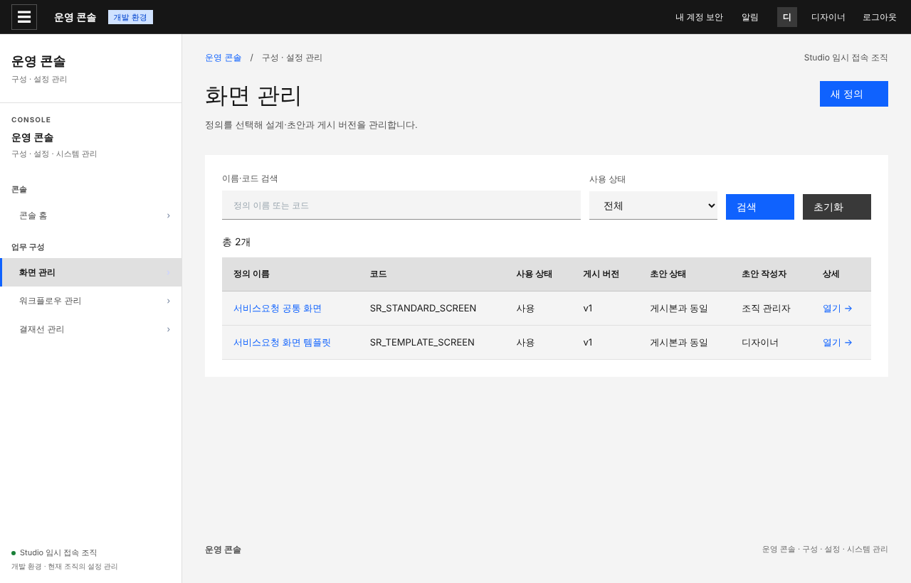

1. designer1로 로그인 → 운영 콘솔 → **화면 관리** → **새 정의**를 누릅니다.
2. 코드 `SR_TEMPLATE_SCREEN`, 이름 「서비스요청 화면 템플릿」을 입력하고 **화면 디자이너 열기**를 누릅니다.
3. 그룹 표시를 「그룹 나열」, 열 수를 2로 설정하고 그룹 5개를 만듭니다: 요청 정보, 접수·배정, 개발, 운영 조치, 사용자 확인.
4. 왼쪽 **필드 추가**에서 유형을 골라 각 그룹에 항목을 놓습니다. 오른쪽 **필드 속성**에서 표시 이름·식별자·너비(열)·높이(단)·필수를 지정합니다.
5. **화면 미리보기**로 확인한 뒤, 저장 사유를 입력하고 **초안 저장**을 누릅니다.
6. **버전·검토·게시** 탭에서 개발자(developer1)가 검토 사유를 입력하고 **독립 검토 완료**를 누릅니다.
7. 디자이너가 게시 사유를 입력하고 **검토된 초안 게시**를 누르면 v1이 만들어집니다.

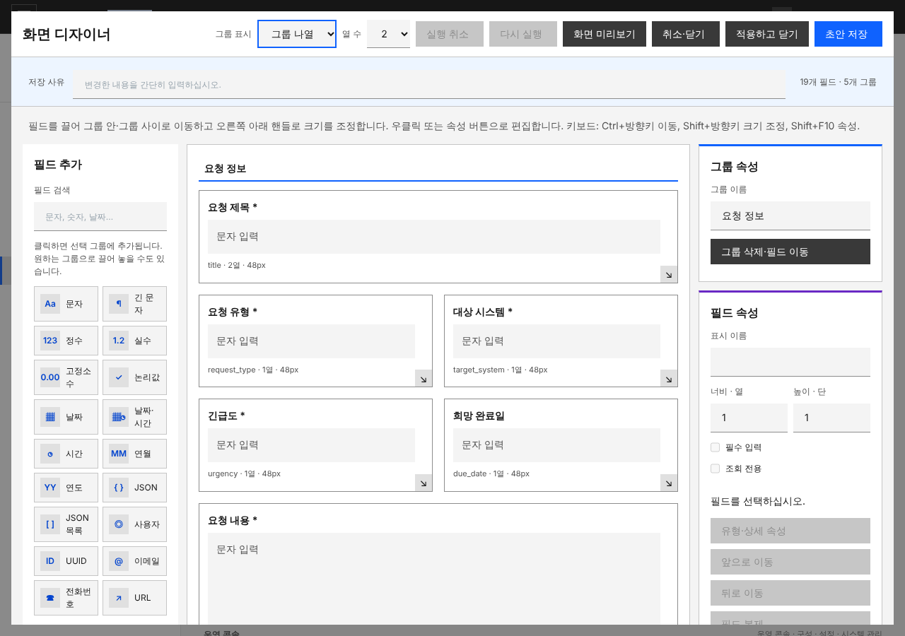

화면 템플릿 항목(19개):

| 그룹 | 항목(식별자 · 유형) |
|---|---|
| 요청 정보 | 요청 제목(title·문자, 필수), 요청 유형(request_type·문자, 필수), 대상 시스템(target_system·문자, 필수), 긴급도(urgency·문자, 필수), 희망 완료일(due_date·문자), 요청 내용(description·문자, 필수), 요청 사유·기대 효과(expected_effect·문자) |
| 접수·배정 | 개발 필요 여부(dev_required·논리값), 조치 담당 운영자(operator·사용자, 선택 범위: 서비스요청 운영그룹), 처리 예정일(planned_date·날짜), 접수 의견(intake_note·긴 문자) |
| 개발 | 개발 내용(dev_content·긴 문자), 변경 프로그램·산출물(dev_artifacts·긴 문자), 개발 완료일(dev_done_date·날짜) |
| 운영 조치 | 조치·운영 반영 내용(action_content·긴 문자), 조치 완료일(action_date·날짜) |
| 사용자 확인 | 조치 결과 확인(confirmed·논리값), 만족도(satisfaction·정수), 확인 의견(feedback·긴 문자) |

> 신청서에서 넘어오는 항목(요청 정보 그룹)은 카탈로그 양식과 **같은 식별자·호환 유형**이어야 합니다. 카탈로그의 선택·긴 문자·날짜 항목은 워크플로우에서 「문자」 유형으로 받습니다.

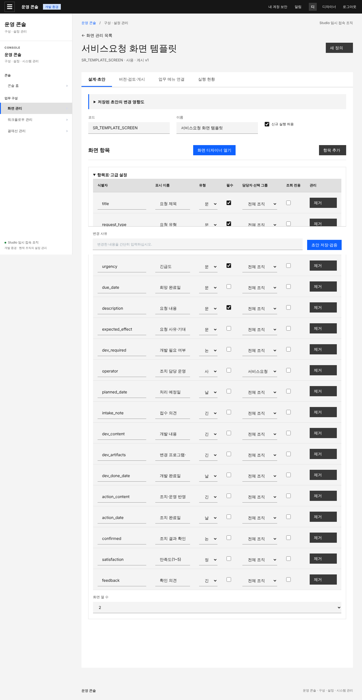

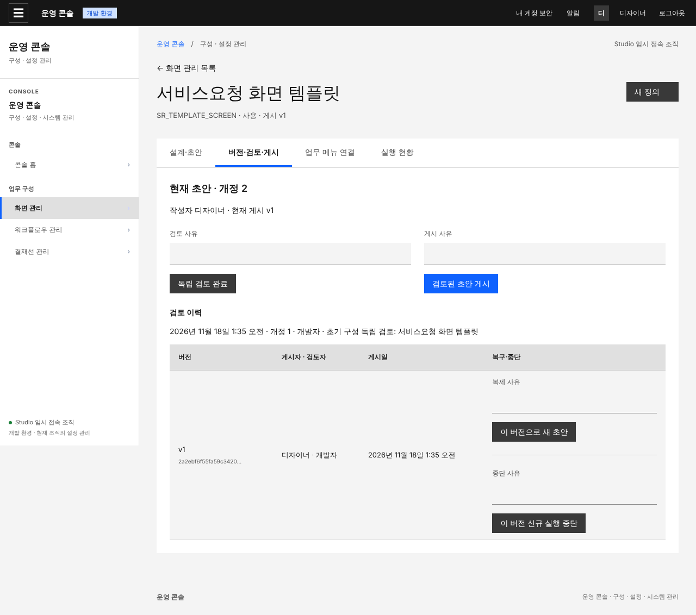

**템플릿 재사용 예시** — 「장비 신청」 화면을 만들 때:
1. 화면 관리에서 「서비스요청 화면 템플릿」의 **버전·검토·게시** 탭 → v1 행의 **이 버전으로 새 초안**을 누르면 같은 정의의 새 초안이 됩니다. 이때 v1은 바뀌지 않습니다.
2. 별도 화면이 필요하면 **새 정의**로 만들고, 같은 그룹 구성을 따라 「요청 정보」 항목만 장비 항목(모델, 수량, 사용 위치)으로 바꿉니다.
3. 워크플로우의 **공통 화면·게시 버전**에서 새 화면 버전을 선택합니다.

## 3.6 단계 4 — 결재선(개발자)

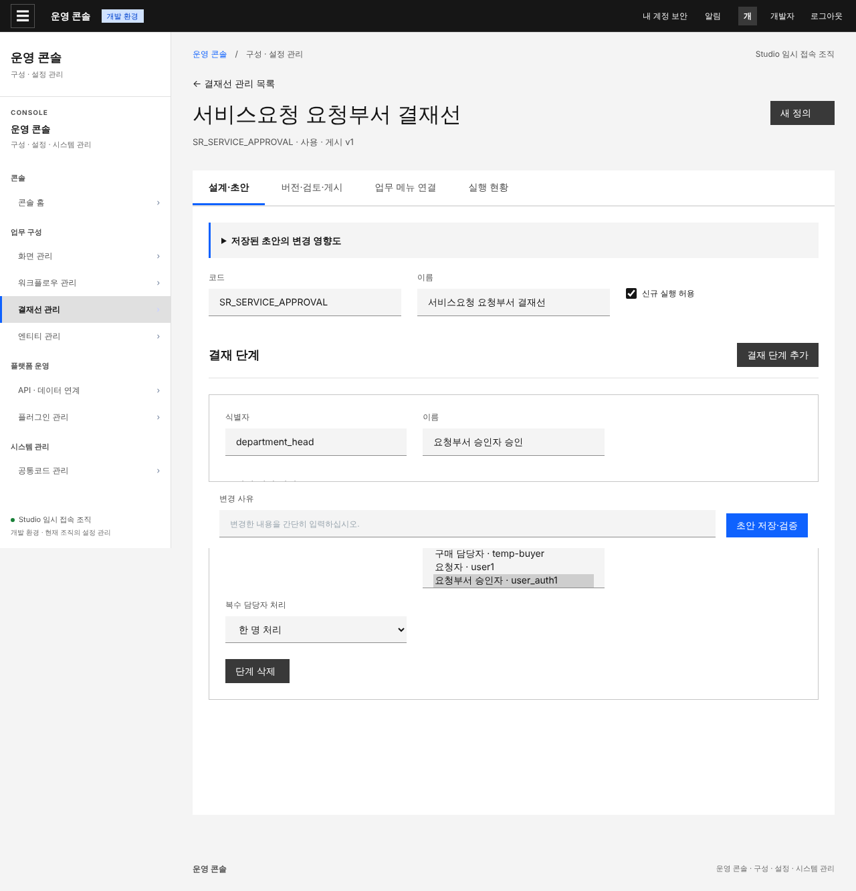

| 항목 | 값 |
|---|---|
| 코드·이름 | SR_SERVICE_APPROVAL · 서비스요청 요청부서 결재선 |
| 단계 | department_head · 요청부서 승인자 승인 |
| 결재자 | 사용자: 요청부서 승인자(user_auth1) |
| 합의 방식 | ANY(한 명 승인으로 완료) |

결재 단계에서는 업무 데이터를 수정할 수 없고 승인·반려와 의견만 남깁니다. 신청자 본인은 결재자가 될 수 없습니다(자기 결재 차단).

활용 예시 — 결재자를 부서 단위로 바꾸기: 할당 유형을 「부서」로 바꾸고 요청부서를 선택한 뒤 초안을 저장하고 검토·게시합니다. 이어서 워크플로우의 결재 노드가 새 결재선 버전을 쓰도록 워크플로우 새 버전을 게시합니다. 이미 진행 중인 요청은 기존 버전으로 끝까지 진행합니다.

## 3.7 단계 5 — 워크플로우(개발자)

1. developer1로 로그인 → **워크플로우 관리** → **새 정의**. 코드 `SR_SERVICE_FLOW`, 이름 「IT 서비스 요청 프로세스(개발·운영)」를 입력합니다.
2. **공통 화면·게시 버전**에서 「서비스요청 화면 템플릿 · v1」을 고르면 화면 항목이 프로세스 데이터 항목으로 선언됩니다.
3. **노드 추가**로 3.2의 9개 노드를 만들고, 각 노드에 할당 유형·다음 노드·조건을 지정합니다.
   - 결재 노드: 결재선 버전 「서비스요청 요청부서 결재선 · v1」
   - 접수: 할당 유형 「그룹」→ 서비스요청 운영그룹, 복수 담당자 처리 「한 명 처리」
   - 개발: 「그룹」→ 서비스요청 개발그룹
   - 운영 조치: 「선택 담당자 필드」→ 조치 담당 운영자(operator)
   - 요청자 확인: 「신청자」
   - 조건 노드: 항목 `dev_required`·`confirmed`, 연산 「같음」, 값 true
4. 각 업무 노드의 **화면 항목·그룹 권한**에서 3.2 표와 같이 그룹·항목을 숨김/조회/입력으로 지정하고, 필수 항목을 표시합니다.
5. **고급 실행 설정**: 카탈로그 전용 실행(catalog_only), 완료 시 요청 종료(close_on_complete), 요청 담당자 반영 항목 `operator`를 지정합니다.
6. 변경 사유를 입력하고 **초안 저장·검증** → temp-admin이 **독립 검토 완료** → developer1이 **검토된 초안 게시**합니다.

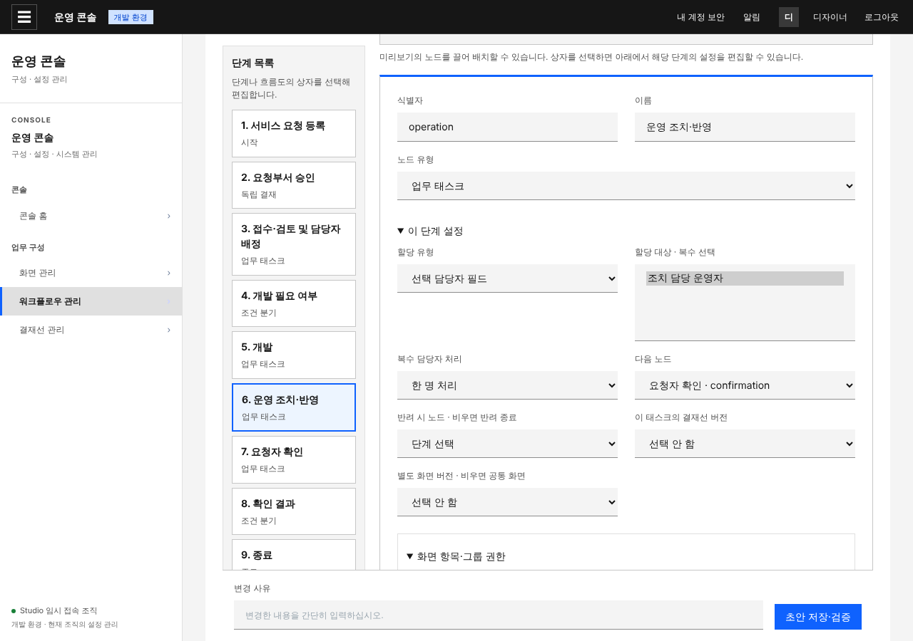

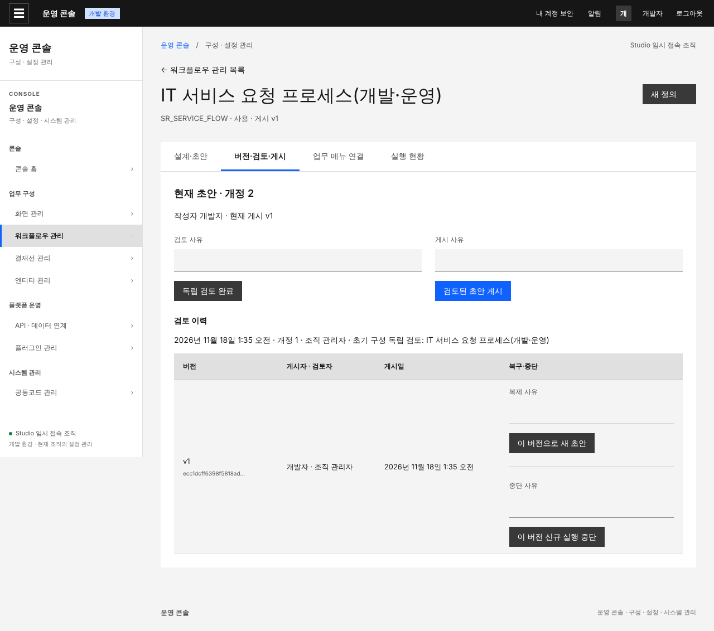

## 3.8 단계 6 — 업무 달력·SLA·적기처리 기준(서비스 관리자)

| 항목 | 초기값 |
|---|---|
| 업무 달력 | 기본 업무 달력(평일 09:00~18:00), Asia/Seoul, 월~금 |
| 휴일 | 2026·2027년 양력 고정 공휴일(1/1, 3/1, 5/5, 6/6, 8/15, 10/3, 10/9, 12/25). **설·추석·부처님오신날·대체공휴일·임시공휴일은 등록하지 않았으므로 운영자가 추가해야 합니다.** |
| 서비스요청 적기처리 기준 | 서비스요청 기본 처리기한(3영업일) = 접수 기준 1,620업무분(3일×9시간) |
| 장애 SLA(P1~P5) | P1 응답 30분/해결 240분, P2 60/540, P3 240/1,620, P4 540/2,700, P5 1,080/5,400(업무분), 임박 알림 80%, 대기 중 해결 시간 정지 |

장애 SLA 값은 초기 권장값입니다. 조직의 합의 수준에 맞게 SLA 화면에서 새 버전을 게시해 조정하십시오. 새 정책은 이후 접수 건부터 적용됩니다.

기존에 업무 달력이나 정책이 있는 환경에서는 새로 만들지 않고 기존 값을 그대로 둡니다.

## 3.9 단계 7 — 카탈로그 게시(서비스 관리자)

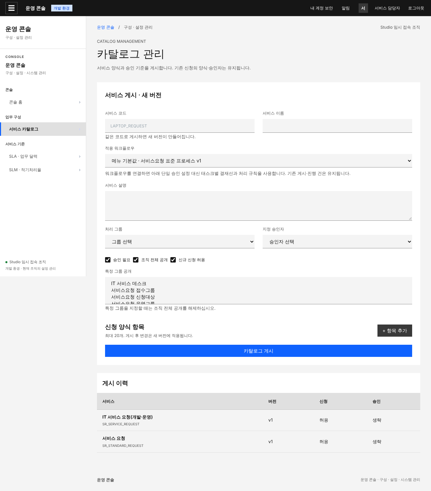

| 항목 | 값 |
|---|---|
| 서비스 코드·이름 | SR_SERVICE_REQUEST · IT 서비스 요청(개발·운영) |
| 적용 워크플로우 | IT 서비스 요청 프로세스(개발·운영) v1 |
| 처리 그룹 | 서비스요청 운영그룹 |
| 공개 범위 | 특정 그룹: 서비스요청 신청대상 |
| 신청 양식 | 요청 제목(문자, 필수), 요청 유형(선택, 필수), 대상 시스템(선택, 필수), 긴급도(선택, 필수), 희망 완료일(날짜), 요청 내용(긴 문자, 필수), 요청 사유·기대 효과(긴 문자) |

워크플로우를 연결하면 카탈로그의 단일 승인 설정 대신 워크플로우의 결재선을 사용합니다. 기존 「서비스 요청(SR_STANDARD_REQUEST)」 카탈로그와 그 업무 메뉴 연결은 바꾸지 않았습니다. 두 서비스가 함께 보이는 것이 혼란스러우면 기존 서비스를 「신규 신청 허용」을 해제한 새 버전으로 게시해 신청을 중단할 수 있습니다.

## 3.10 단계 8 — 초기 데이터와 예시 요청

요청자(user1)가 카탈로그로 신청하고, 실제 담당자가 아래 단계까지 처리해 두었습니다.

| 번호 | 요청 제목 | 유형·시스템·긴급도 | 현재 단계 | 다음 처리자 |
|---|---|---|---|---|
| 1 | 신규 입사자 그룹웨어 계정·결재 권한 등록 | 계정·권한 · 그룹웨어 · 높음 | 요청부서 승인 대기 | 요청부서 승인자 |
| 2 | 월간 매출 보고서 엑셀 다운로드 기능 개선 | 기능 개선 · ERP · 보통 | 접수·배정 대기 | 운영자1 또는 운영자2 |
| 3 | 고객 상담 이력 조회 화면 신규 개발 | 신규 개발 · CRM · 보통 | 개발 진행(개발 필요=예, 조치 담당=운영자1) | 개발자 |
| 4 | 3분기 거래처별 발주 실적 데이터 추출 | 데이터 추출·변경 · ERP · 낮음 | 요청자 확인 대기(운영자2 조치 완료) | 요청자 |
| 5 | 홈페이지 공지사항 게시판 첨부파일 다운로드 오류 | 오류 문의 · 홈페이지 · 긴급 | 종료(개발→운영 반영→확인, 만족도 5) | — |

## 3.11 자동 구성 명령(재설치·다른 환경)

위 1~8단계는 아래 명령 하나로 재현합니다. 명령은 화면 템플릿·결재선·워크플로우를 실제 업무 명령으로 만듭니다. 디자이너 작성 → 개발자 검토 → 디자이너 게시, 개발자 작성 → 시스템 관리자 검토 → 개발자 게시 순서이며, 모두 감사 이력에 남습니다.

```bash
python manage.py setup_sr_template --password-file /안전한/경로/sr-template-passwords.json
```

- 비밀번호 JSON은 새로 만들 계정만 키로 가집니다(예: `{"developer1": "...", "designer1": "..."}`). 이미 있는 user1·user_auth1·worker1·worker2는 재사용하며 비밀번호를 바꾸지 않습니다.
- 조직이 하나이면 `--organization-id`를 생략할 수 있습니다. `--skip-samples`를 주면 예시 요청을 만들지 않습니다.
- 같은 코드의 구성이 이미 있으면 중단하며, 부분 변경 없이 전체를 되돌립니다. 완료 마커가 있으면 다시 실행해도 바꾸는 것이 없습니다.

**Render 적용 절차**

1. 이 변경이 `main` 브랜치에 병합되어 있어야 합니다(Render 서비스는 `main`을 배포합니다).
2. Render 대시보드 → 웹 서비스 → Environment에 다음 값을 추가합니다.
   - `STUDIO_SR_TEMPLATE` = `1`
   - `STUDIO_SR_TEMPLATE_PASSWORDS_JSON` = `{"developer1":"<초기 비밀번호>","designer1":"<초기 비밀번호>"}`
3. **Manual Deploy**를 실행합니다(자동 배포는 꺼져 있습니다). 시작 스크립트가 마이그레이션 후 구성을 실행합니다. 실패해도 웹 서비스는 계속 시작되며, 로그에 `SR template setup failed`가 남습니다.
4. 로그에서 `SR_TEMPLATE {"retained": false, ...}`를 확인한 뒤, `STUDIO_SR_TEMPLATE_PASSWORDS_JSON`은 지워도 됩니다. 마커가 남아 있어 다음 배포 때는 다시 구성하지 않습니다.

# 4. 운영 콘솔 메뉴별 기능

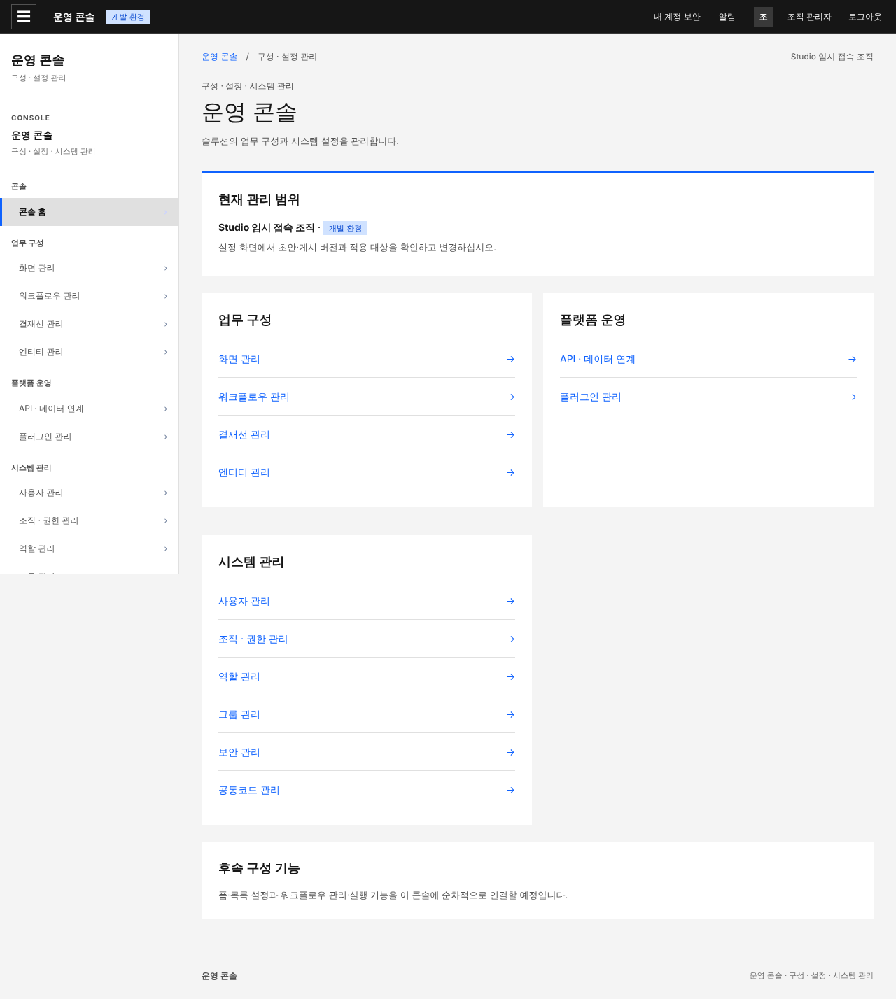

운영 콘솔 좌측 메뉴는 역할 권한에 따라 다르게 보입니다. 시스템 관리자는 업무 구성·플랫폼 운영·시스템 관리 메뉴를 봅니다. 서비스 관리자는 서비스 카탈로그·SLA·SLM을, 디자이너는 화면·워크플로우·결재선 관리를 봅니다.

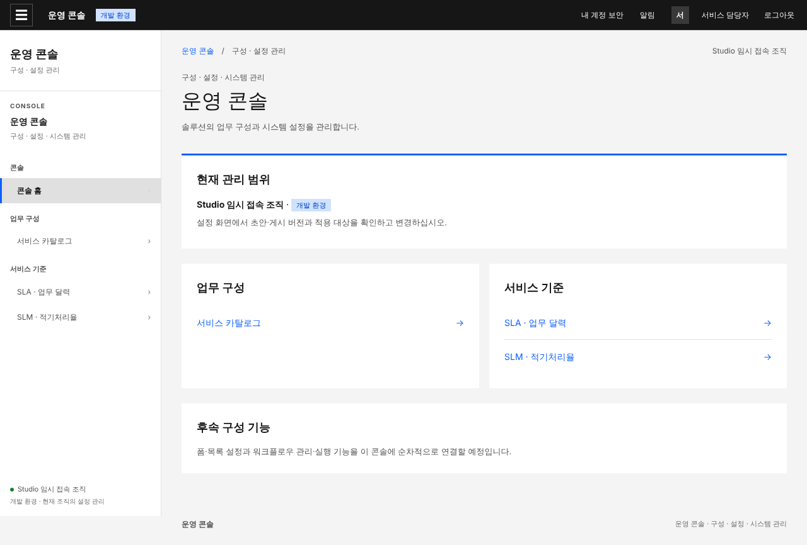

## 4.1 화면 관리 `/console/screens`

| 기능 | 설명 |
|---|---|
| 목록 검색 | 이름·코드 검색, 사용 상태(전체/사용/중지) 필터. 게시 버전과 초안 상태(미게시 초안, 게시본과 동일, 변경된 초안, 검증 오류)를 표시합니다. |
| 새 정의 | 코드·이름을 입력해 화면 정의를 만듭니다. 코드는 저장 후 바꿀 수 없습니다. |
| 화면 디자이너 | 필드 추가(문자, 긴 문자, 정수, 실수, 고정소수, 논리값, 날짜, 날짜·시간, 시간, 연월, 연도, JSON, JSON 목록, 사용자, UUID, 이메일, 전화번호, URL), 끌어서 이동, 크기 조정, 그룹 나열/탭 표시, 열 수 1~3, 실행 취소/다시 실행, 미리보기, 초안 저장. 키보드는 Ctrl+방향키로 이동, Shift+방향키로 크기 조정, Shift+F10으로 속성을 엽니다. |
| 항목표·고급 설정 | 항목을 표로 보며 식별자·유형·필수·설명·기본값·최대 길이·사용자 선택 범위(그룹)를 편집합니다. |
| 변경 영향도 | 저장된 초안이 어떤 워크플로우·카탈로그에 영향을 주는지 확인합니다. |
| 버전·검토·게시 | 독립 검토 완료(작성자와 다른 검토자), 검토된 초안 게시, 이전 버전으로 새 초안 복제, 버전의 신규 실행 중단 |
| 실행 현황 | 이 정의를 쓰는 실행 목록 |

활용 예시: 「접수·배정」 그룹에 **고객 연락처(전화번호)** 항목을 추가하려면 디자이너가 화면 디자이너에서 전화번호 필드를 접수·배정 그룹에 놓고 초안을 저장합니다. 개발자가 검토하고 디자이너가 v2를 게시합니다. 그다음 개발자가 워크플로우 공통 화면을 v2로 바꿔 새 버전을 게시합니다.

## 4.2 워크플로우 관리 `/console/workflows`

| 기능 | 설명 |
|---|---|
| 설계·초안 | 공통 화면 선택, 프로세스 데이터 항목, 노드 추가/삭제, 흐름도에서 끌어 배치, 노드별 설정(할당 유형: 사용자/역할/그룹/부서/선택 담당자 필드/신청자, 복수 담당자 처리, 다음·반려 노드, 노드별 결재선·화면), 화면 항목·그룹 권한(숨김/조회/입력, 역할별 조회·입력), 필수 항목, 고급 실행 설정 |
| 노드 유형 | 시작, 업무 태스크, 독립 결재, 조건 분기, 병렬 분기·합류, 시간 대기, 하위 프로세스, 이관, API 호출, 종료 |
| 버전·검토·게시 | 화면 관리와 같음 |
| 업무 메뉴 연결 | 게시 버전을 「서비스요청」 메뉴의 기본 프로세스로 연결합니다. 카탈로그 게시 때 워크플로우를 지정하지 않으면 이 연결을 씁니다. |
| 실행 현황 | 실행 건별 상태·시작자·현재 단계 |

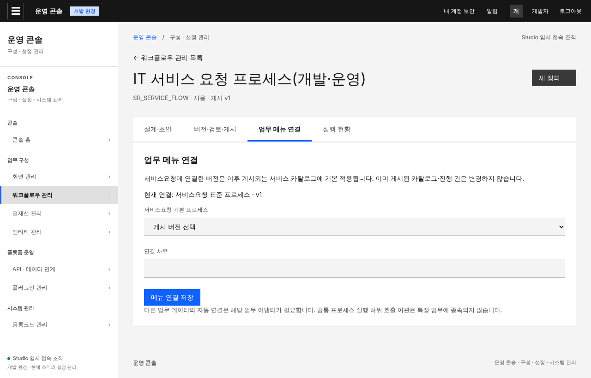

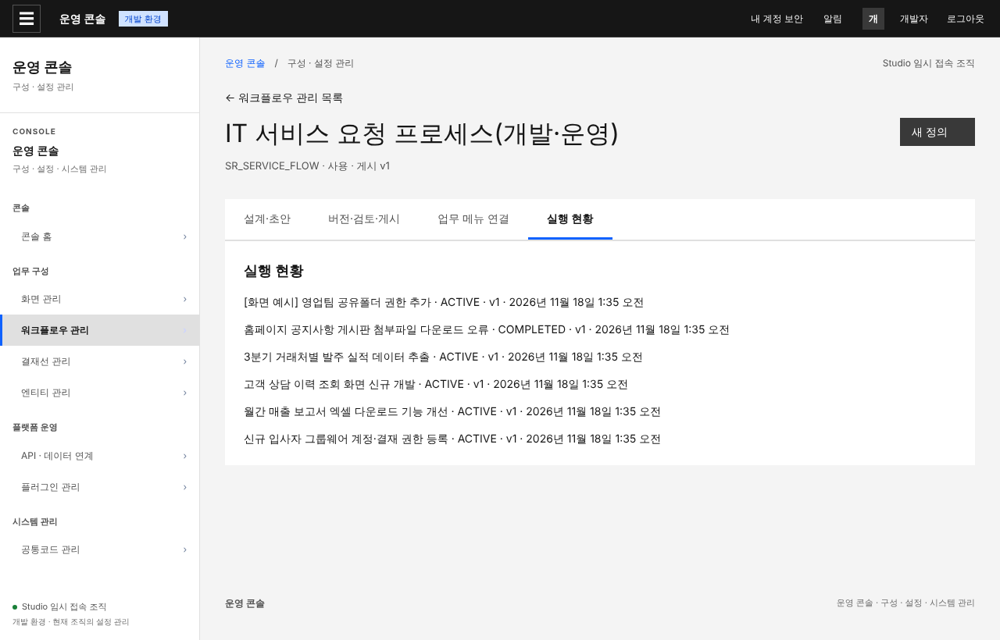

활용 예시 — 긴급 요청은 승인 없이 접수하기: 시작 노드 다음에 조건 노드 「긴급 여부」(urgency 같음 「긴급」)를 넣습니다. 참이면 접수 노드로, 거짓이면 요청부서 승인 노드로 연결합니다. 저장·검토·게시하면 이후 신청부터 적용됩니다. 진행 중인 요청은 신청 당시 버전을 유지합니다.

## 4.3 결재선 관리 `/console/approval-lines`

결재 단계(최대 20단계)마다 식별자·이름·결재자(사용자/역할/그룹/부서, 하위 부서 포함 여부)·합의 방식(ALL 전원, ANY 한 명)을 지정합니다. 버전 관리 규칙은 화면 관리와 같습니다.

활용 예시: 금액이 큰 요청에 2단계 결재(요청부서장 → IT기획팀장)가 필요하면 단계 2개짜리 결재선을 새로 게시하고, 워크플로우의 해당 결재 노드에 연결합니다.

## 4.4 서비스 카탈로그 `/console/catalog`

| 기능 | 설명 |
|---|---|
| 서비스 게시·새 버전 | 서비스 코드(같은 코드로 게시하면 새 버전), 이름, 설명, 적용 워크플로우, 처리 그룹, 지정 승인자(워크플로우 미연결 시), 승인 필요, 조직 전체 공개, 신규 신청 허용, 특정 그룹 공개 |
| 신청 양식 항목 | 최대 20개. 종류는 문자(2,000자), 긴 문자(4,000자), 정수, 선택(최대 30개 선택지), 날짜, 논리값 |
| 게시 이력 | 서비스·버전·신청 허용·승인 여부 |

활용 예시 — 「IT 서비스 요청」 선택지에 「모바일 앱」을 추가하기: 서비스 코드 `SR_SERVICE_REQUEST`, 적용 워크플로우와 처리 그룹·공개 그룹을 기존과 같게 선택하고, 대상 시스템 선택지에 「모바일 앱」을 추가해 게시합니다. v2가 만들어지며, 이미 접수된 요청의 양식은 바뀌지 않습니다.

## 4.5 SLA·업무 달력 `/console/sla`


| 기능 | 설명 |
|---|---|
| 우선순위별 정책 게시 | 정책 이름, 우선순위(P1~P5), 업무 달력, 응답·해결 목표(업무분), 임박 알림 기준(%), 대기 중 해결 시간 정지 |
| 업무 달력 게시 | 달력 이름, 시간대, 업무 요일, 업무 시작·종료, 휴일(한 줄에 YYYY-MM-DD) |
| 게시된 정책 이력 | 정책·우선순위·버전·목표·달력 |

활용 예시 — 2027년 설 연휴 추가: 업무 달력 게시에서 기존 휴일에 2027년 설 연휴 날짜를 추가해 새 달력을 게시합니다. 이어서 각 우선순위 정책을 새 달력으로 다시 게시합니다. 날짜는 관보 등 공식 발표로 확인하십시오.

## 4.6 SLM·적기처리율 `/console/slm`

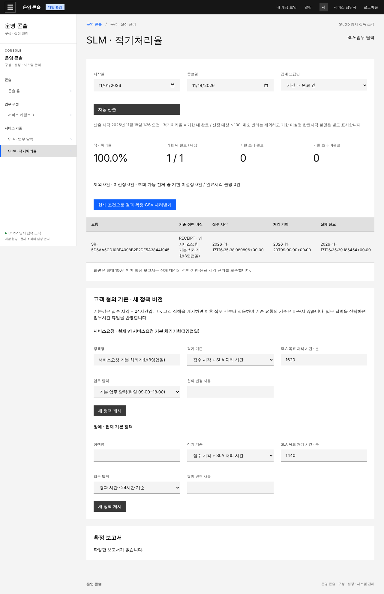

| 기능 | 설명 |
|---|---|
| 적기처리 기준 게시 | 대상 업무(장애/서비스요청), 기준(접수 시각, 합의 시작, 요청 기한, 합의 기한), 목표 시간(업무분), 업무 달력 |
| 현황 조회 | 기간별 대상 건수, 기한 내 완료율 |
| 확정 보고서 | 기간·모집단(완료 기준/기한 기준)으로 보고서를 확정하고 CSV로 내려받습니다. |
| 기준일·기한 조정 | 요청 건별 합의 시작·요청 기한·합의 기한을 사유와 함께 변경합니다. 이력이 남습니다. |

활용 예시: 11월 서비스요청 적기처리율을 보고하려면 기간을 2026-11-01~2026-11-30, 모집단을 완료 기준으로 선택해 보고서를 확정한 뒤 CSV를 내려받습니다.

## 4.7 사용자 관리 `/console/users`

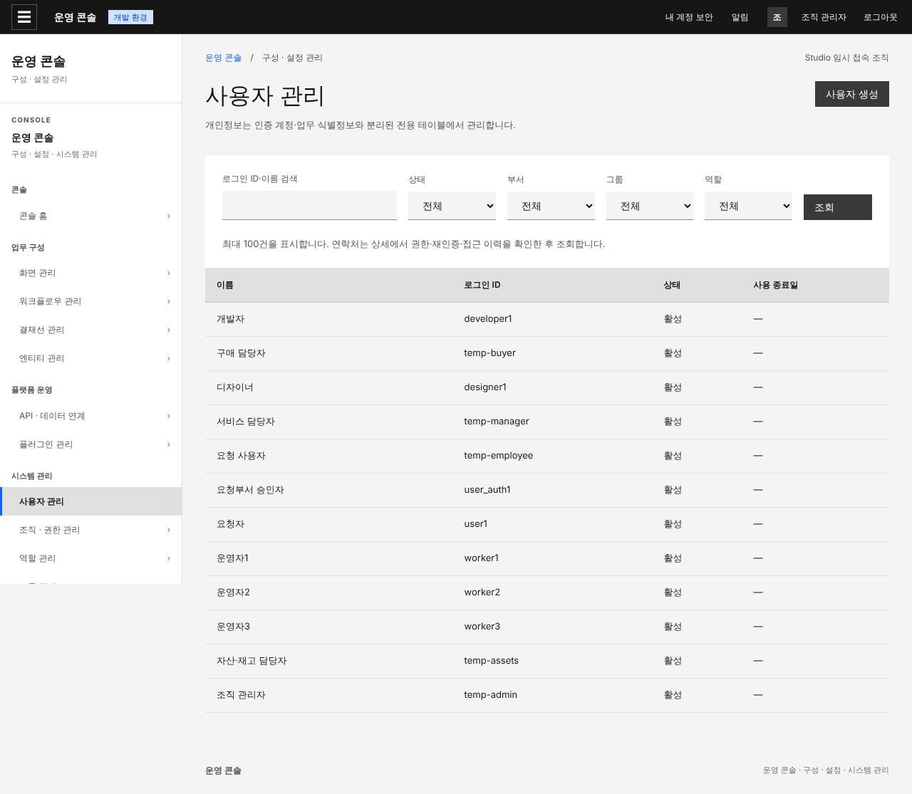

| 기능 | 설명 |
|---|---|
| 사용자 검색·목록 | 아이디·이름·부서·상태 |
| 사용자 생성 | 초기 비밀번호 방식 또는 초대 링크 방식. 비밀번호 정책과 아이디 중복을 검사합니다. |
| 사용자 정보 저장 | 부서·연락처·만료일 등. 개인정보 조회는 별도 권한·재인증·접근 이력이 필요합니다. |
| 계정 활성/중지 | 사유 필수. 시스템 관리자 계정은 시스템 관리자만 변경할 수 있습니다. |
| 비밀번호 초기화 | 임시 비밀번호를 설정하고 변경을 강제합니다. |
| 잠금 해제·MFA 해제·초대 링크·개인정보 삭제·세션 회수 | 사유와 재인증 정책을 적용합니다. |

활용 예시 — 퇴사자 처리: 해당 사용자를 선택해 **세션 회수** → **계정 중지**(사유 「퇴사」)를 실행합니다. 과거 요청의 작성자·처리자 이력은 그대로 남습니다.

## 4.8 조직·권한 관리 `/console/access`

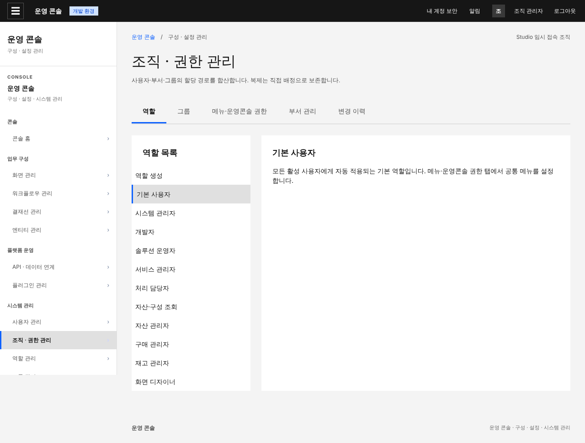

| 탭 | 기능 |
|---|---|
| 역할 | 역할별 배정 대상(사용자·부서·그룹, 하위 부서 포함) 지정 |
| 그룹 | 그룹에 사용자·부서 배정 |
| 메뉴·운영콘솔 권한 | 역할별 사용 메뉴, 운영 콘솔 버튼, 데이터 조회·변경 범위(본인/담당/부서/하위 부서) |
| 부서 관리 | 부서 생성·편집·삭제(하위 부서·소속 사용자가 있으면 삭제 불가) |
| 변경 이력 | 권한 변경 감사 이력 |

활용 예시: 요청부서 전원이 서비스를 신청하게 하려면 그룹 탭에서 「서비스요청 신청대상」 그룹에 부서 「요청부서」를 배정합니다. 사용자를 한 명씩 추가할 필요가 없습니다.

## 4.9 역할 관리 `/console/roles`

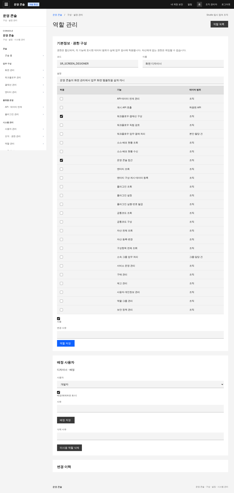

시스템 역할(시스템 관리자, 개발자, 솔루션 운영자, 서비스 관리자, 처리 담당자, 자산·구성 조회, 자산 관리자, 구매 관리자, 재고 관리자)과 사용자 정의 역할을 관리합니다. 사용자 정의 역할은 고정된 기능 권한 목록에서 고른 권한으로 구성합니다. 역할 저장, 사용자 직접 배정, 삭제(사용 이력이 있으면 삭제 대신 사용 중지)를 지원합니다.

활용 예시: 「화면 디자이너」 역할(콘솔 접근 + 워크플로우·결재선 구성)을 새 디자이너에게 배정하면 화면 관리 메뉴를 바로 사용할 수 있습니다. 사용자·보안 메뉴는 보이지 않습니다.

## 4.10 그룹 관리 `/console/groups`

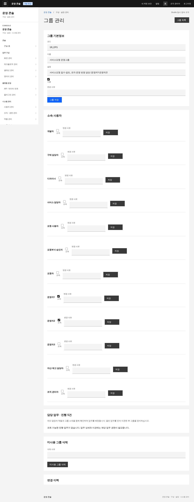

그룹 코드·이름·설명·사용 여부를 저장하고 구성원을 활성/비활성으로 관리합니다. 접수 그룹이거나 구성원이 있는 그룹은 삭제할 수 없습니다.

## 4.11 보안 관리 `/console/security`

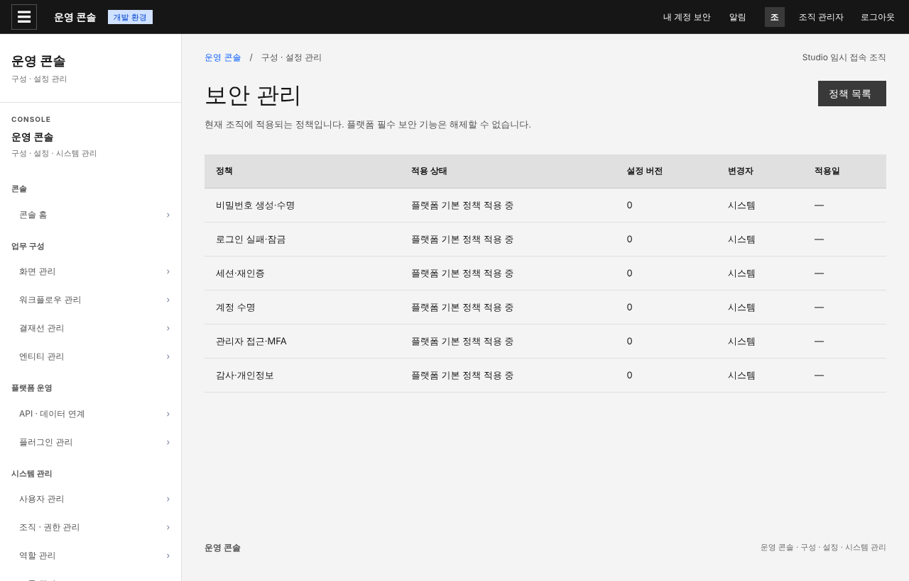

정책 유형별로 값을 미리보기한 뒤 사유와 함께 적용합니다.

| 정책 유형 | 주요 설정(기본값) |
|---|---|
| 비밀번호 생성·수명 | 최소 길이(8), 최대 길이(128), 대문자·소문자·숫자·특수문자 필수 여부, 재사용 제한 개수(5), 변경 주기(0=정기 변경 없음), 만료 사전 안내(7일), 추가 취약 비밀번호 목록, 기존 계정 변경 강제 |
| 로그인 실패·잠금 | 계정별 실패 제한(5회), 집계 시간(15분), 잠금 시간(15분), 접속 경로별 요청 제한(100회/5분) |
| 세션·재인증 | 유휴 만료(30분), 최대 유지(8시간), 동시 세션 수(3), 민감 작업 재인증 유효시간(10분) |
| 계정 수명 | 미접속 계정 제한(0=미사용), 신규 계정 기본 사용기간 |
| 관리자 접근·MFA | 관리 기능 MFA 필수 여부, 관리자 허용 IP/CIDR |
| 감사·개인정보 | 감사 이력 최소 보존기간(365일), 개인정보 기본 마스킹 |

활용 예시: 비밀번호를 90일마다 바꾸게 하려면 「비밀번호 생성·수명」에서 변경 주기를 90으로 입력하고, 미리보기로 영향을 확인한 뒤 사유와 함께 적용합니다. 「이 정책 버전으로 기존 계정 변경 강제」를 선택하면 기존 사용자도 다음 로그인 때 변경해야 합니다.

## 4.12 공통코드 관리 `/console/codes`

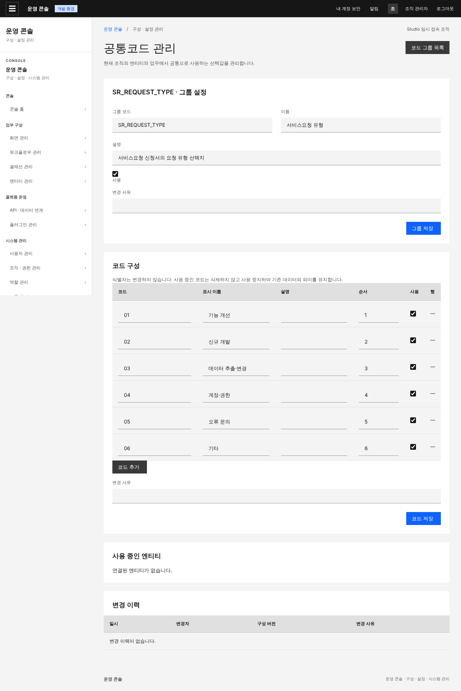

코드 그룹(코드·이름·설명·사용 여부)을 만들고, 항목의 코드·이름·순서·사용 여부를 일괄 저장합니다. 중복 코드와 참조 여부를 검사합니다.

## 4.13 엔티티 관리 `/console/entities`

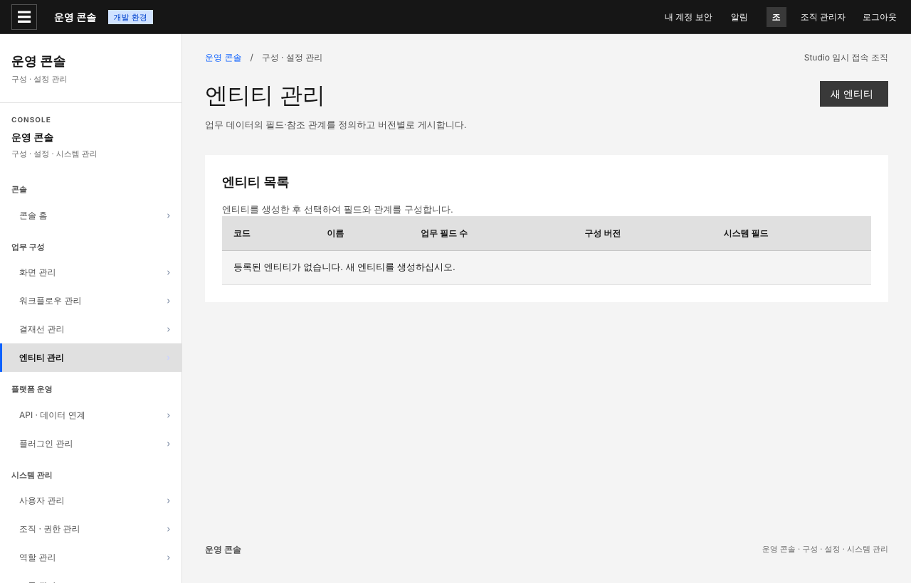

업무 데이터 구조(엔티티)를 정의합니다. 고정 필드와 업무 키, 논리 유형, 관계 대상·카디널리티를 검증해 초안을 저장하고 게시합니다. 게시 스키마는 바뀌지 않으며, 게시 스키마 기준으로 레코드를 등록합니다.

활용 예시: 「대상 시스템」을 담당자·운영 시간 같은 속성이 있는 마스터 데이터로 관리하려면 엔티티 「업무 시스템」을 만들어 게시하고 레코드를 등록합니다.

## 4.14 API·데이터 연계 `/console/integrations`

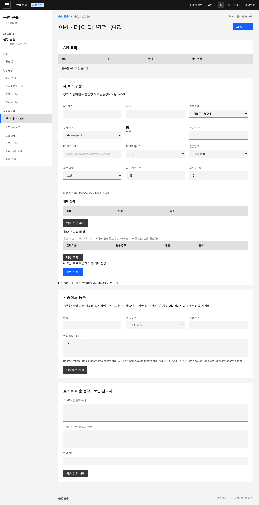

| 기능 | 설명 |
|---|---|
| API 정의 저장·게시 | 프로토콜(REST·SOAP·GraphQL·Webhook), 실행 계정, 입력·응답 매핑을 검증해 불변 버전으로 게시 |
| 호출 | 게시 API 호출. 쓰기 API는 확인과 멱등성 규칙을 적용합니다. |
| 외부 호출 클라이언트 | 외부 시스템이 호출할 클라이언트 발급·중지 |
| 인증 정보 | 인증 유형별 비밀정보를 서버에 보호 저장하며, 화면에 원문을 다시 보여 주지 않습니다. |
| 네트워크 정책 | 허용 HTTPS 호스트·사설 CIDR |

활용 예시: 개발 완료 후 배포 시스템(Jenkins)에 작업을 요청하려면 Jenkins API를 정의·게시하고 워크플로우 운영 조치 앞에 「API 호출」 노드를 넣습니다. 이때 입력 매핑에 `dev_artifacts`를 연결합니다.

## 4.15 플러그인 관리 `/console/plugins`

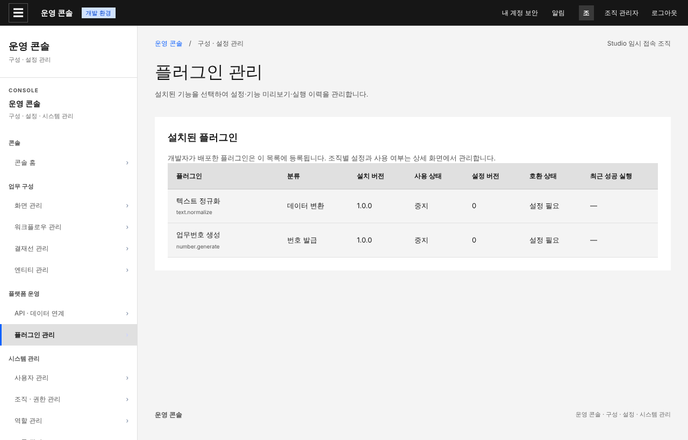

등록된 플러그인(업무번호 생성기, 텍스트 정규화)의 설정을 매니페스트 규칙에 따라 저장하고, 입력 시험(미리보기)과 업무번호 발급을 수행합니다.

활용 예시: 업무번호 형식을 `SR-202611-00001`로 하려면 업무번호 생성기 설정에서 접두어 SR, 날짜 형식 YYYYMM, 구분자 -, 자릿수 5, 월별 초기화를 저장하고 미리보기로 확인합니다. 현재 서비스요청 번호(SR-+임의 식별자)에는 이 플러그인이 자동 적용되지 않습니다.

# 5. 일상 운영 점검

| 주기 | 점검 항목 | 위치 |
|---|---|---|
| 매일 | 담당자 없는 업무(차단 실행) 확인과 재배정 | 워크플로우 관리 → 실행 현황, 각 실행의 재배정 |
| 매일 | 승인 대기 장기 건 확인 | 서비스 요청 처리, 서비스 승인함 |
| 매주 | 적기처리율 현황 | SLM·적기처리율 |
| 매월 | 확정 보고서 CSV 보관 | SLM·적기처리율 |
| 수시 | 인력 변동 시 그룹 구성원 변경 | 그룹 관리 |
| 연 1회 | 다음 연도 공휴일 반영 | SLA·업무 달력 |

**담당자 재배정 예시**: 조치 담당 운영자가 휴가 중이면 워크플로우 권한이 있는 관리자가 해당 실행 화면 하단의 재배정에서 다른 운영자를 지정하고 사유를 입력합니다. 이미 결정한 업무는 재배정할 수 없습니다.

# 6. 문제 해결

| 증상 | 원인과 조치 |
|---|---|
| 「현재 초안을 독립 검토한 후 게시하십시오」 | 초안 작성자와 다른, 검토 권한이 있는 사용자가 「독립 검토 완료」를 눌러야 합니다. |
| 「민감 작업 전 … 비밀번호를 다시 확인하십시오」 | 내 계정 보안에서 비밀번호를 다시 확인한 뒤 시도합니다(재인증 주기). |
| 「워크플로우 입력 항목을 신청 양식에 같은 유형·필수 조건으로 구성하십시오」 | 카탈로그 양식 항목의 식별자·유형·필수가 워크플로우 필수 항목과 맞지 않습니다. |
| 운영 조치 단계가 「차단」 상태 | 조치 담당 운영자가 비활성이거나 운영그룹에서 빠졌습니다. 실행을 재배정합니다. |
| 사용자가 카탈로그에서 서비스를 못 봄 | 공개 그룹(서비스요청 신청대상)에 그 사용자 또는 소속 부서를 배정합니다. |
| 서비스 관리자가 콘솔 메뉴를 못 봄 | 조직·권한 관리 → 메뉴·운영콘솔 권한에서 서비스 관리자 역할의 운영 콘솔 버튼을 허용합니다. |
