# 1. 문서 개요

이 매뉴얼은 Studio 통합 ITSM 사용자 포털에서 **IT 서비스 요청(개발·운영)**을 신청·승인·처리·확인하는 방법을 역할별로 설명합니다. 이어서 포털의 메뉴별 기능과 활용 예시를 다룹니다.

| 역할 | 계정(예) | 이 매뉴얼에서 볼 장 |
|---|---|---|
| 요청자 | user1 | 3장, 4.1, 5장 |
| 요청부서 승인자 | user_auth1 | 4.2, 5장 |
| 운영자(접수·조치) | worker1, worker2 | 4.3, 4.5, 5장 |
| 개발자 | developer1 | 4.4, 5장 |

화면 이미지는 개발 환경에서 같은 구성으로 촬영했으며, 실제 화면의 건수·일시는 다를 수 있습니다. 화면 관리·워크플로우 구성 같은 운영 콘솔 기능은 「운영자 매뉴얼」을 참고하십시오.

# 2. 접속과 공통 화면

## 2.1 접속

1. 시스템 관리자가 안내한 주소 뒤에 `/login/`을 붙여 접속합니다(예: Render 서비스 주소 `https://<서비스 주소>/login/`).
2. 아이디와 초기 비밀번호를 입력합니다.
3. 처음 로그인하면 **내 계정 보안** 화면에서 새 비밀번호로 바꿉니다. 비밀번호는 다른 사람과 공유하지 않습니다.

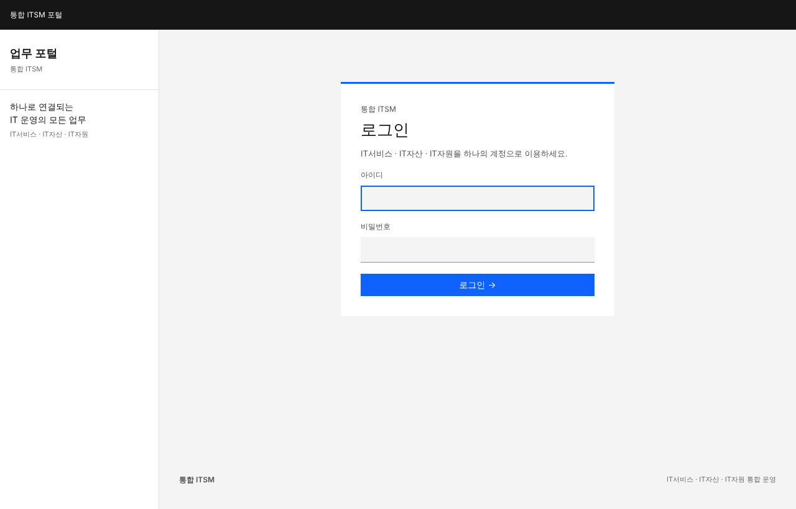

로그인에 여러 번 실패하면 계정이 일정 시간 잠깁니다(기본 5회 실패 시 15분). 급하면 시스템 관리자에게 잠금 해제를 요청합니다.

## 2.2 통합 포털 홈

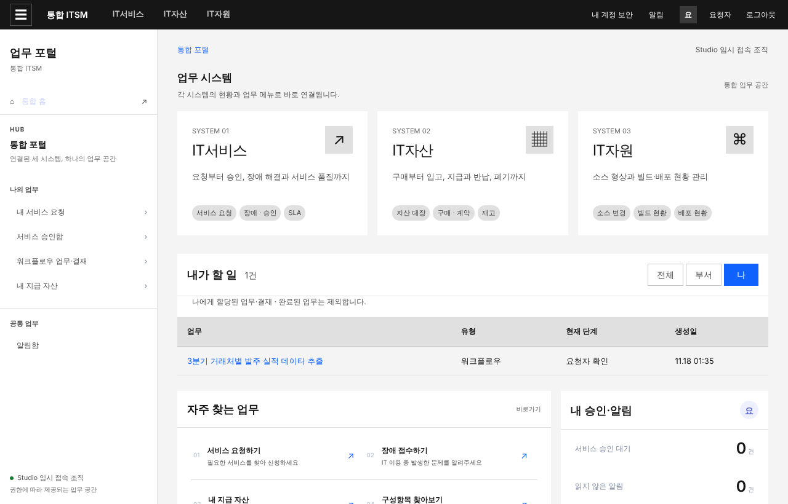

| 영역 | 기능 |
|---|---|
| 상단 메뉴 | IT서비스·IT자산·IT자원 업무 시스템 이동, 내 계정 보안, 알림, 내 이름, 로그아웃 |
| 업무 시스템 카드 | IT서비스(요청·장애·SLA), IT자산(자산·구매·재고), IT자원(소스·빌드·배포) 바로 가기 |
| **내가 할 일** | 나에게 할당된 업무·결재 목록. **나 / 부서 / 전체** 범위 버튼으로 바꿔 봅니다. 부서·전체는 권한이 있을 때만 보입니다. 업무 이름을 누르면 처리 화면으로 이동합니다. |
| 자주 찾는 업무 | 서비스 요청하기, 장애 접수하기, 내 지급 자산, 구성항목 찾아보기 |
| 내 승인·알림 | 서비스 승인 대기 건수, 읽지 않은 알림 건수 |

> 워크플로우 단계가 넘어오면 **내가 할 일**에 표시됩니다. 업무를 시작할 때는 먼저 홈의 내가 할 일을 확인하십시오.

좌측 메뉴는 ☰ 버튼으로 접고 펼 수 있으며, 데스크톱에서는 경계를 끌어 너비를 조정할 수 있습니다.

## 2.3 IT서비스 현황

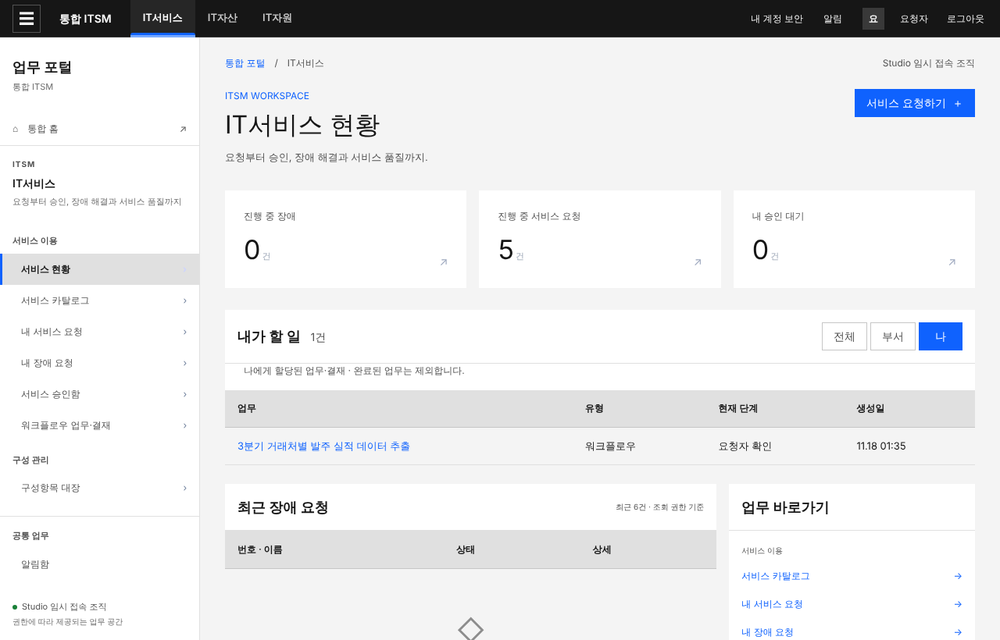

IT서비스 시스템의 첫 화면입니다. 내 요청·처리 대기·SLA 현황 요약과 IT서비스 메뉴 바로 가기를 제공합니다.

# 3. 서비스 신청(요청자)

## 3.1 서비스 카탈로그에서 신청하기

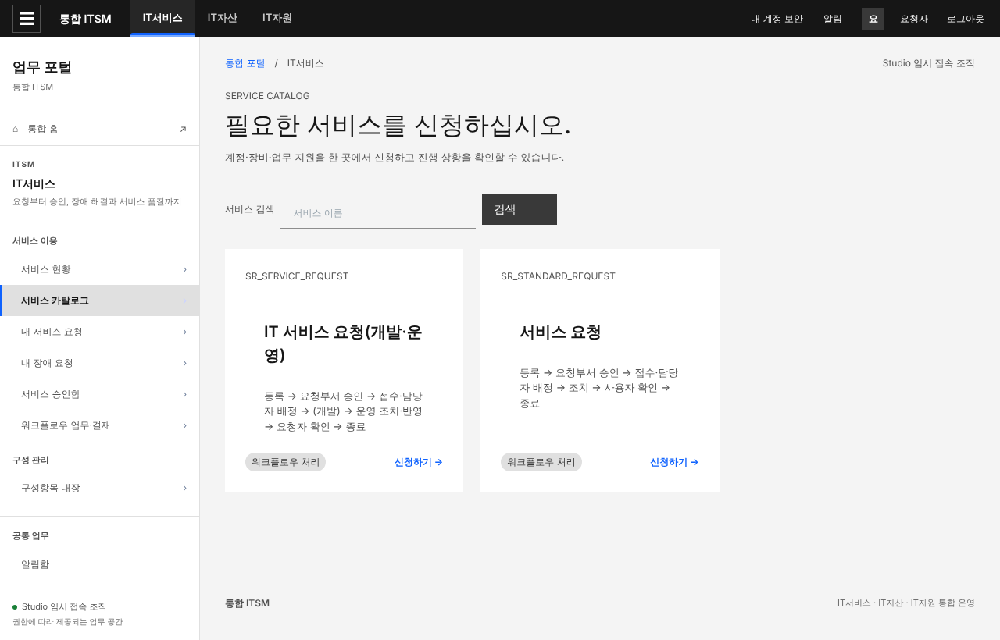

1. 좌측 **서비스 카탈로그**를 누릅니다. 나에게 공개된 서비스만 보입니다.
2. 「IT 서비스 요청(개발·운영)」 카드의 **신청하기**를 누릅니다.
3. 신청서를 작성합니다. `*` 표시는 필수 항목입니다.

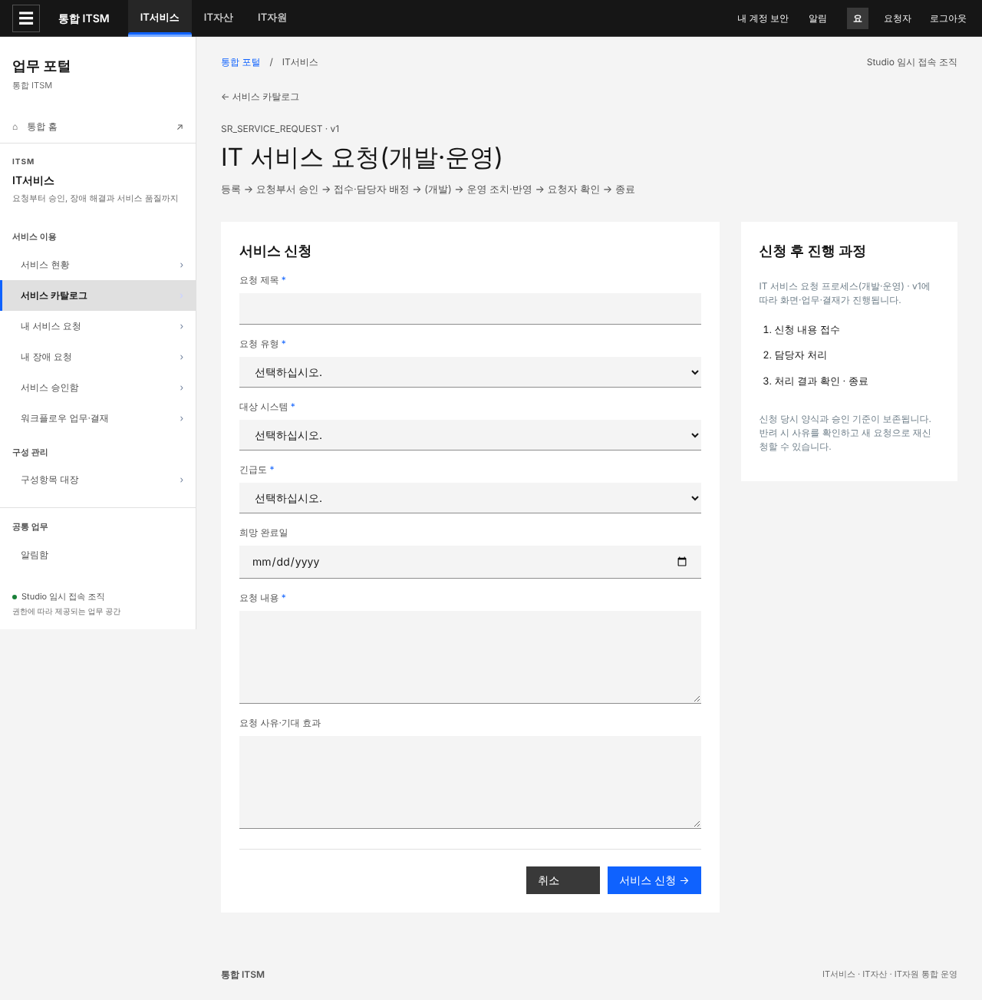

| 항목 | 입력 방법 |
|---|---|
| 요청 제목\* | 요청을 한 줄로 요약합니다. 목록과 처리 화면에 이 제목이 표시됩니다. |
| 요청 유형\* | 기능 개선, 신규 개발, 데이터 추출·변경, 계정·권한, 오류 문의, 기타 중 선택 |
| 대상 시스템\* | 그룹웨어, ERP, 고객관리(CRM), 홈페이지, ITSM, 기타 중 선택 |
| 긴급도\* | 긴급, 높음, 보통, 낮음 중 선택 |
| 희망 완료일 | 원하는 완료 날짜 |
| 요청 내용\* | 현상, 원하는 결과, 재현 방법 등을 구체적으로 적습니다(최대 4,000자). |
| 요청 사유·기대 효과 | 업무상 필요한 이유와 기대 효과 |

4. **서비스 신청**을 누르면 요청이 접수되고 요청부서 승인 단계로 넘어갑니다. **취소**는 작성 내용을 저장하지 않고 카탈로그로 돌아갑니다.

**작성 예시**

| 항목 | 예시 |
|---|---|
| 요청 제목 | 월간 매출 보고서 엑셀 다운로드 기능 개선 |
| 요청 유형 / 대상 시스템 / 긴급도 | 기능 개선 / ERP / 보통 |
| 희망 완료일 | 2026-11-30 |
| 요청 내용 | ERP 월간 매출 보고서를 엑셀로 내려받을 때 거래처명이 잘립니다. 전체 거래처명을 포함하도록 개선을 요청합니다. |
| 요청 사유·기대 효과 | 보고서 수작업 보정 시간을 줄입니다. |

## 3.2 진행 과정

신청 후 요청은 아래 순서로 진행됩니다. 각 단계 담당자에게만 입력란과 처리 버튼이 열립니다.

| 단계 | 담당 | 하는 일 |
|---|---|---|
| ① 서비스 요청 등록 | 요청자 | 신청서 작성 |
| ② 요청부서 승인 | 요청부서 승인자 | 승인 또는 반려(반려하면 요청이 종료됩니다) |
| ③ 접수·검토 및 담당자 배정 | 운영자1·운영자2 중 한 명 | 개발 필요 여부와 조치 담당 운영자 지정 |
| ④ 개발 | 개발자 | 개발이 필요한 경우에만 수행 |
| ⑤ 운영 조치·반영 | 지정된 운영자 | 조치 또는 개발 결과를 운영에 반영 |
| ⑥ 요청자 확인 | 요청자 | 결과 확인. 「예」면 종료, 「아니오」면 ⑤로 돌아가 재조치 |
| ⑦ 종료 | — | 요청 상태가 「종료」로 바뀝니다. |

## 3.3 내 서비스 요청

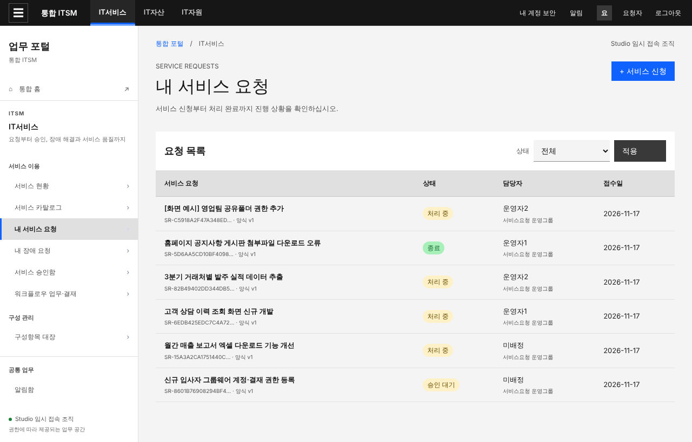

| 기능 | 설명 |
|---|---|
| 요청 목록 | 요청 제목, 요청 번호, 양식 버전, 상태(승인 대기, 처리 중, 종료, 반려, 취소), 담당자·처리 그룹, 접수일 |
| 상태 필터 | 상태를 고르고 **적용**을 누릅니다. |
| + 서비스 신청 | 서비스 카탈로그로 이동합니다. |

요청 제목을 누르면 상세 화면이 열립니다.

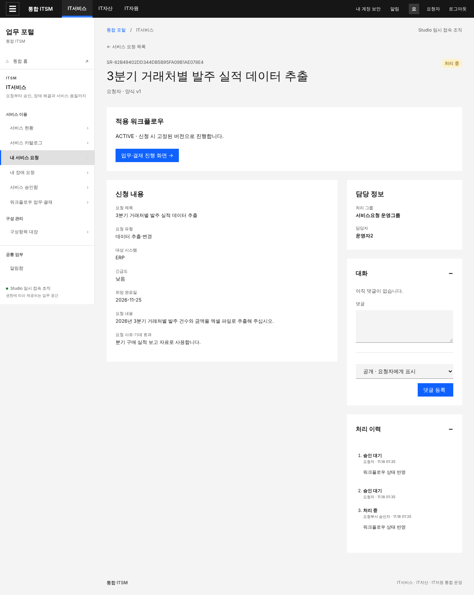

| 영역 | 기능 |
|---|---|
| 상단 | 요청 번호, 제목, 신청자·양식 버전, 현재 상태 |
| 적용 워크플로우 | 실행 상태와 **업무·결재 진행 화면** 바로 가기 |
| 신청 내용 | 신청서에 입력한 값(수정 불가) |
| 담당 정보 | 처리 그룹, 조치 담당자 |
| 대화 | 댓글을 등록합니다. 요청자는 **공개** 댓글만 쓰고 볼 수 있으며, 처리자가 쓴 내부 댓글은 보이지 않습니다. |
| 처리 이력 | 상태가 바뀐 시각과 처리자 |

활용 예시: 처리 중인 요청에 추가 자료가 생기면 **대화**에 「거래처 코드 기준으로 정렬해 주십시오」처럼 남깁니다. 담당 운영자가 요청 상세에서 확인합니다.

## 3.4 조치 결과 확인(요청자 확인 단계)

운영자가 조치를 마치면 요청자에게 「요청자 확인」 업무가 할당됩니다. 홈의 **내가 할 일** 또는 **워크플로우 업무·결재 → 내 처리 대기**에서 해당 요청을 엽니다.

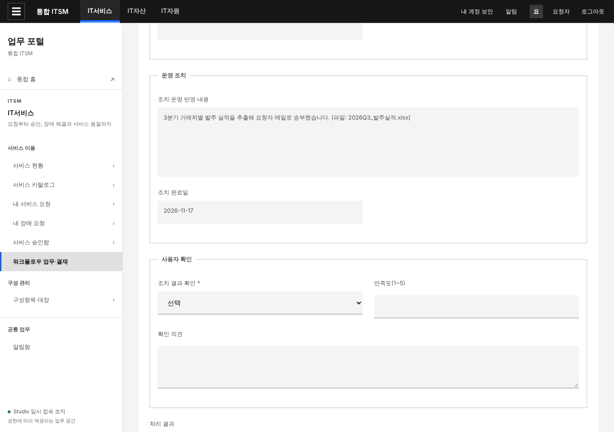

1. 「운영 조치」 그룹에서 조치 내용과 조치 완료일을 확인합니다. 개발이 있었다면 「개발」 그룹도 확인합니다.
2. 「사용자 확인」 그룹을 입력합니다.
   - **조치 결과 확인\***: 예(정상) / 아니오(재조치 필요)
   - **만족도(1~5)**: 5가 가장 만족
   - **확인 의견**: 재조치가 필요하면 구체적인 사유를 적습니다.
3. 처리 결과 「업무 완료」를 선택하고 필요하면 처리 사유·의견을 적은 뒤 **처리·다음 단계 진행**을 누릅니다.

| 선택 | 결과 |
|---|---|
| 조치 결과 확인 = 예 | 요청이 종료되고 적기처리율에 완료 시각이 반영됩니다. |
| 조치 결과 확인 = 아니오 | 같은 운영자에게 「운영 조치·반영」 업무가 다시 할당됩니다. |

활용 예시: 데이터 추출 파일의 거래처 일부가 빠져 있으면 「아니오」를 선택하고 확인 의견에 「거래처 A-102, A-107 누락」을 적어 진행합니다.

## 3.5 진행 이력 확인

워크플로우 처리 화면 맨 아래 **실행 이력**에 단계 진입, 승인, 업무 완료가 시각·처리자와 함께 남습니다.

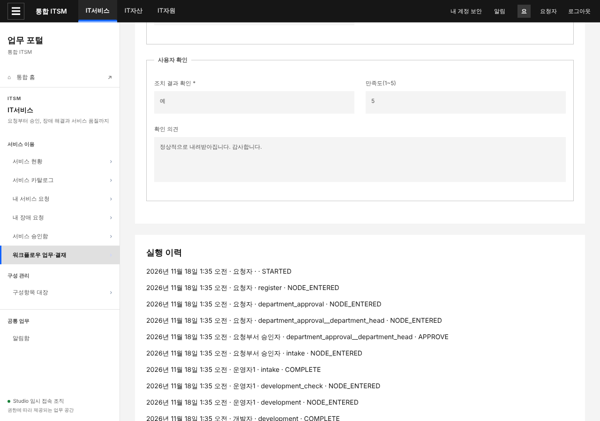

## 3.6 신청 취소

워크플로우 처리 화면의 **취소** 영역에서 취소 사유를 입력하고 「취소됨을 확인합니다」에 표시한 뒤 취소합니다. 신청자 본인과 워크플로우 관리자만 취소할 수 있습니다. 취소한 요청은 다시 진행할 수 없으므로 필요하면 새로 신청합니다.

# 4. 담당자별 업무 처리

## 4.1 공통 — 워크플로우 업무·결재

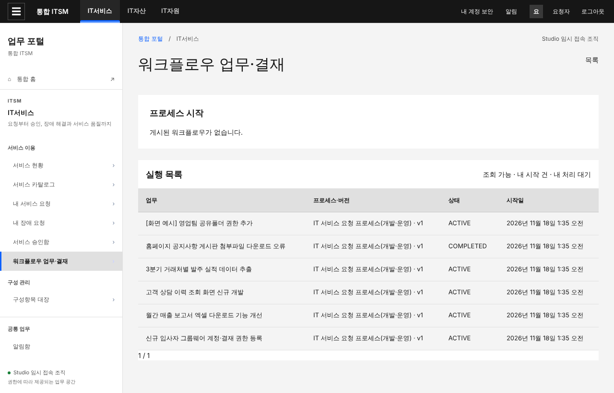

| 기능 | 설명 |
|---|---|
| 조회 가능 | 내가 시작했거나 담당한 적이 있는 실행 전체 |
| 내 시작 건 | 내가 신청한 실행 |
| 내 처리 대기 | 지금 내가 처리해야 하는 실행 |
| 실행 상세 | 단계별 카드(단계 이름, 유형·상태, 담당자), 화면 항목, 처리 결과·사유, **처리·다음 단계 진행** 버튼, 실행 이력 |

처리 화면의 각 단계 카드에는 그 단계 시점의 화면이 나옵니다. **현재 열린 단계에 내가 담당자로 지정된 경우에만** 입력란과 처리 버튼이 활성화됩니다. 이전 단계 내용은 회색 조회 전용으로, 이후 단계 항목은 숨겨서 표시합니다.

## 4.2 요청부서 승인자 — 승인·반려

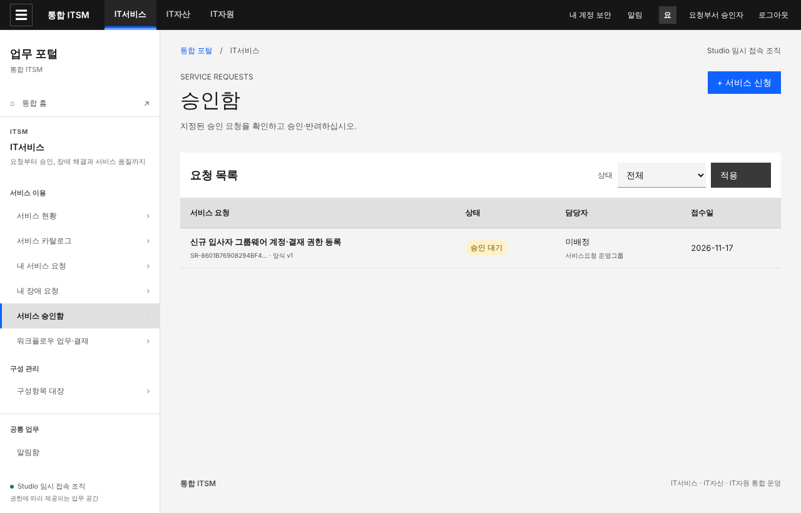

1. 좌측 **서비스 승인함** 또는 홈의 **내가 할 일**에서 승인 대기 요청을 엽니다. 서비스 승인함에서 요청 제목을 누르면 상세 화면으로 이동하고, **업무·결재 진행 화면**으로 들어갑니다.
2. 「요청 정보」 그룹의 내용을 검토합니다(수정 불가).
3. **처리 결과**에서 승인 또는 반려를 고릅니다. 반려할 때는 **처리 사유·의견**이 필수입니다.
4. **처리·다음 단계 진행**을 누릅니다.

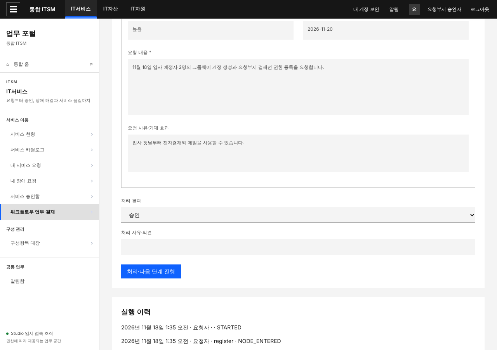

| 결정 | 결과 |
|---|---|
| 승인 | 서비스요청 운영그룹(운영자1·2)에게 접수 업무가 할당됩니다. |
| 반려 | 요청이 「반려」로 종료되고 요청자에게 결과가 표시됩니다. 요청자는 내용을 보완해 새로 신청합니다. |

활용 예시: 예산 승인이 필요한 신규 개발 요청이면 반려를 선택하고 사유에 「차년도 예산 편성 후 재신청 바랍니다」를 적습니다. 본인이 신청한 요청은 본인이 승인할 수 없습니다.

## 4.3 운영자 — 접수·검토 및 담당자 배정

승인된 요청은 운영자1·운영자2 모두에게 할당되며, **한 명이 처리하면** 다음 단계로 넘어갑니다.

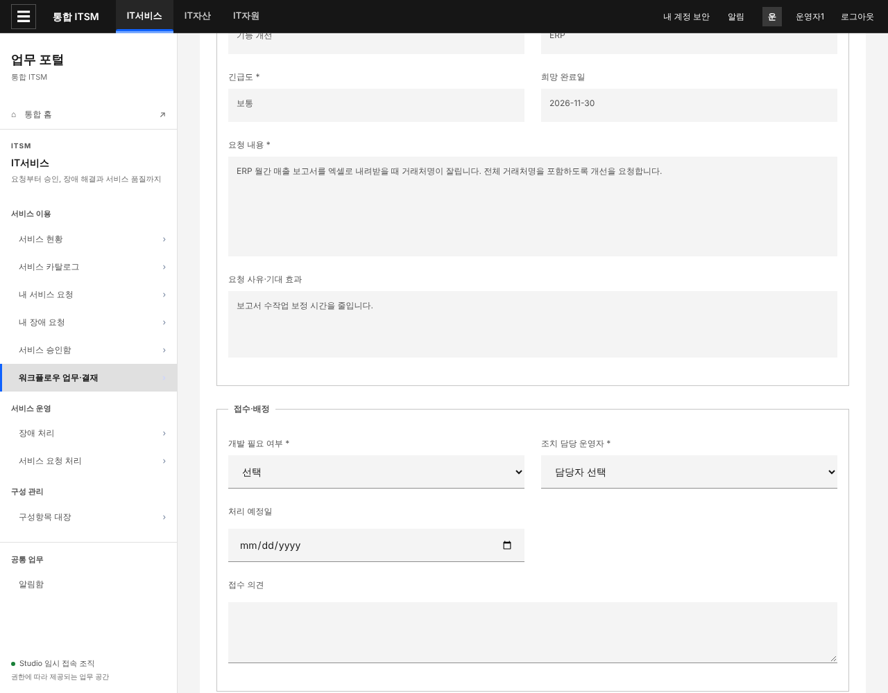

| 항목 | 입력 방법 |
|---|---|
| 개발 필요 여부\* | 예: 개발자에게 개발 업무 할당 / 아니오: 바로 운영 조치 |
| 조치 담당 운영자\* | 운영그룹 구성원 중 운영 조치를 맡을 사람(본인 포함) |
| 처리 예정일 | 요청자와 협의한 예정일 |
| 접수 의견 | 검토 결과, 처리 방향, 개발자에게 전달할 내용 |

입력 후 **처리·다음 단계 진행**을 누릅니다. 필수 항목이 비어 있으면 진행되지 않습니다.

활용 예시 1 (개발 필요): 「고객 상담 이력 조회 화면 신규 개발」 → 개발 필요 여부 **예**, 조치 담당 운영자 **운영자1**, 접수 의견 「화면 신규 개발 필요. 개발 완료 후 운영자1이 운영 반영합니다.」

활용 예시 2 (운영 조치): 「3분기 거래처별 발주 실적 데이터 추출」 → 개발 필요 여부 **아니오**, 조치 담당 운영자 **운영자2**.

**서비스 요청 처리 목록**: 좌측 **서비스 요청 처리**(`/work/requests`)에서 내 그룹이 처리하는 요청 전체를 상태별로 볼 수 있습니다.

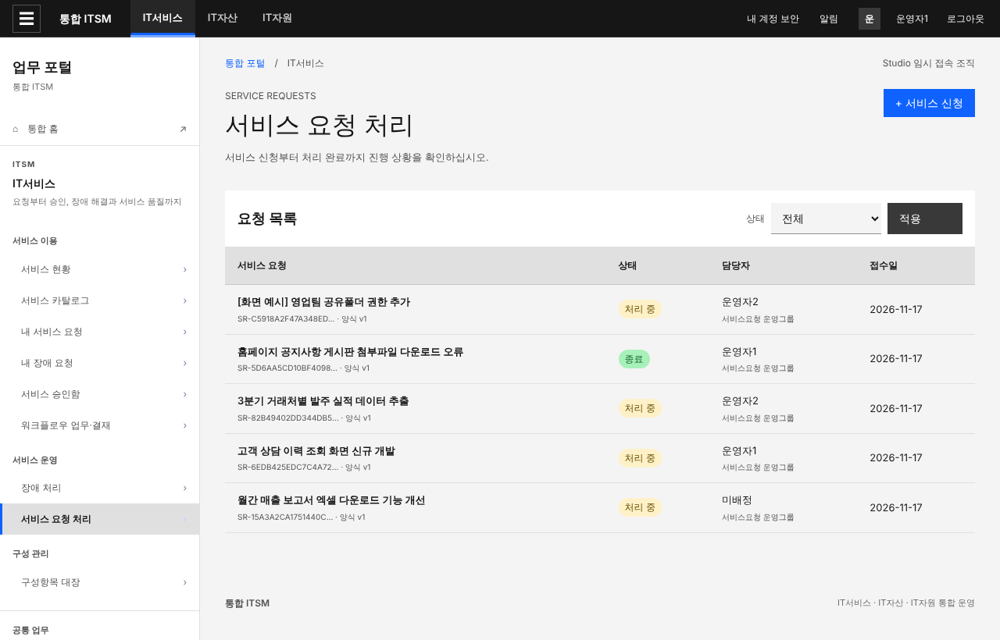

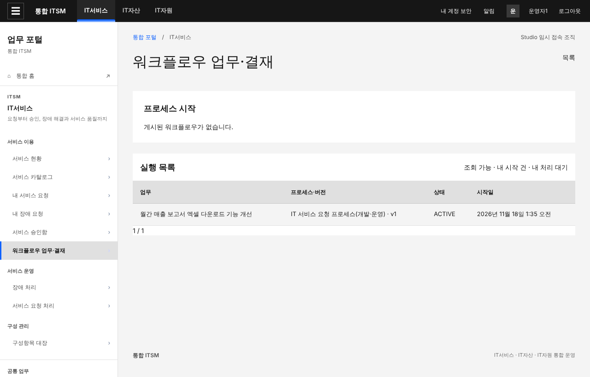

## 4.4 개발자 — 개발

개발이 필요한 요청은 서비스요청 개발그룹(개발자)에게 할당됩니다.

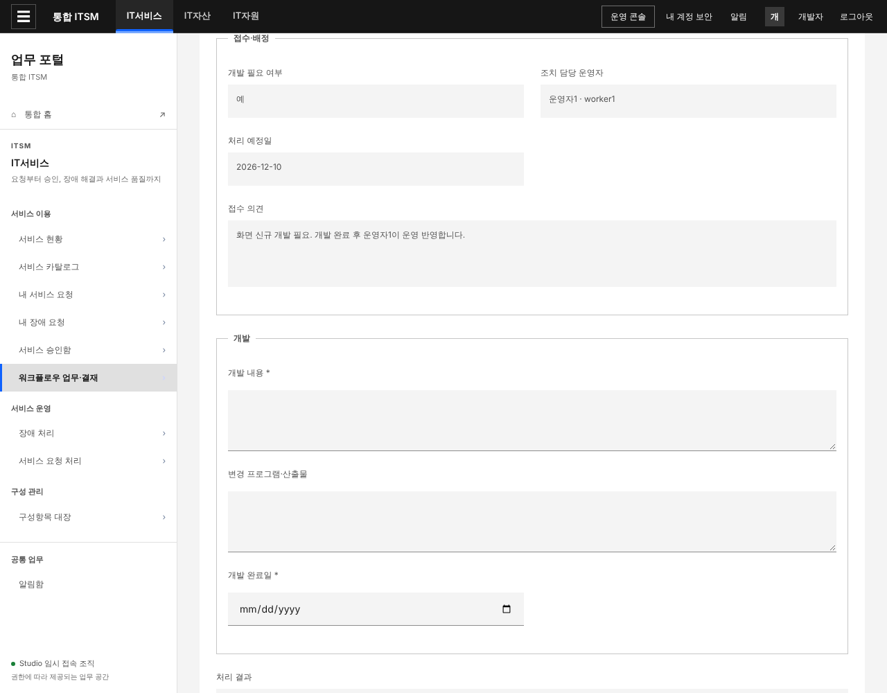

| 항목 | 입력 방법 |
|---|---|
| 개발 내용\* | 수정·개발한 기능과 방법 |
| 변경 프로그램·산출물 | 변경 소스 파일, 화면, 배포 대상 등 |
| 개발 완료일\* | 개발과 단위 시험을 마친 날짜 |

활용 예시: 개발 내용 「첨부파일 저장 경로의 한글 파일명 인코딩 처리를 수정했습니다.」, 변경 프로그램 「board/download.jsp, FileUtil.java」, 개발 완료일 2026-11-17 → **처리·다음 단계 진행**. 접수 단계에서 지정한 운영자에게 운영 반영 업무가 넘어갑니다.

## 4.5 운영자 — 운영 조치·반영

접수 단계에서 **조치 담당 운영자**로 지정된 사람에게만 할당됩니다. 다른 운영자는 내용을 볼 수 있어도 처리할 수 없습니다.

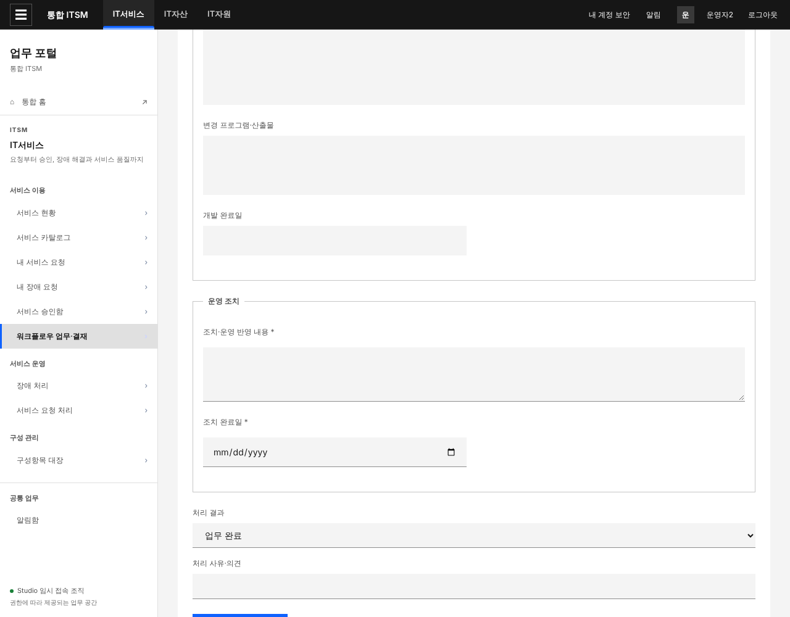

| 항목 | 입력 방법 |
|---|---|
| 조치·운영 반영 내용\* | 수행한 조치, 개발 결과의 운영 반영 내용, 확인 결과 |
| 조치 완료일\* | 조치를 마친 날짜 |

활용 예시: 「3분기 거래처별 발주 실적을 추출해 요청자 메일로 송부했습니다. (파일: 2026Q3_발주실적.xlsx)」, 조치 완료일 2026-11-17 → **처리·다음 단계 진행**. 요청자 확인 단계로 넘어갑니다. 요청자가 「아니오」를 선택하면 이 단계가 다시 할당되므로, 확인 의견을 보고 재조치합니다.

# 5. 포털 메뉴별 기능

## 5.1 서비스 카탈로그 `/catalog`

나에게 공개된 서비스 목록과 검색을 제공합니다. 카드에는 서비스 코드, 이름, 진행 과정, 처리 방식(워크플로우 처리 등)이 표시되며, **신청하기**로 신청 양식을 엽니다.

활용 예시: 서비스가 많을 때 검색창에 「IT 서비스」를 입력하고 **검색**을 누릅니다.

## 5.2 내 서비스 요청 `/portal/requests`

3.3을 참고하십시오.

## 5.3 내 장애 요청 `/portal/incidents`

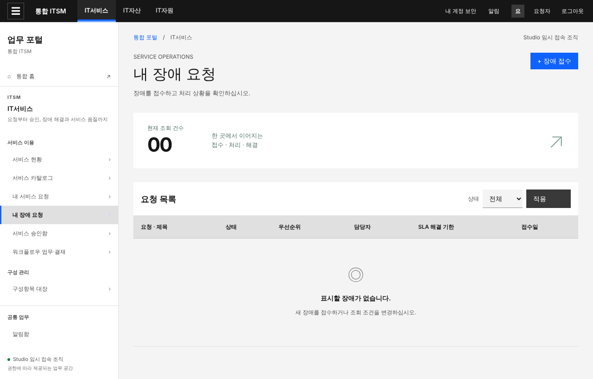

IT 이용 중 발생한 장애를 접수하고 처리 상태를 확인합니다. **장애 접수**를 누르면 등록 화면이 열립니다.

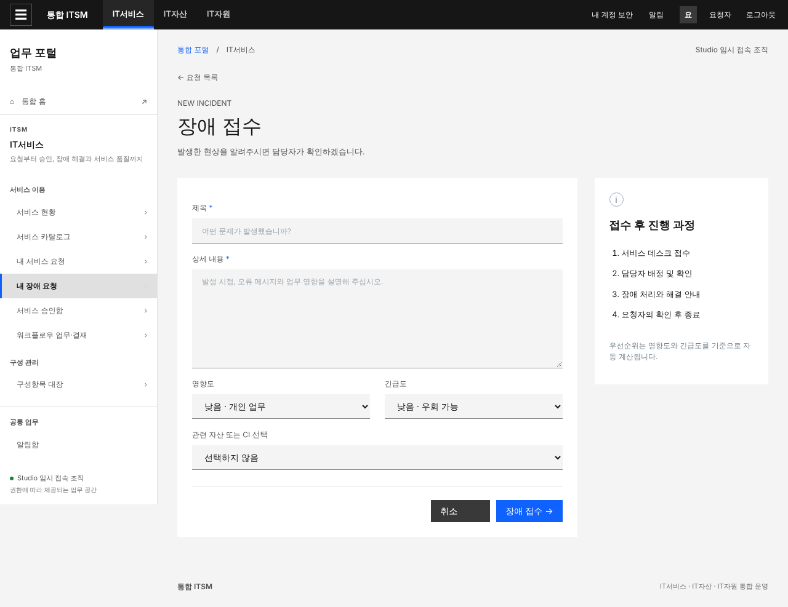

| 항목 | 설명 |
|---|---|
| 제목·설명 | 장애 현상과 발생 시각, 영향 범위 |
| 영향도·긴급도 | 1(높음)~3(낮음). 두 값으로 우선순위(P1~P5)가 자동 계산되고, 우선순위별 SLA 응답·해결 목표가 적용됩니다. |
| 관련 자산·구성항목 | 조회 권한이 있는 자산·CI를 연결합니다. |

활용 예시: 「그룹웨어 메일 발송 불가」, 영향도 1(부서 전체), 긴급도 1(업무 중단) → P1으로 접수됩니다.

장애 상세 화면에서는 공개 댓글 작성, 해결 확인·재개방(해결 후 사유 입력)을 할 수 있습니다.

## 5.4 서비스 승인함 `/approvals`

나에게 지정된 승인 대기 요청과 과거 결정 건을 보여 줍니다. 4.2를 참고하십시오.

## 5.5 워크플로우 업무·결재 `/processes`

4.1을 참고하십시오.

## 5.6 서비스 요청 처리 `/work/requests` (처리 담당자)

내가 속한 처리 그룹의 서비스요청 전체를 상태별로 조회합니다. 워크플로우로 처리하는 요청은 처리 화면(업무·결재 진행 화면)에서 처리합니다. 요청 상세에서 **내부** 댓글을 쓰면 처리자끼리만 공유되고 요청자에게는 보이지 않습니다.

활용 예시: 운영자가 개발자에게 「운영 DB 반영은 18시 이후 진행」을 남길 때 내부 댓글을 씁니다.

## 5.7 장애 처리 `/work/incidents` (처리 담당자)

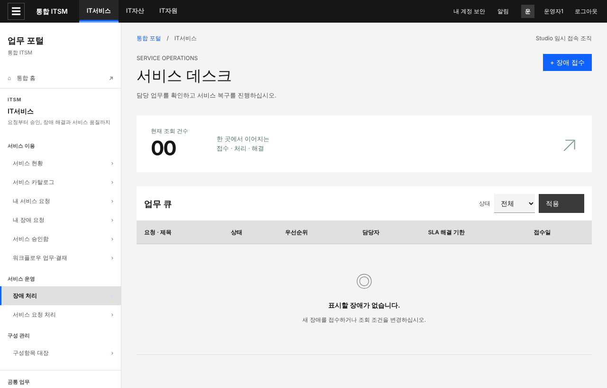

허용된 그룹의 장애 큐와 내 담당 건을 우선순위·상태로 필터링합니다. 상세 화면에서 그룹·담당자 배정, 처리 시작, 대기(사유 필수), 해결(해결 내용 필수), 공개/내부 댓글, 자산·CI 연결을 수행합니다.

활용 예시: P1 장애를 받으면 담당자를 본인으로 배정 → **처리 시작** → 원인 조치 후 해결 내용 「메일 서버 디스크 정리 후 발송 정상화」를 입력하고 **해결**을 누릅니다.

## 5.8 구성항목 대장 `/cis`

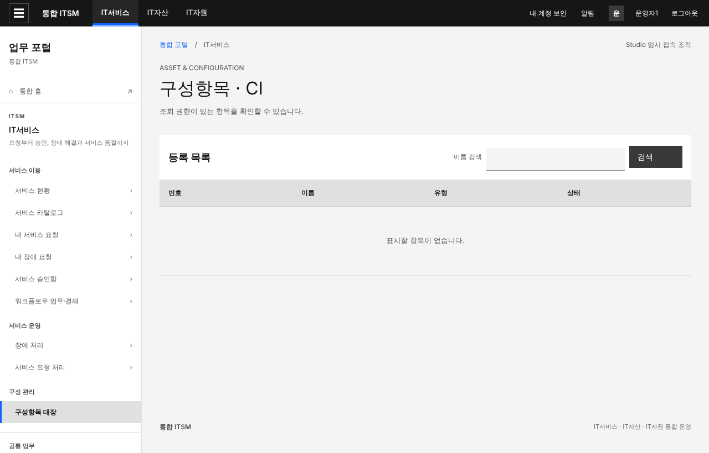

조회 권한이 있는 구성항목(CI)의 번호·이름·유형·상태를 검색하고 상세를 확인합니다. 장애·요청에 연결할 대상을 찾을 때 씁니다.

## 5.9 내 지급 자산 `/my-assets`

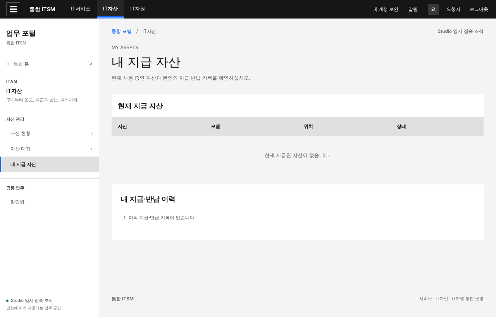

나에게 지급된 자산과 지급·반납 이력을 확인합니다.

활용 예시: 노트북 반납 전 자산번호를 확인해 반납 요청에 적습니다.

## 5.10 알림함 `/notifications`

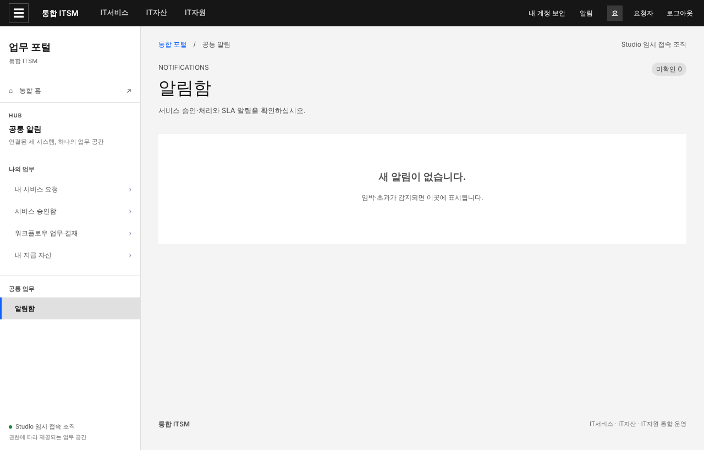

서비스 승인·처리 알림과 SLA 임박·초과 알림을 모아 보여 주며, 알림을 읽음으로 처리합니다. 워크플로우 단계 할당은 홈의 **내가 할 일**과 **내 처리 대기**에서 확인합니다.

## 5.11 내 계정 보안 `/account/security`

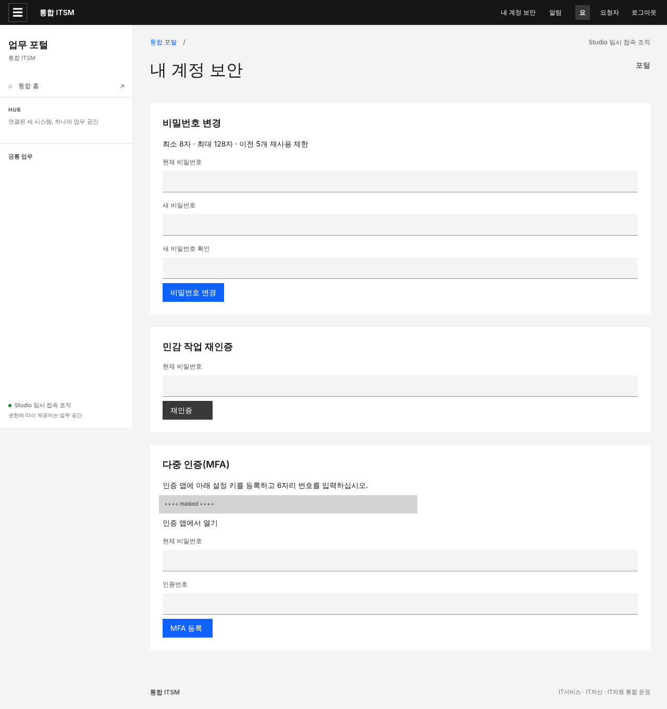

| 기능 | 설명 |
|---|---|
| 비밀번호 변경 | 현재 비밀번호, 새 비밀번호, 새 비밀번호 확인(정책: 최소 8자·최대 128자, 이전 5개 재사용 제한) |
| 민감 작업 재인증 | 현재 비밀번호를 다시 확인합니다. 콘솔 구성 변경 같은 민감 작업 전에 필요합니다(기본 10분 유효). |
| 다중 인증(MFA) | 화면의 설정 키를 인증 앱에 등록하고, 현재 비밀번호와 6자리 인증번호를 입력해 **MFA 등록**을 누릅니다. 설정 키는 다른 사람에게 보여 주지 마십시오. |

활용 예시: MFA를 쓰려면 휴대폰 인증 앱에서 설정 키를 추가하고, 앱에 표시된 6자리 번호를 입력해 등록합니다. 다음 로그인부터 추가 인증 화면에서 번호를 입력합니다. 공용 PC에서 로그아웃하지 않았다면 시스템 관리자에게 세션 회수를 요청합니다.

# 6. 자주 묻는 질문

| 질문 | 답변 |
|---|---|
| 카탈로그에 서비스가 보이지 않습니다. | 서비스 공개 대상 그룹에 포함되지 않았습니다. 시스템 관리자에게 「서비스요청 신청대상」 그룹 추가를 요청하십시오. |
| 처리 버튼이 보이지 않습니다. | 현재 단계의 담당자가 아니거나 이미 처리한 단계입니다. 처리 화면의 단계 카드에서 「담당자」를 확인하십시오. |
| 「현재 유효한 담당자만 처리할 수 있습니다」 오류 | 다른 사람이 먼저 처리했거나 담당자가 바뀌었습니다. 화면을 새로 고쳐 최신 상태를 확인하십시오. |
| 「… 항목을 입력하십시오」 오류 | 필수 항목(\*)을 입력하지 않았습니다. |
| 신청 내용을 고치고 싶습니다. | 접수된 신청 내용은 수정할 수 없습니다. 대화(공개 댓글)로 보완 내용을 남기거나, 반려·취소 후 새로 신청하십시오. |
| 반려된 요청을 다시 진행할 수 있나요? | 반려된 요청은 종료됩니다. 반려 사유를 반영해 새로 신청하십시오. |
